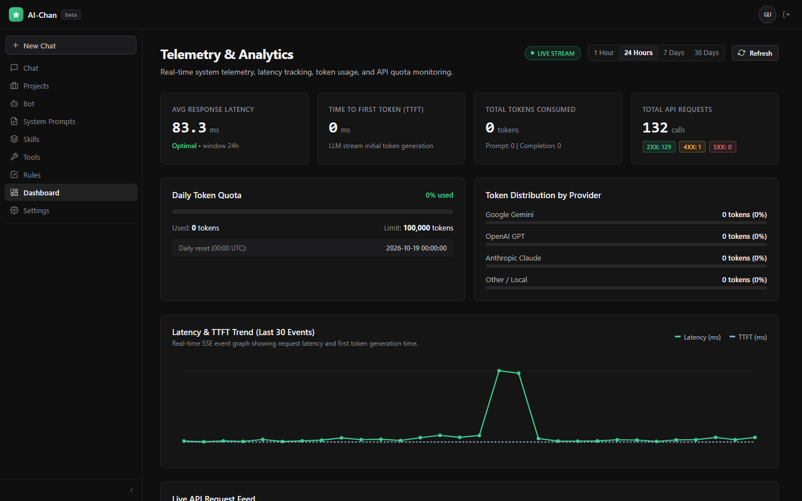
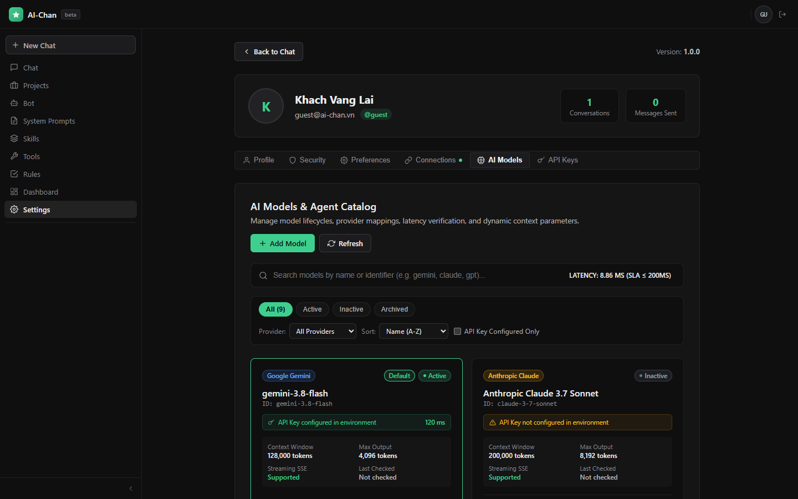
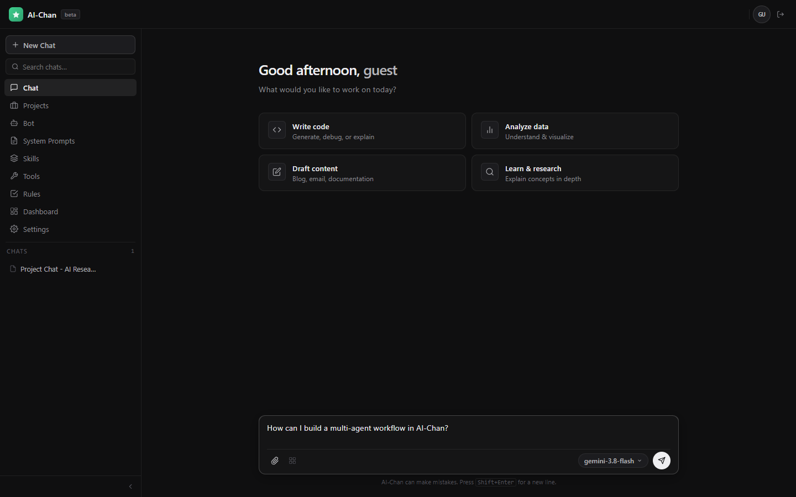
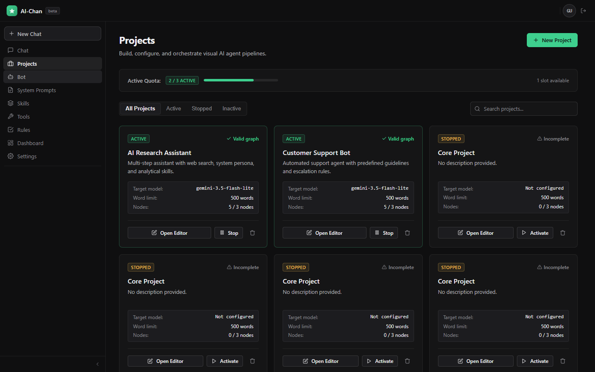
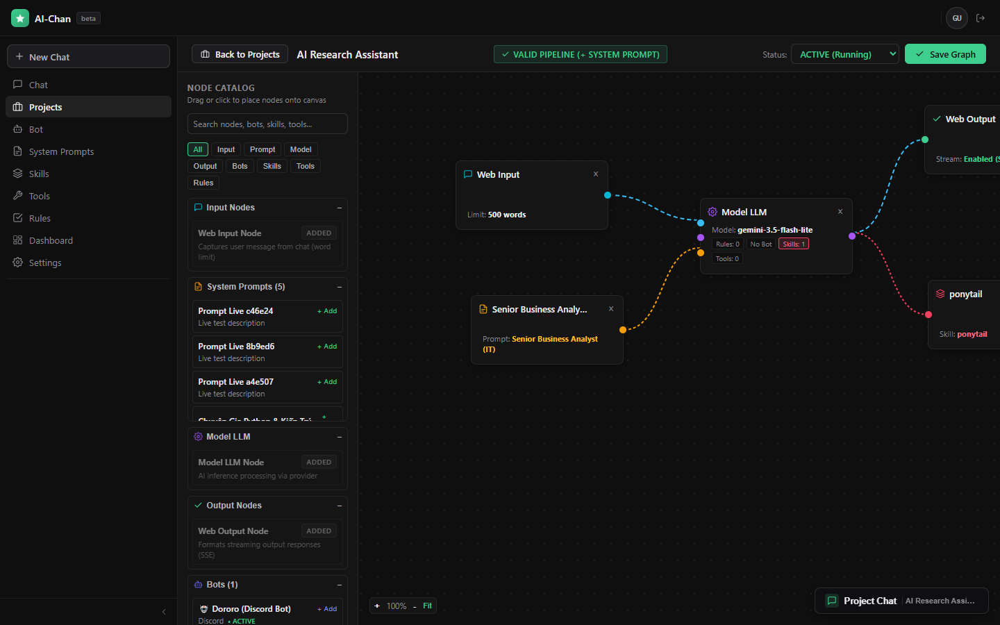
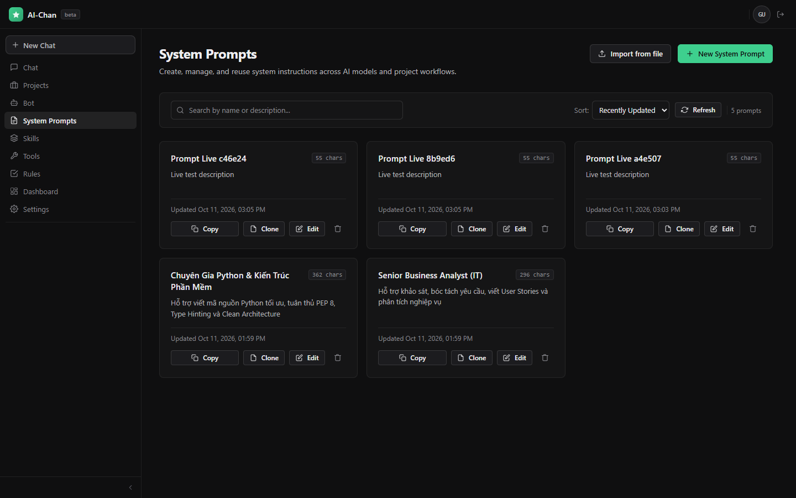
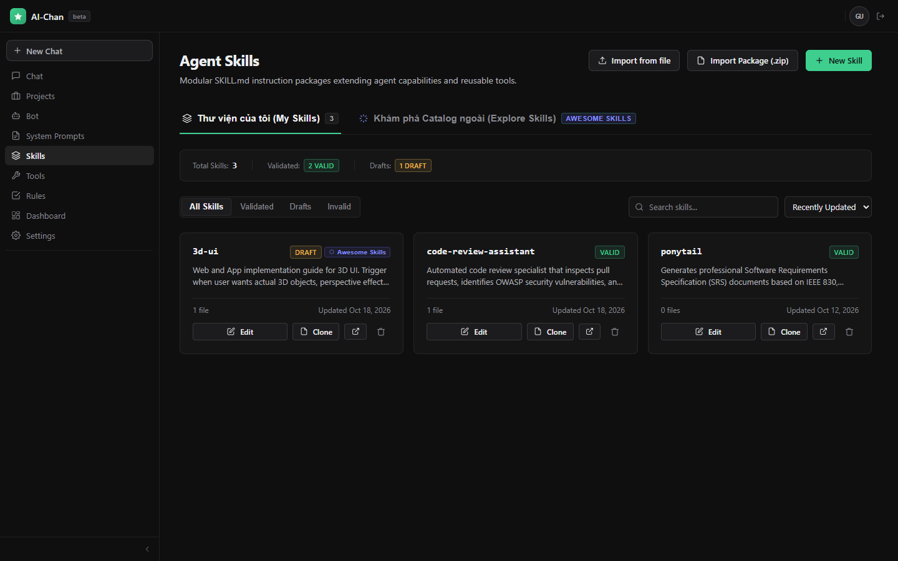
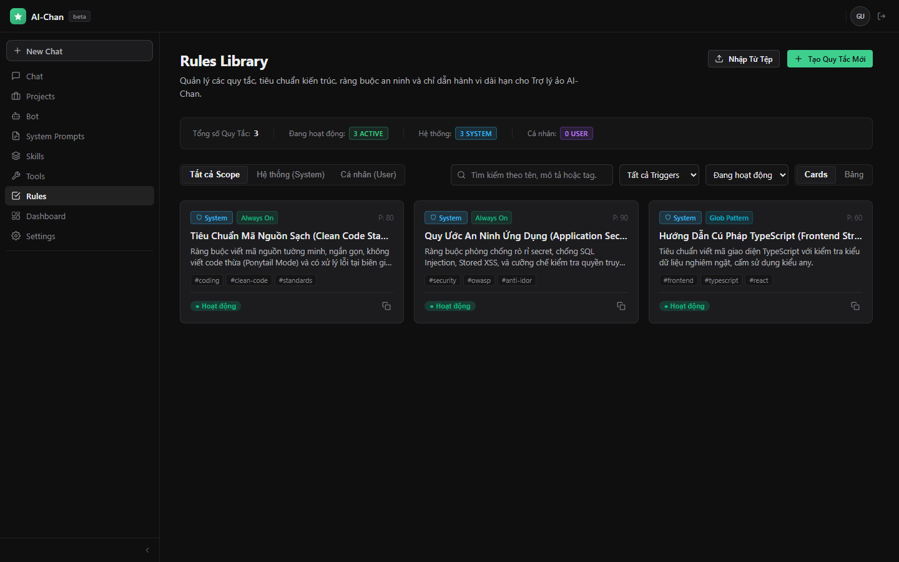
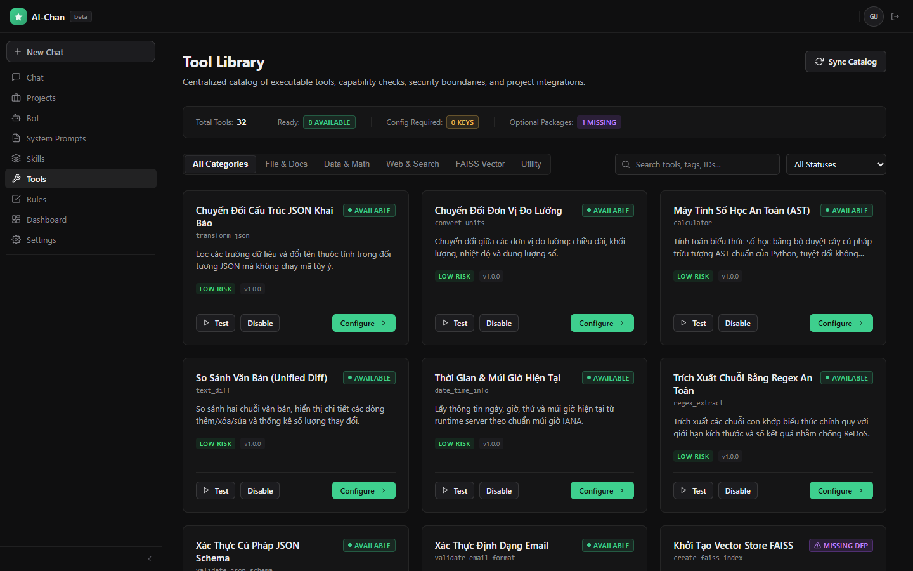
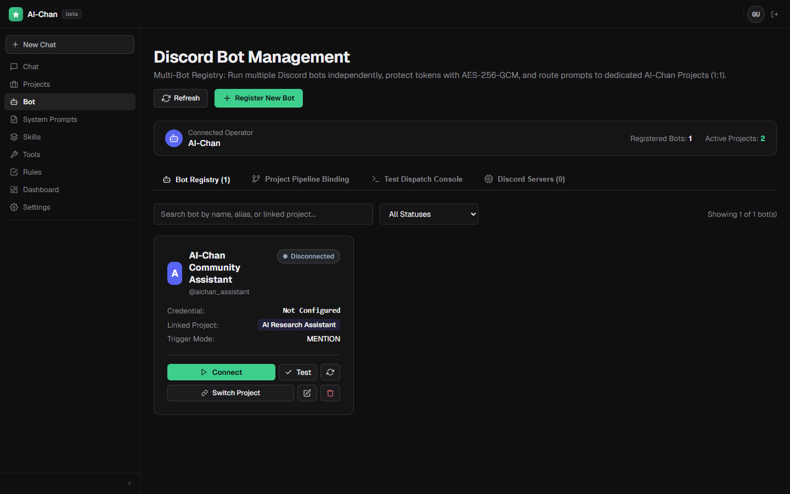

# AI-Chan User Guide

Welcome to **AI-Chan**! This guide explains how to install, configure, and use AI-Chan on Windows without technical jargon or terminal commands.

---

## Table of Contents

1. [About AI-Chan & Local Website Mode](#1-about-ai-chan--local-website-mode)
2. [Downloading & Installing AI-Chan](#2-downloading--installing-ai-chan)
3. [First Launch & Initial Setup](#3-first-launch--initial-setup)
4. [Configuring AI Providers & Models](#4-configuring-ai-providers--models)
5. [Starting, Stopping, & Exiting AI-Chan](#5-starting-stopping--exiting-ai-chan)
6. [Core Features & Step-by-Step Workflows](#6-core-features--step-by-step-workflows)
   - [Interactive Chat Interface](#interactive-chat-interface)
   - [Projects & Visual Node Canvas](#projects--visual-node-canvas)
   - [System Prompts Library](#system-prompts-library)
   - [Agent Skills & External Catalog](#agent-skills--external-catalog)
   - [Rules Management](#rules-management)
   - [Tools & Capabilities](#tools--capabilities)
7. [Optional Discord Bot Integration](#7-optional-discord-bot-integration)
8. [Data Storage Locations & Security](#8-data-storage-locations--security)
9. [Backing Up & Restoring Your Data](#9-backing-up--restoring-your-data)
10. [Updating to Newer Versions](#10-updating-to-newer-versions)
11. [Uninstalling AI-Chan](#11-uninstalling-ai-chan)
12. [Troubleshooting Common Issues](#12-troubleshooting-common-issues)
13. [Privacy & Third-Party AI Services](#13-privacy--third-party-ai-services)

---

## 1. About AI-Chan & Local Website Mode

AI-Chan is an AI assistant and agent workspace that runs entirely on your own Windows computer.

Unlike typical cloud-only software or bulky Electron apps, AI-Chan uses a **Local Website Mode**:
- When you launch AI-Chan, a lightweight supervisor process starts two local services in the background:
  1. The **Backend API service** (handles data, SQLite database, and AI communication).
  2. The **Frontend Web service** (renders the user interface, dashboards, and interactive chat).
- Once both services are verified healthy, AI-Chan automatically opens the application interface inside your preferred web browser (e.g. Chrome, Edge, Firefox).
- All services bind strictly to loopback (`127.0.0.1`), meaning they are never exposed to other devices on your local Wi-Fi or local area network.
- You do **not** need to open a command prompt, install Python, Node.js, or Docker.

---

## 2. Downloading & Installing AI-Chan

1. Open your web browser and navigate to the official [AI-Chan GitHub Releases](https://github.com/DungTran1201/ai-chan/releases) page.
2. Under the latest release, download the installer executable: `AI-Chan-Setup.exe`.
3. Locate the downloaded file in your `Downloads` folder and double-click to open it.
   > **Note on Windows SmartScreen**: Because AI-Chan is open-source and distributed without an expensive commercial code-signing certificate, Windows Defender SmartScreen may display a prompt stating *"Windows protected your PC"*. Click **More info**, then click **Run anyway**.
4. Follow the setup wizard instructions:
   - Choose whether you want a Desktop icon created.
   - Choose your preferred installation directory (by default, AI-Chan installs into your user programs directory `{LOCALAPPDATA}\Programs\AI-Chan`, which requires no Administrator privileges).
5. Click **Install**. Once finished, check **Launch AI-Chan** and click **Finish**.

---

## 3. First Launch & Initial Setup

When AI-Chan launches for the first time:
1. The background supervisor automatically creates your personal data folders and sets up the local SQLite database.
2. Your default web browser will open to:
   ```text
   http://127.0.0.1:3000
   ```
3. You will see the AI-Chan interface with a navigation sidebar on the left and the primary telemetry dashboard or workspace landing view.


*Figure 1: The AI-Chan main interface displaying system telemetry, latency tracking, and navigation sidebar.*

4. By default, you can explore the application as a guest or create an account for personalized settings.
5. Review the sidebar navigation options on the left:
   - **Chat**: Open conversations and multi-turn discussions.
   - **Projects**: Build and orchestrate multi-node AI workflows.
   - **Bot**: Configure Discord bot gateways.
   - **System Prompts**: Manage persona templates and instructions.
   - **Skills**: Manage modular agent capability packages.
   - **Tools**: View sandbox execution capabilities.
   - **Rules**: Enforce security and architectural standards.
   - **Dashboard**: Monitor system metrics and token usage.
   - **Settings**: Configure AI models, API keys, and account preferences.

---

## 4. Configuring AI Providers & Models

To enable chat, agent reasoning, and interactive answers, AI-Chan supports both commercial cloud AI providers and local offline models:
- **Google Gemini** (Recommended for speed and generous free tiers)
- **OpenAI** (GPT-4o, GPT-4o-mini)
- **Anthropic** (Claude 3.5 Sonnet, Claude 3.7 Sonnet)
- **Groq** (High-speed Llama 3 models)
- **Ollama** (Completely offline, locally-hosted models)

### How to Configure AI Models and API Keys:

1. In the left navigation menu, click **Settings**.
2. Select the **AI Models** tab to browse available models, context window limits, and provider capabilities.
3. To view or add provider keys, navigate to the **API Keys** tab.
4. Locate your preferred provider (e.g., Google Gemini, OpenAI, or Anthropic).
5. Enter your API key obtained from the provider's developer console:
   - For Gemini: [Google AI Studio](https://aistudio.google.com/)
   - For OpenAI: [OpenAI Platform](https://platform.openai.com/api-keys)
   - For Anthropic: [Anthropic Console](https://console.anthropic.com/)
6. Click **Test Connection** to verify that your key is valid and can reach the provider.
7. Click **Save Key**. Your key is immediately encrypted using AES-256-GCM and saved into your local database. It is never displayed in cleartext again.


*Figure 2: The AI Models catalog in Settings displaying provider mappings, context windows, and active model status.*

> [!TIP]
> If you have [Ollama](https://ollama.com/) running on your computer, AI-Chan can communicate with it locally at `http://localhost:11434` without needing any API key or Internet connection!

---

## 5. Starting, Stopping, & Exiting AI-Chan

### Starting AI-Chan:
- Double-click the **AI-Chan** shortcut on your Desktop or Start Menu.
- If AI-Chan is already running, launching the shortcut simply brings your active browser tab into focus.

### System Tray Management:
When AI-Chan is active, a small icon appears in your **Windows System Tray** (near the clock in the bottom-right corner of your taskbar). Right-clicking this icon opens a quick menu:
- **Open AI-Chan Web**: Opens your active AI-Chan session in your browser.
- **Open Logs Folder**: Opens Windows File Explorer directly to your diagnostic logs.
- **Open User Data Folder**: Opens your personal data and database folder.
- **Exit AI-Chan**: Safely shuts down all background services and removes temporary locks.

### Stopping AI-Chan via Command Line:
If you prefer keyboard shortcuts or scripts, you can cleanly stop all running AI-Chan services by opening PowerShell or CMD and running:
```cmd
"C:\Users\%USERNAME%\AppData\Local\Programs\AI-Chan\AI-Chan.exe" --stop
```

---

## 6. Core Features & Step-by-Step Workflows

### Interactive Chat Interface

The Chat interface allows you to communicate with AI models directly, ask questions, write code, and analyze content.

#### How to start a conversation:
1. In the left navigation sidebar, click **Chat**.
2. You will see prompt suggestion cards (e.g., *Write code*, *Analyze data*, *Draft content*, *Learn & research*).
3. The model selector badge in the bottom right corner shows your currently active model (e.g., `gemini-1.5-flash`).
4. Type your message into the input box at the bottom of the screen.
5. (Optional) Click the paperclip icon to attach text, code files, or images.
6. Press **Enter** or click the **Send** button to receive a streaming response.


*Figure 3: The Chat workspace featuring quick action prompts, model selector, and message input.*

---

### Projects & Visual Node Canvas

Projects allow you to build customized, multi-step AI agent workflows with visual drag-and-drop node orchestration.

#### How to view and create projects:
1. In the left navigation sidebar, click **Projects**.
2. The **Projects** page displays your existing workflows, status badges (*ACTIVE*, *STOPPED*, *DRAFT*), and active quota metrics.
3. To start a new workspace, click the green **+ New Project** button in the top right corner.
4. Enter a project name and brief description, then click **Create**.


*Figure 4: The Projects dashboard showing active workflows, pipeline validation indicators, and node counts.*

#### How to build workflows in the Project Editor:
1. On any project card, click **Open Editor**.
2. The interactive node canvas will open, displaying your configured workflow components:
   - **Web Input Node**: Captures user input and sets word limits.
   - **System Prompt Node**: Binds expert personas or formatting rules.
   - **Model LLM Node**: Specifies the reasoning engine and provider.
   - **Web Output Node**: Manages streaming output delivery.
   - **Skill & Tool Nodes**: Attaches specialized capabilities like code reviewers, calculators, or web search.
3. Click and drag connectors between node ports to define data flow.
4. Click **Save Graph** in the top right corner to persist and activate your pipeline.
5. Click **Project Chat** at the bottom right to test your live workflow immediately inside the editor.


*Figure 5: The Project Editor canvas with connected input, prompt, model, skill, and output nodes.*

---

### System Prompts Library

System Prompts define the persona, behavior, constraints, and tone of your AI assistants.

#### How to manage system prompts:
1. In the left navigation sidebar, click **System Prompts**.
2. Browse the built-in system prompt cards (e.g., *Senior Business Analyst (IT)*, *Software Architect*).
3. To add your own prompt, click **+ New System Prompt** or click **Import from file** to upload a Markdown prompt file.
4. Each card provides quick actions:
   - **Copy**: Copies the prompt instructions to your clipboard.
   - **Clone**: Duplicates an existing prompt to customize without altering the original.
   - **Edit**: Updates the prompt title, instructions, and target tags.


*Figure 6: The System Prompts library displaying available expert personas and prompt management actions.*

---

### Agent Skills & External Catalog

Agent Skills are modular instruction packages (`SKILL.md`) that extend an agent's abilities for specialized tasks.

#### How to browse and import skills:
1. In the left navigation sidebar, click **Skills**.
2. The **Thư viện của tôi (My Skills)** tab displays your installed skills (e.g., *3d-ui*, *code-review-assistant*, *ponytail*).
3. Each skill displays validation badges (*VALID*, *DRAFT*) and file counters.
4. Click **Khám phá Catalog ngoài (Explore Skills)** to browse community skill repositories and import verified skills with one click.
5. You can also import local skills using **Import from file** or **Import Package (.zip)**.


*Figure 7: The Agent Skills library showing installed skills, validation status, and external catalog access.*

---

### Rules Management

Rules enforce architectural standards, privacy constraints, and security policies across your conversations and projects.

#### How to manage rules:
1. In the left navigation sidebar, click **Rules**.
2. The **Rules Library** displays active constraints such as:
   - **Tiêu Chuẩn Mã Nguồn Sạch (Clean Code Standard)**: Enforces clean architecture and eliminates dead code.
   - **Quy Ước An Ninh Ứng Dụng (Application Security)**: Guardrails against SQL injection, secret leakage, and IDOR.
   - **Hướng Dẫn Cú Pháp TypeScript (Frontend Strict)**: Enforces strict typing and forbids untyped constructs.
3. Filter rules by Scope (*Tất cả Scope*, *Hệ thống (System)*, *Cá nhân (User)*) or status.
4. Toggle rules active or inactive, or click **+ Tạo Quy Tắc Mới** to author custom organizational guidelines.


*Figure 8: The Rules Library showing enforced application security, clean code, and syntax guidelines.*

---

### Tools & Capabilities

Tools provide executable actions (e.g., unit conversion, arithmetic, diff generation, regex extraction) within a secure local sandbox.

#### How to view and configure tools:
1. In the left navigation sidebar, click **Tools**.
2. The **Tool Library** shows the complete catalog of executable tools and their risk classifications (*LOW RISK*, *AVAILABLE*).
3. Filter tools by category using the category pills:
   - **File & Docs**: Document comparison and text parsing.
   - **Data & Math**: Safe AST calculators and JSON transform tools.
   - **Web & Search**: Search tools and network fetchers with strict SSRF protections.
   - **Utility**: Date/time info, unit conversion, and regex validators.
4. Click **Test** on any tool card to verify its functionality with sample input data.
5. Click **Configure** to adjust parameters, default arguments, or project bindings.


*Figure 9: The Tool Library showcasing sandbox tools, risk levels, and configuration options.*

---

## 7. Optional Discord Bot Integration

AI-Chan includes an optional Discord Gateway that allows you to chat with your configured AI-Chan projects directly from Discord servers or direct messages.

### Requirements:
- You must create a Bot application in the official [Discord Developer Portal](https://discord.com/developers/applications).
- You must generate a Bot Token and invite the bot to your Discord server with message permissions.

### How to configure a Discord Bot:
1. In the left navigation sidebar, click **Bot** (navigates to `/bot/discord`).
2. The **Discord Bot Management** screen displays your connected operator account and registered bots.
3. Click **+ Register New Bot**.
4. Enter a bot name, alias, and your official Discord Bot Token.
5. Under **Linked Project**, select which AI-Chan project the bot should route messages to (e.g., *AI Research Assistant*).
6. Set the **Trigger Mode** (e.g., *MENTION* or custom prefix like `!ai`).
7. Click **Connect** to start the bot.


*Figure 10: The Discord Bot Management interface showing registered bot runtimes and project routing.*

> [!WARNING]
> Never share your Discord Bot Token with anyone. AI-Chan encrypts the token at rest using an AES-256-GCM vault on your local machine.

---

## 8. Data Storage Locations & Security

AI-Chan follows strict Windows standards for separating software files from your personal data:

| Content | Location | Purpose |
| :--- | :--- | :--- |
| **Application Executables** | `%LOCALAPPDATA%\Programs\AI-Chan` | Software binaries, icons, web server files (read-only) |
| **Database (`ai_chan.db`)** | `%LOCALAPPDATA%\AI-Chan\data\` | Your conversations, projects, prompts, rules, keys |
| **Uploaded Files** | `%LOCALAPPDATA%\AI-Chan\uploads\` | Files attached in chat or project workflows |
| **Skills Storage** | `%LOCALAPPDATA%\AI-Chan\skills\` | Locally imported or authored agent skills |
| **Safety Backups** | `%LOCALAPPDATA%\AI-Chan\backups\` | Automatic database snapshots taken before upgrades |
| **Diagnostic Logs** | `%LOCALAPPDATA%\AI-Chan\logs\` | Rotated logs (`launcher.log`, `backend.log`, `frontend.log`) |

*(To navigate to these folders in Windows File Explorer, press `Win + R`, paste `%LOCALAPPDATA%\AI-Chan`, and press Enter).*

---

## 9. Backing Up & Restoring Your Data

Because AI-Chan stores everything in standard files and SQLite databases, backing up is simple:

### Creating a Backup:
1. Exit AI-Chan via the system tray icon to ensure no open write operations.
2. Open Windows File Explorer and navigate to `%LOCALAPPDATA%\AI-Chan`.
3. Copy the `data` and `uploads` folders to an external drive, USB stick, or your preferred backup location.

### Restoring from Backup:
1. Exit AI-Chan.
2. Copy your saved `data` and `uploads` folders back into `%LOCALAPPDATA%\AI-Chan`.
3. Start AI-Chan. Your projects, conversations, and settings will be restored.

---

## 10. Updating to Newer Versions

When a new version of AI-Chan is released:
1. Download the new `AI-Chan-Setup.exe` from GitHub Releases.
2. Run the installer. You do not need to uninstall the previous version.
3. The installer replaces only the program files in `%LOCALAPPDATA%\Programs\AI-Chan`.
4. On first launch after update, AI-Chan automatically:
   - Makes a timestamped safety backup of your database into `%LOCALAPPDATA%\AI-Chan\backups`.
   - Applies any new database schema migrations.
   - Preserves all your existing projects, prompts, chat history, and API keys.

---

## 11. Uninstalling AI-Chan

If you wish to remove AI-Chan from your computer:
1. Open Windows **Settings** > **Apps** > **Installed apps** (or Control Panel > Programs and Features).
2. Find **AI-Chan** in the list and click **Uninstall**.
3. The uninstaller will stop any running background services.
4. During uninstallation, a message box will ask:
   > *"Do you want to delete your personal projects, database, and uploaded data from this computer? Click 'No' to keep your data intact for future use or reinstalling."*
5. Choose **No** if you want to reinstall later without losing your conversations and settings, or choose **Yes** for a complete, clean removal.

---

## 12. Troubleshooting Common Issues

### 1. The browser opens to a "Cannot reach this page" or "Connection refused" error
- **Cause**: The background services are still initializing or encountered a startup error.
- **Solution**: Wait 5–10 seconds and refresh the browser page. If it still does not connect, check the Windows system tray to ensure AI-Chan is running. Inspect `%LOCALAPPDATA%\AI-Chan\logs\backend.log` for details.

### 2. Startup error message: "Port conflict detected"
- **Cause**: Another application is using default ports 3000 or 8000.
- **Solution**: AI-Chan automatically detects port conflicts and scans for the next available port. If an error persists, close competing local development servers or start AI-Chan with custom ports:
  ```cmd
  AI-Chan.exe --port 3050 --backend-port 8050
  ```

### 3. AI provider returns "Invalid API Key" or "Quota Exceeded"
- **Cause**: The key was typed incorrectly, lacks active billing, or has expired.
- **Solution**: Go to **Settings** > **API Keys**, click **Test Connection**, and check your credit balance or permissions on the provider's developer console.

### 4. Discord bot stays offline
- **Cause**: The Discord token is invalid, or the required Gateway Privileged Intents (Message Content Intent) are not enabled in the Discord Developer Portal.
- **Solution**: Open the Discord Developer Portal, navigate to your Bot settings, ensure **Message Content Intent** is toggled ON, and regenerate your bot token.

### 5. Settings → API Keys shows "Please log in to authenticate", flickers, or displays "Failed to fetch"
- **Cause**: In older packaged releases prior to v0.1.1, when port 8000 was in use by another program, the background launcher moved the backend to a dynamic port (e.g., 8001), while the client bundle attempted direct cross-origin calls to port 8000. This caused "Failed to fetch" and cross-origin cookie separation.
- **Solution in v0.1.1+**: Upgrading to version 0.1.1 or later completely resolves this issue. The application now uses dynamic runtime same-origin reverse proxying (`/api/v1/...`) and stable session encryption. If upgrading from an older version, simply download and run the latest `AI-Chan-Setup.exe`. Your saved conversations, projects, and encrypted keys will be automatically preserved.

### 6. Where can I find diagnostic logs?
- Press `Win + R`, paste:
  ```text
  %LOCALAPPDATA%\AI-Chan\logs
  ```
- The folder contains:
  - `launcher.log`: Supervisor and process lifecycle events.
  - `backend.log`: FastAPI and database logs.
  - `frontend.log`: Next.js web interface logs.

---

## 13. Privacy & Third-Party AI Services

- **Local Processing**: AI-Chan's interface, database, tools sandbox, and file storage run 100% locally on your machine.
- **Remote Providers**: When using remote AI providers (Google, OpenAI, Anthropic, Groq), the prompt text and attachments you send are transmitted over encrypted HTTPS directly to that provider's API. Those interactions are governed by each provider's individual privacy policy and terms of service.
- **No Telemetry / No Tracking**: AI-Chan does not transmit your personal data, queries, or telemetry to external tracking servers.
