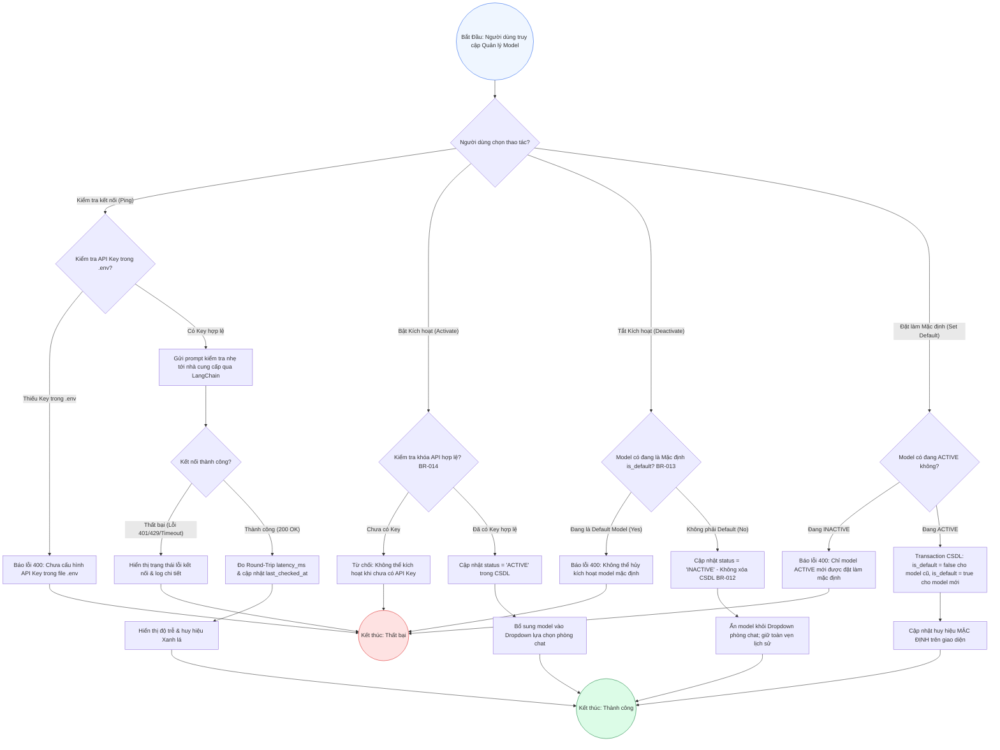

# Sơ Đồ BPMN: Quy Trình Quản Lý Vòng Đời & Kích Hoạt Mô Hình Agent (Agent Model Management BPMN)
## Dự Án: Website Chatbot Trợ Lý Ảo (AI-Chan Assistant)

---

| Thông Tin Sơ Đồ | Chi Tiết |
| :--- | :--- |
| **Mã Sơ Đồ** | `DIAG-BPMN-007` |
| **Quy Trình Nghiệp Vụ** | `BP-AGENT-001 [PROC-013]` |
| **Nguồn Sự Thật Thượng Nguồn** | [docs/03-business-process/business-process-catalog.md](file:///c:/Users/sv/Desktop/ai-chan/ai-chan/docs/03-business-process/business-process-catalog.md), [docs/06-architecture/ADR/ADR-006-multi-provider-agent-management.md](file:///c:/Users/sv/Desktop/ai-chan/ai-chan/docs/06-architecture/ADR/ADR-006-multi-provider-agent-management.md), [docs/02-requirements/functional-requirements.md](file:///c:/Users/sv/Desktop/ai-chan/ai-chan/docs/02-requirements/functional-requirements.md) (`FR-021`..`FR-026`), [docs/02-requirements/business-rules.md](file:///c:/Users/sv/Desktop/ai-chan/ai-chan/docs/02-requirements/business-rules.md) (`BR-012`..`BR-015`) |
| **Mục Đích** | Mô tả quy trình xử lý đa nhánh nghiệp vụ: Kiểm tra kết nối (Ping), Kích hoạt (Activate), Hủy kích hoạt an toàn không xóa cứng (Deactivate - Soft Toggle) và Thiết lập mô hình mặc định (Set Default) |

---

## 1. Biểu Đồ BPMN Quy Trình Quản Lý Vòng Đời Agent Model (PROC-013)

---

## 2. Bảng Ràng Buộc Nghiệp Vụ Tương Ứng

| Cổng Quyết Định (Gateway) | Ràng Buộc Nghiệp Vụ | Mã Lỗi / Kết Quả |
| :--- | :--- | :--- |
| `CheckActiveKey` | `BR-014`: Bắt buộc có API Key trong `.env` trước khi kích hoạt | `HTTP 400 Bad Request` nếu thiếu |
| `CheckIsDefault` | `BR-013`: Bất biến duy trì mô hình mặc định hoạt động | `HTTP 400 Bad Request` nếu cố tình tắt model mặc định |
| `SetStatusInactive` | `BR-012`: Tuyệt đối không xóa cứng thực thể | Soft toggle `status = INACTIVE` |
| `CheckModelActive` | `BR-013`: Mô hình mặc định phải luôn ở trạng thái `ACTIVE` | `HTTP 400 Bad Request` nếu model chưa kích hoạt |
