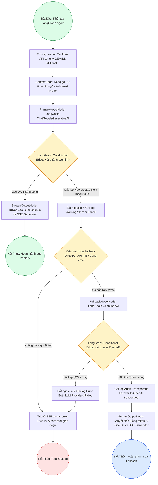

# Sơ Đồ BPMN: Quy Trình Tự Động Chuyển Đổi Dự Phòng Cổng AI (Multi-Provider Failover BPMN)
## Dự Án: Website Chatbot Trợ Lý Ảo (AI-Chan Assistant)

---

| Thông Tin Sơ Đồ | Chi Tiết |
| :--- | :--- |
| **Mã Sơ Đồ** | `DIAG-BPMN-004` |
| **Quy Trình Nghiệp Vụ** | `BP-AI-001 [PROC-009]` |
| **Nguồn Sự Thật Thượng Nguồn** | [docs/03-business-process/process-flows.md](file:///c:/Users/PC/Project/ai-chan/docs/03-business-process/process-flows.md), [docs/06-architecture/ADR/ADR-003-multi-provider-llm-failover.md](file:///c:/Users/PC/Project/ai-chan/docs/06-architecture/ADR/ADR-003-multi-provider-llm-failover.md), [docs/02-requirements/functional-requirements.md](file:///c:/Users/PC/Project/ai-chan/docs/02-requirements/functional-requirements.md) (`FR-011`) |
| **Mục Đích** | Mô tả cơ chế xử lý ngoại lệ, điều phối tự động và chuyển đổi dự phòng trong suốt từ Google Gemini sang OpenAI |

---

## 1. Biểu Đồ BPMN Quy Trình Chuyển Đổi Dự Phòng AI (PROC-009)

---

## 2. Thuyết Minh Quy Tắc Chuyển Vùng Dự Phòng (ADR-003, ADR-005)

1. **Điều phối qua LangGraph StateGraph**: Toàn bộ luồng chuyển vùng dự phòng được quản lý bằng đồ thị trạng thái của LangGraph. State được bảo toàn nguyên vẹn khi chuyển từ nút `PrimaryModelNode` sang `FallbackModelNode`.
2. **Tải cấu hình từ `.env`**: Các model adapters của LangChain được nạp động dựa trên sự hiện diện của API key trong `.env` (`GEMINI_API_KEY`, `OPENAI_API_KEY`, `ANTHROPIC_API_KEY`, `GROQ_API_KEY`, `OLLAMA_BASE_URL`).
3. **Tính trong suốt với người dùng (Transparency)**: Quá trình chuyển đổi diễn ra hoàn toàn ở tầng Backend. Giao diện người dùng vẫn tiếp tục nhận các token streaming bình thường mà không nhận thấy lỗi gián đoạn.
4. **Các điều kiện kích hoạt Failover**:
   - `HTTP 429 Too Many Requests`: Hạn ngạch (Quota) Google Gemini bị vượt ngưỡng.
   - `HTTP 500/502/503`: Máy chủ Google AI Studio gặp sự cố.
   - `TimeoutException`: Sau 30 giây không nhận được phản hồi từ Gemini.
