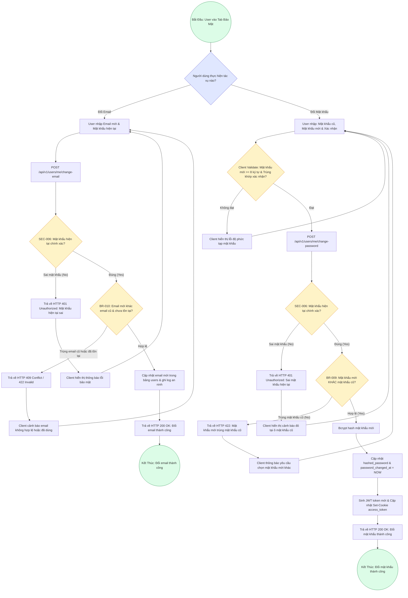

# Sơ Đồ BPMN: Quy Trình Thay Đổi Bảo Mật (Security BPMN)
## Dự Án: Website Chatbot Trợ Lý Ảo (AI-Chan Assistant)

---

| Thông Tin Sơ Đồ | Chi Tiết |
| :--- | :--- |
| **Mã Sơ Đồ** | `DIAG-BPMN-006` |
| **Quy Trình Nghiệp Vụ** | `BP-USER-002 [PROC-012]` |
| **Nguồn Sự Thật Thượng Nguồn** | [docs/03-business-process/business-process-catalog.md](file:///c:/Users/PC/Project/ai-chan/docs/03-business-process/business-process-catalog.md), [docs/02-requirements/functional-requirements.md](file:///c:/Users/PC/Project/ai-chan/docs/02-requirements/functional-requirements.md) (`FR-018`, `FR-019`), [docs/10-security/security-specification.md](file:///c:/Users/PC/Project/ai-chan/docs/10-security/security-specification.md) (`SEC-006`, `SEC-007`) |
| **Mục Đích** | Mô tả luồng xử lý an ninh nghiêm ngặt khi thay đổi thuộc tính nhạy cảm (Email, Mật khẩu) có yêu cầu Re-authentication |

---

## 1. Biểu Đồ BPMN Quy Trình Bảo Mật (PROC-012)

---

## 2. Bảng Thuyết Minh Các Điểm Quyết Định An Ninh (Security Decision Points)

| Mã Điểm Quyết Định | Điều Kiện Kiểm Tra | Nhánh Đúng (True) | Nhánh Sai (False) |
| :--- | :--- | :--- | :--- |
| **`VerifyPwdEmail`** | `verify_password(current_password, hashed_password)` | Tiến hành kiểm tra tính duy nhất của email mới | Trả về `HTTP 401 Unauthorized` |
| **`CheckEmailDiff`** | `new_email != current_email` và không tồn tại trong CSDL | Cập nhật `email` mới trong bảng `users` | Trả về `HTTP 409 Conflict` hoặc `422` |
| **`VerifyPwdOld`** | `verify_password(current_password, hashed_password)` | Tiếp tục kiểm tra mật khẩu mới | Trả về `HTTP 401 Unauthorized` |
| **`CheckPwdNotSame`**| `verify_password(new_password, hashed_password) == False` | Mã hóa bcrypt và cập nhật mật khẩu mới | Trả về `HTTP 422 Unprocessable Entity` |
