# Sơ Đồ BPMN: Quy Trình Gửi Tin Nhắn & Stream Thời Gian Thực (Streaming Chat BPMN)
## Dự Án: Website Chatbot Trợ Lý Ảo (AI-Chan Assistant)

---

| Thông Tin Sơ Đồ | Chi Tiết |
| :--- | :--- |
| **Mã Sơ Đồ** | `DIAG-BPMN-003` |
| **Quy Trình Nghiệp Vụ** | `BP-CHAT-001 [PROC-008]` |
| **Nguồn Sự Thật Thượng Nguồn** | [docs/03-business-process/process-flows.md](file:///c:/Users/PC/Project/ai-chan/docs/03-business-process/process-flows.md), [docs/02-requirements/functional-requirements.md](file:///c:/Users/PC/Project/ai-chan/docs/02-requirements/functional-requirements.md) (`FR-007` - `FR-014`), [docs/06-architecture/ADR/ADR-004-sse-streaming-protocol.md](file:///c:/Users/PC/Project/ai-chan/docs/06-architecture/ADR/ADR-004-sse-streaming-protocol.md) |
| **Mục Đích** | Mô tả dòng xử lý gửi tin nhắn, lưu trữ người dùng, mở luồng SSE, truyền từng chunk và xử lý ngắt luồng |

---

## 1. Biểu Đồ BPMN Quy Trình Chat Dòng Chảy (PROC-008)

```mermaid
flowchart TD
    StartChat((Bắt Đầu: Người dùng gửi Prompt)) --> ValidateLength{Độ dài <= 4000 ký tự?}

    ValidateLength -- Vượt ngưỡng (No) --> BlockSend[Chặn gửi tin nhắn & hiển thị cảnh báo đỏ]
    BlockSend --> EndFail((Kết Thúc: Thất bại))

    ValidateLength -- Hợp lệ (Yes) --> OptimisticUI[Render bong bóng tin nhắn User ngay trên UI]
    OptimisticUI --> LockInput[Khóa ô soạn thảo & hiển thị nút 'Dừng phản hồi']
    LockInput --> SendStreamReq[POST /api/v1/conversations/:id/messages/stream]

    SendStreamReq --> AuthAndOwner{Xác thực JWT Cookie & quyền sở hữu hội thoại?}
    AuthAndOwner -- Không hợp lệ (No) --> Return404[Trả về HTTP 404/401]
    Return404 --> ShowErrToast[Hiển thị thông báo lỗi & mở khóa ô nhập]
    ShowErrToast --> EndFail

    AuthAndOwner -- Hợp lệ (Yes) --> SaveUserMsg[Ghi tin nhắn User vào bảng messages CSDL]
    SaveUserMsg --> GetContext[Truy vấn tối đa 20 tin nhắn gần nhất làm ngữ cảnh trượt]
    GetContext --> CallLLMGateway[Gửi yêu cầu stream tới LLM Orchestrator Gateway]
    CallLLMGateway --> OpenSSE[Mở kết nối Server-Sent Events HTTP 200 text/event-stream]

    OpenSSE --> StreamLoop{Vòng lặp nhận Token Chunk từ AI}
    
    StreamLoop -- Nhận Chunk Token --> CheckUserAbort{Người dùng có bấm nút 'Dừng'?}
    CheckUserAbort -- Có (Abort) --> CloseStreamUser[Client ngắt ReadableStream, Backend dừng generator]
    CloseStreamUser --> SavePartial[Lưu nội dung đã sinh đến lúc dừng vào CSDL]
    SavePartial --> UnlockUI[Mở khóa ô soạn thảo và hiển thị trạng thái hoàn tất]
    UnlockUI --> EndSuccess((Kết Thúc: Dừng luồng theo yêu cầu))

    CheckUserAbort -- Không (Tiếp tục) --> SendSSEEvent[Truyền SSE data: chunk về Client]
    SendSSEEvent --> ClientRenderToken[Client nối token vào UI & tự động cuộn bám đáy]
    ClientRenderToken --> CheckStreamEnd{AI đã hoàn tất toàn văn?}

    CheckStreamEnd -- Chưa xong (No) --> StreamLoop
    CheckStreamEnd -- Đã xong (Yes) --> SendSSEDone[Gửi SSE event: done kèm message_id]
    SendSSEDone --> SaveFullAssistant[Ghi toàn bộ câu trả lời hoàn chỉnh vào CSDL]
    SaveFullAssistant --> ClientMarkdown[Client render hoàn chỉnh Markdown & tô màu code]
    ClientMarkdown --> UnlockUI2[Mở khóa ô soạn thảo sẵn sàng nhận câu hỏi tiếp theo]
    UnlockUI2 --> EndSuccessFull((Kết Thúc: Hoàn thành trọn vẹn))

    style StartChat fill:#dcfce7,stroke:#15803d
    style EndSuccessFull fill:#dcfce7,stroke:#15803d
    style EndSuccess fill:#fef3c7,stroke:#d97706
    style EndFail fill:#fee2e2,stroke:#b91c1c
    style ValidateLength fill:#fef3c7,stroke:#d97706
    style AuthAndOwner fill:#fef3c7,stroke:#d97706
    style StreamLoop fill:#eff6ff,stroke:#2563eb
    style CheckUserAbort fill:#fee2e2,stroke:#dc2626
    style CheckStreamEnd fill:#fef3c7,stroke:#d97706
```

---

## 2. Thuyết Minh Các Điểm Quyết Định Quan Trọng

1. **`ValidateLength`**: Bảo vệ hệ thống khỏi việc tiêu tốn token quá mức và tràn bộ nhớ.
2. **`AuthAndOwner`**: Ngăn chặn tấn công IDOR (`SEC-002`, `CTRL-002`). Nếu không sở hữu conversation, trả về 404 để chống dò quét.
3. **`CheckUserAbort`**: Người dùng có toàn quyền dừng phản hồi bất kỳ lúc nào qua nút `Stop Generation` (`UX-003`). Dữ liệu đã sinh được giữ nguyên vẹn.
