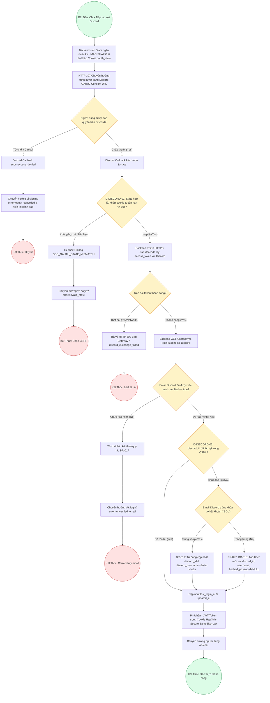

# Sơ Đồ BPMN: Quy Trình Xác Thực & Đăng Ký Qua Discord OAuth2 (Discord Auth BPMN)
## Dự Án: Website Chatbot Trợ Lý Ảo (AI-Chan Assistant)

---

| Thông Tin Sơ Đồ | Chi Tiết |
| :--- | :--- |
| **Mã Sơ Đồ** | `DIAG-BPMN-008` |
| **Quy Trình Nghiệp Vụ** | `BP-AUTH-004 [PROC-014]` |
| **Nguồn Sự Thật Thượng Nguồn** | [docs/03-business-process/business-process-catalog.md](file:///c:/Users/PC/Project/ai-chan/docs/03-business-process/business-process-catalog.md), [docs/02-requirements/functional-requirements.md](file:///c:/Users/PC/Project/ai-chan/docs/02-requirements/functional-requirements.md) (`FR-027`, `FR-028`), [docs/06-architecture/ADR/ADR-007-discord-oauth2-authentication.md](file:///c:/Users/PC/Project/ai-chan/docs/06-architecture/ADR/ADR-007-discord-oauth2-authentication.md) |
| **Mục Đích** | Trực quan hóa toàn diện chuỗi sự kiện, các cổng kiểm tra an ninh (CSRF State, Verified Email, Token Exchange) và các nhánh xử lý tạo mới hoặc liên kết tài khoản |

---

## 1. Biểu Đồ BPMN Quy Trình Xác Thực Discord OAuth2 (PROC-014)

---

## 2. Bảng Thuyết Minh Các Điểm Quyết Định & Rẽ Nhánh (Decision Gateways)

| Mã Điểm Quyết Định | Tên Điều Kiện Kiểm Tra | Nhánh Đúng (True) | Nhánh Sai (False) | Quy Tắc Liên Quan |
| :--- | :--- | :--- | :--- | :--- |
| **`UserConsent`** | Người dùng chấp thuận ủy quyền trên trang Discord OAuth2 | Tiếp tục với Callback `code` | Chuyển hướng hủy về `/login?error=oauth_cancelled` | RFC 6749 |
| **`D-DISCORD-01`** | Chuỗi `state` khớp cookie `oauth_state`, chữ ký HMAC hợp lệ và thời gian sống <= 10 phút | Tiến hành gọi token endpoint | Chặn request, ghi log `SEC_OAUTH_STATE_MISMATCH` | `BR-016`, `SEC-008` |
| **`TokenCheck`** | Phản hồi từ Discord token endpoint trả về HTTP 200 kèm `access_token` | Gọi API lấy hồ sơ `@me` | Báo lỗi `HTTP 502 Bad Gateway` | `ADR-007` |
| **`VerifyEmailCheck`** | Trường `verified` trong thông tin trả về từ Discord có giá trị `true` | Cho phép tiếp tục xử lý | Từ chối tự động liên kết tài khoản | `BR-017` |
| **`D-DISCORD-02`** | Đã tồn tại bản ghi trong bảng `users` có `discord_id == discord_profile.id` | Đăng nhập trực tiếp và cấp JWT | Kiểm tra email để liên kết hoặc tạo mới | `FR-028` |
| **`LookupEmail`** | Tồn tại tài khoản người dùng có cùng địa chỉ email trong bảng `users` | Tự động liên kết `discord_id` vào tài khoản sẵn có | Tạo mới tài khoản với `hashed_password = NULL` | `BR-017`, `BR-018`, `FR-027` |
