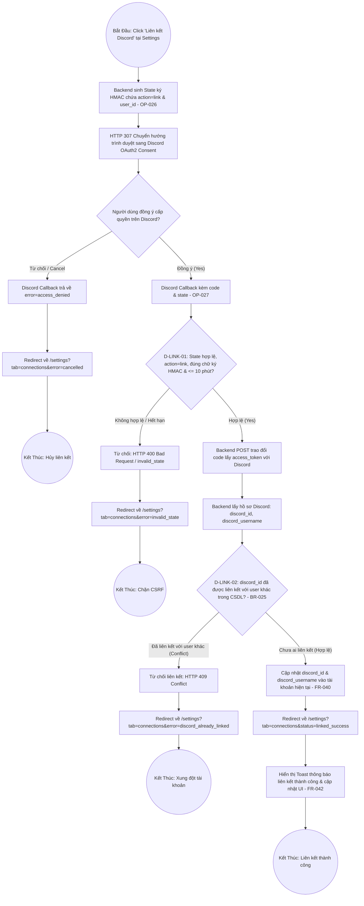
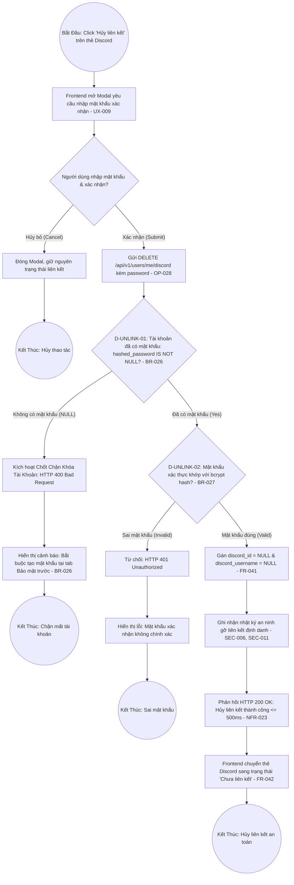

# Sơ Đồ BPMN: Quy Trình Liên Kết & Hủy Liên Kết Tài Khoản Discord (Discord Link & Unlink BPMN)
## Dự Án: Website Chatbot Trợ Lý Ảo (AI-Chan Assistant)

---

| Thông Tin Sơ Đồ | Chi Tiết |
| :--- | :--- |
| **Mã Sơ Đồ** | `DIAG-BPMN-011` |
| **Quy Trình Nghiệp Vụ** | `BP-USER-003 [PROC-019]` & `BP-USER-004 [PROC-020]` |
| **Nguồn Sự Thật Thượng Nguồn** | [docs/03-business-process/business-process-catalog.md](file:///c:/Users/PC/Project/ai-chan/docs/03-business-process/business-process-catalog.md), [docs/02-requirements/functional-requirements.md](file:///c:/Users/PC/Project/ai-chan/docs/02-requirements/functional-requirements.md) (`FR-040`, `FR-041`, `FR-042`), [docs/06-architecture/ADR/ADR-010-discord-account-linking-and-unlinking.md](file:///c:/Users/PC/Project/ai-chan/docs/06-architecture/ADR/ADR-010-discord-account-linking-and-unlinking.md) |
| **Mục Đích** | Trực quan hóa toàn diện chuỗi sự kiện, cổng kiểm tra an ninh (Chữ ký HMAC action=link, Ánh xạ duy nhất 1-1 BR-025, Chốt chặn có mật khẩu BR-026 và Tái xác thực mật khẩu BR-027) |

---

## 1. Biểu Đồ BPMN Quy Trình Liên Kết Tài Khoản Discord (PROC-019)

---

## 2. Biểu Đồ BPMN Quy Trình Hủy Liên Kết Tài Khoản Discord Có Chốt Chặn (PROC-020)

