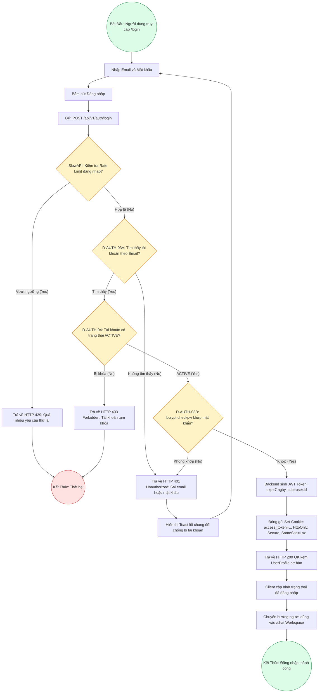

# Sơ Đồ BPMN: Quy Trình Đăng Nhập & Cấp Phiên (User Login BPMN)
## Dự Án: Website Chatbot Trợ Lý Ảo (AI-Chan Assistant)

---

| Thông Tin Sơ Đồ | Chi Tiết |
| :--- | :--- |
| **Mã Sơ Đồ** | `DIAG-BPMN-002` |
| **Quy Trình Nghiệp Vụ** | `BP-AUTH-002 [PROC-002]` |
| **Nguồn Sự Thật Thượng Nguồn** | [docs/03-business-process/process-flows.md](file:///c:/Users/PC/Project/ai-chan/docs/03-business-process/process-flows.md), [docs/02-requirements/functional-requirements.md](file:///c:/Users/PC/Project/ai-chan/docs/02-requirements/functional-requirements.md) (`FR-002`), [docs/06-architecture/ADR/ADR-002-httponly-cookie-jwt.md](file:///c:/Users/PC/Project/ai-chan/docs/06-architecture/ADR/ADR-002-httponly-cookie-jwt.md) |
| **Mục Đích** | Mô tả dòng xử lý xác thực thông tin đăng nhập, xác minh mật khẩu và thiết lập Cookie bảo mật phiên làm việc |

---

## 1. Biểu Đồ BPMN Quy Trình Đăng Nhập (PROC-002)

---

## 2. Bảng Thuyết Minh Rẽ Nhánh Bảo Mật

- **Chống Dò Quét Tài Khoản (User Enumeration Defense)**: Dù không tìm thấy email hay sai mật khẩu, hệ thống đều trả về mã lỗi duy nhất `HTTP 401 Unauthorized` với thông điệp đồng nhất: `"Sai email hoặc mật khẩu"`.
- **Cơ chế thiết lập Cookie an toàn**: JWT token không bao giờ được gửi trong body JSON để tránh việc lưu trữ trong `localStorage`, ngăn chặn triệt để nguy cơ trích xuất token qua lỗ hổng XSS (`ADR-002`, `SEC-004`).
