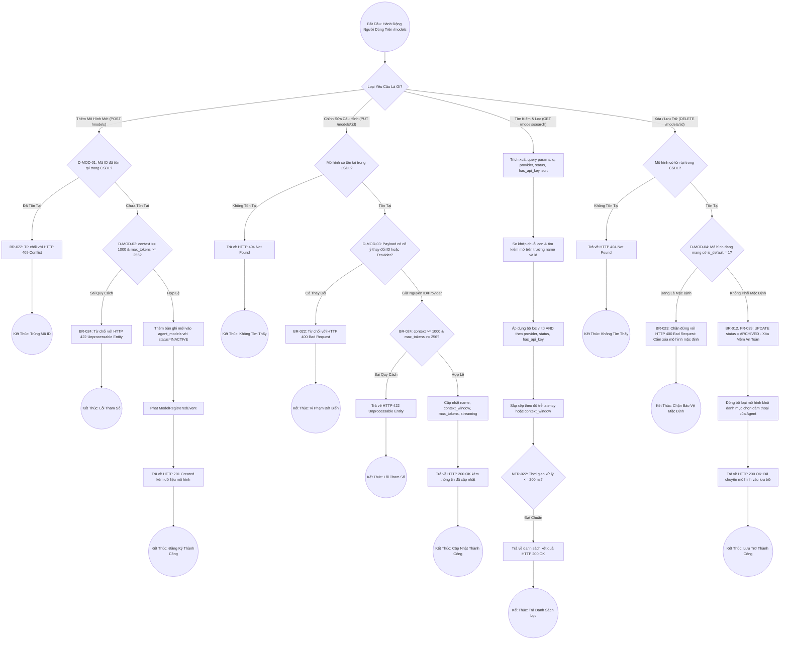

# Sơ Đồ BPMN: Quy Trình Quản Lý, Tìm Kiếm & Vòng Đời Mô Hình Mở Rộng (Model Management BPMN)
## Dự Án: Website Chatbot Trợ Lý Ảo (AI-Chan Assistant)

---

| Thông Tin Sơ Đồ | Chi Tiết |
| :--- | :--- |
| **Mã Sơ Đồ** | `DIAG-BPMN-010` |
| **Quy Trình Nghiệp Vụ** | `BP-MOD-001 [PROC-017]` & `BP-MOD-002 [PROC-018]` |
| **Nguồn Sự Thật Thượng Nguồn** | [docs/03-business-process/business-process-catalog.md](file:///c:/Users/PC/Project/ai-chan/docs/03-business-process/business-process-catalog.md), [docs/02-requirements/functional-requirements.md](file:///c:/Users/PC/Project/ai-chan/docs/02-requirements/functional-requirements.md) (`FR-035` - `FR-039`), [docs/06-architecture/ADR/ADR-009-extensible-model-management-search-filter.md](file:///c:/Users/PC/Project/ai-chan/docs/06-architecture/ADR/ADR-009-extensible-model-management-search-filter.md) |
| **Mục Đích** | Trực quan hóa toàn diện quy trình tiếp nhận yêu cầu đăng ký mô hình mới, thẩm định biên tham số, chỉnh sửa cấu hình bất biến, tìm kiếm toàn văn/mờ, lọc đa tiêu chí và xóa mềm lưu trữ an toàn có bảo vệ mô hình mặc định |

---

## 1. Biểu Đồ BPMN Quy Trình Quản Trị & Vòng Đời Mô Hình (PROC-017 / PROC-018)

---

## 2. Bảng Phân Tích Cổng Rẽ Nhánh Nghiệp Vụ (Decision Gateways)

| Cổng Quyết Định | Điều Kiện Kiểm Tra | Nhánh Đúng (True) | Nhánh Sai (False) | Quy Tắc Thực Thi |
| :--- | :--- | :--- | :--- | :--- |
| **`D-MOD-01`** | `agent_models.id` đã tồn tại? | Từ chối với HTTP 409 Conflict | Tiếp tục bước kiểm tra tham số | `BR-022` |
| **`D-MOD-02`** | `context >= 1000 & max_tokens >= 256`? | Tiến hành INSERT CSDL | Từ chối với HTTP 422 Unprocessable | `BR-024` |
| **`D-MOD-03`** | Payload cố ý sửa `id` hoặc `provider`? | Từ chối với HTTP 400 Bad Request | Cho phép cập nhật các trường khác | `BR-022` |
| **`D-MOD-04`** | `model.is_default == true`? | Từ chối với HTTP 400 Bad Request | Cho phép cập nhật `status = ARCHIVED` | `BR-023` |
