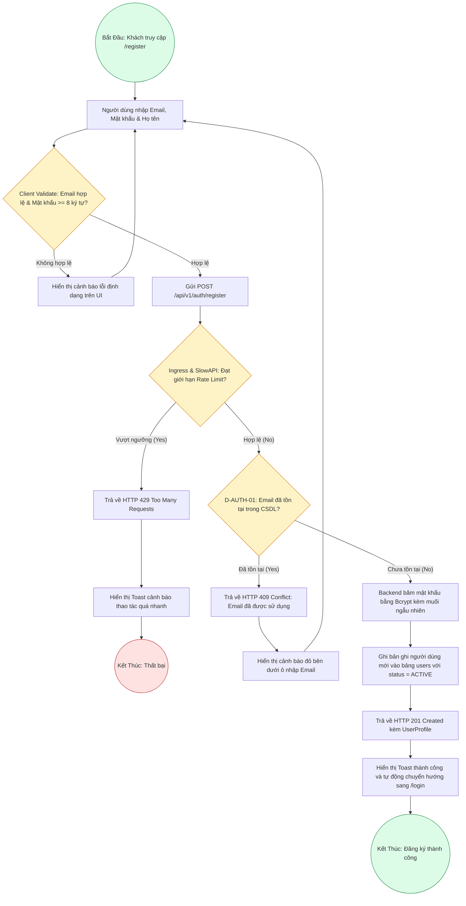

# Sơ Đồ BPMN: Quy Trình Đăng Ký Tài Khoản (User Registration BPMN)
## Dự Án: Website Chatbot Trợ Lý Ảo (AI-Chan Assistant)

---

| Thông Tin Sơ Đồ | Chi Tiết |
| :--- | :--- |
| **Mã Sơ Đồ** | `DIAG-BPMN-001` |
| **Quy Trình Nghiệp Vụ** | `BP-AUTH-001 [PROC-001]` |
| **Nguồn Sự Thật Thượng Nguồn** | [docs/03-business-process/process-flows.md](file:///c:/Users/PC/Project/ai-chan/docs/03-business-process/process-flows.md), [docs/02-requirements/functional-requirements.md](file:///c:/Users/PC/Project/ai-chan/docs/02-requirements/functional-requirements.md) (`FR-001`) |
| **Mục Đích** | Mô tả các sự kiện bắt đầu/kết thúc, hoạt động kiểm tra, và các nhánh rẽ điều kiện trong quy trình tạo tài khoản mới |

---

## 1. Biểu Đồ BPMN Quy Trình Đăng Ký (PROC-001)

---

## 2. Bảng Thuyết Minh Các Điểm Quyết Định (Decision Points)

| Mã Điểm Quyết Định | Điều Kiện Kiểm Tra | Nhánh Đúng (True) | Nhánh Sai (False) |
| :--- | :--- | :--- | :--- |
| **`ClientValidate`** | Định dạng Email regex chuẩn và mật khẩu có ít nhất 8 ký tự kèm chữ hoa, số | Gửi request lên Backend | Hiển thị thông báo yêu cầu sửa form tại Client |
| **`IngressCheck`** | Tần suất request không vượt quá 10 req/s (Nginx) và 30 req/min (Backend) | Chuyển tiếp request vào xử lý nghiệp vụ | Trả về `HTTP 429 Too Many Requests` |
| **`D-AUTH-01`** | `SELECT id FROM users WHERE email = :email` | Trả về `HTTP 409 Conflict` (trùng email) | Thực hiện băm mật khẩu bcrypt và tạo user mới |
