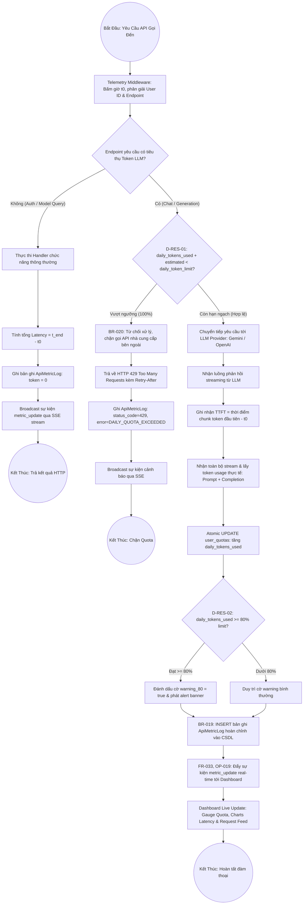

# Sơ Đồ BPMN: Quy Trình Quản Lý Tài Nguyên & Kiểm Soát Quota (Resource Management BPMN)
## Dự Án: Website Chatbot Trợ Lý Ảo (AI-Chan Assistant)

---

| Thông Tin Sơ Đồ | Chi Tiết |
| :--- | :--- |
| **Mã Sơ Đồ** | `DIAG-BPMN-009` |
| **Quy Trình Nghiệp Vụ** | `BP-RES-001 [PROC-015]` & `BP-RES-002 [PROC-016]` |
| **Nguồn Sự Thật Thượng Nguồn** | [docs/03-business-process/business-process-catalog.md](file:///c:/Users/PC/Project/ai-chan/docs/03-business-process/business-process-catalog.md), [docs/02-requirements/functional-requirements.md](file:///c:/Users/PC/Project/ai-chan/docs/02-requirements/functional-requirements.md) (`FR-029` - `FR-034`), [docs/06-architecture/ADR/ADR-008-resource-telemetry-and-realtime-dashboard.md](file:///c:/Users/PC/Project/ai-chan/docs/06-architecture/ADR/ADR-008-resource-telemetry-and-realtime-dashboard.md) |
| **Mục Đích** | Trực quan hóa toàn diện quy trình tiếp nhận yêu cầu API, thẩm định hạn ngạch Quota trước thực thi, đo đạc độ trễ/TTFT/token, ghi nhật ký telemetry nguyên tử và đẩy luồng SSE thời gian thực lên Dashboard |

---

## 1. Biểu Đồ BPMN Quy Trình Đo Đạc Telemetry & Quản Lý Quota (PROC-015 / PROC-016)

---

## 2. Bảng Cổng Điều Kiện & Điểm Quyết Định BPMN (Gateways)

| Cổng Quyết Định | Tên Cổng Nghiệp Vụ | Điều Kiện Thẩm Định | Nhánh Xử Lý Tiếp Theo |
| :--- | :--- | :--- | :--- |
| `CheckTarget` | Phân loại Endpoint Yêu Cầu | Endpoint thuộc nhóm gọi AI Chat/Completion hay dịch vụ thường | Nếu dịch vụ thường: bỏ qua bước kiểm tra Quota LLM; Nếu gọi LLM: bắt buộc thẩm định Quota. |
| `CheckQuota` | Kiểm Tra Hạn Ngạch Token (`D-RES-01`) | `daily_tokens_used + estimated < daily_token_limit` | Nếu FALSE: trả về `HTTP 429`, chặn gọi model; Nếu TRUE: cho phép gửi request tới LLM provider. |
| `Check80Warning` | Cảnh Báo Ngưỡng 80% (`D-RES-02`) | `daily_tokens_used >= 80% * daily_token_limit` | Nếu TRUE: đính kèm cảnh báo `warning_80` qua SSE để hiển thị banner màu cam; Nếu FALSE: tiếp tục bình thường. |
