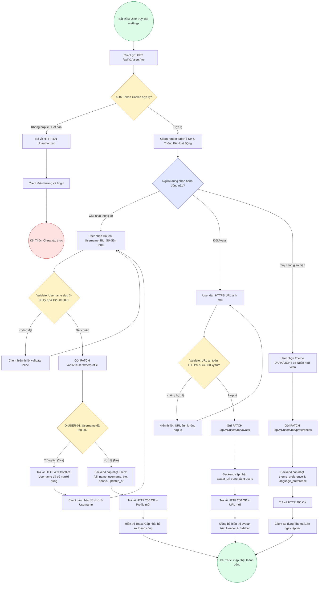

# Sơ Đồ BPMN: Quy Trình Quản Lý Hồ Sơ & Cài Đặt Người Dùng (User Profile BPMN)
## Dự Án: Website Chatbot Trợ Lý Ảo (AI-Chan Assistant)

---

| Thông Tin Sơ Đồ | Chi Tiết |
| :--- | :--- |
| **Mã Sơ Đồ** | `DIAG-BPMN-005` |
| **Quy Trình Nghiệp Vụ** | `BP-USER-001 [PROC-011]` |
| **Nguồn Sự Thật Thượng Nguồn** | [docs/03-business-process/business-process-catalog.md](file:///c:/Users/PC/Project/ai-chan/docs/03-business-process/business-process-catalog.md), [docs/02-requirements/functional-requirements.md](file:///c:/Users/PC/Project/ai-chan/docs/02-requirements/functional-requirements.md) (`FR-015`, `FR-016`, `FR-017`, `FR-020`) |
| **Mục Đích** | Mô tả các sự kiện, hoạt động thẩm định và nhánh rẽ điều kiện trong quy trình xem, cập nhật hồ sơ cá nhân và thay đổi tùy chọn hiển thị |

---

## 1. Biểu Đồ BPMN Quy Trình Quản Lý Hồ Sơ (PROC-011)

---

## 2. Bảng Thuyết Minh Các Điểm Quyết Định (Decision Points)

| Mã Điểm Quyết Định | Điều Kiện Kiểm Tra | Nhánh Đúng (True) | Nhánh Sai (False) |
| :--- | :--- | :--- | :--- |
| **`CheckAuth`** | Cookie `access_token` hợp lệ và tài khoản `ACTIVE` | Render giao diện cài đặt | Trả về `401 Unauthorized` và chuyển hướng về `/login` |
| **`ClientRegex`** | `username` 3-30 ký tự la-tinh thường/số/gạch (`BR-007`), `bio` <= 500 | Gửi request `PATCH /api/v1/users/me/profile` | Hiển thị cảnh báo inline trên form |
| **`D-USER-01`** | `SELECT id FROM users WHERE username = :username AND id != :current_user_id` | Trả về `HTTP 409 Conflict` | Cập nhật CSDL và trả về `HTTP 200 OK` |
| **`CheckAvatarUrl`**| URL bắt đầu bằng `https://` và độ dài <= 500 ký tự (`BR-011`) | Gửi request `PATCH /api/v1/users/me/avatar` | Hiển thị lỗi định dạng URL ảnh |
