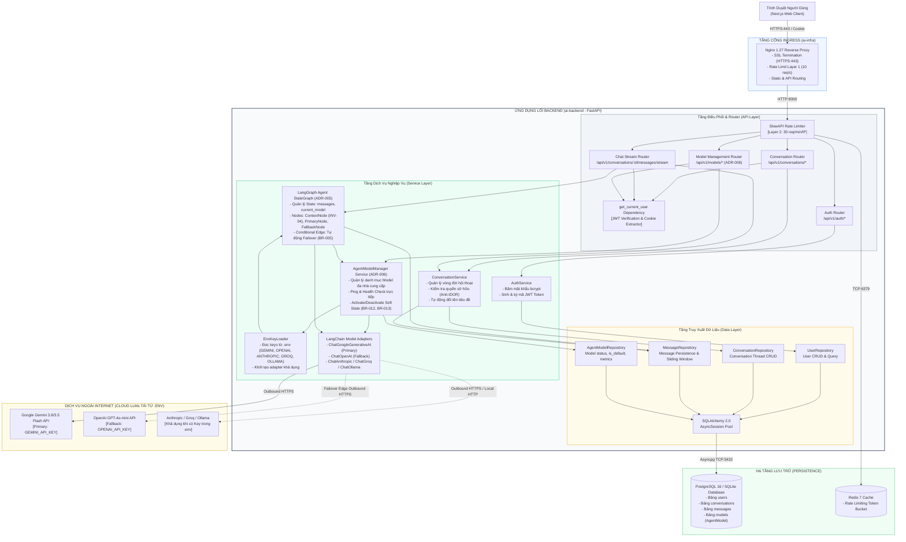

# Sơ Đồ Thành Phần Kiến Trúc (Component Architecture Diagram)
## Dự Án: Website Chatbot Trợ Lý Ảo (AI-Chan Assistant)

---

| Thông Tin Sơ Đồ | Chi Tiết |
| :--- | :--- |
| **Mã Sơ Đồ** | `DIAG-COMP-001` |
| **Loại Sơ Đồ** | **C4 Component Diagram (Level 3 - ai-backend Core)** |
| **Nguồn Sự Thật Thượng Nguồn** | [docs/06-architecture/sad.md](file:///c:/Users/PC/Project/ai-chan/docs/06-architecture/sad.md) (`ARCH-SAD-001`) |
| **Mục Đích** | Trực quan hóa cấu trúc các module, dịch vụ nghiệp vụ, tầng điều phối AI và tầng dữ liệu bên trong Backend |

---

## 1. Biểu Đồ Thành Phần Chi Tiết (C4 Component View)

