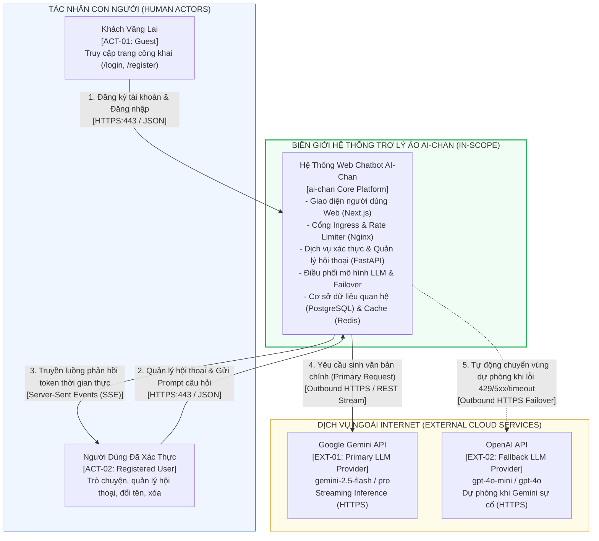

# Sơ Đồ Ngữ Cảnh Hệ Thống (System Context Diagram)
## Dự Án: Website Chatbot Trợ Lý Ảo (AI-Chan Assistant)

---

| Thông Tin Sơ Đồ | Chi Tiết |
| :--- | :--- |
| **Mã Sơ Đồ** | `DIAG-CTX-001` |
| **Loại Sơ Đồ** | **System Context Diagram (C4 Context Level 1)** |
| **Nguồn Sự Thật Thượng Nguồn** | [docs/05-system-analysis/system-context.md](file:///c:/Users/PC/Project/ai-chan/docs/05-system-analysis/system-context.md), [docs/06-architecture/sad.md](file:///c:/Users/PC/Project/ai-chan/docs/06-architecture/sad.md) |
| **Mục Đích** | Mô tả biên giới hệ thống AI-Chan, các tác nhân con người tương tác và các dịch vụ đám mây ngoại vi |

---

## 1. Biểu Đồ Ngữ Cảnh Mermaid

---

## 2. Thuyết Minh Ranh Giới Kỹ Thuật

1. **Bên trong ranh giới (In-Scope)**:
   - Toàn bộ giao diện Web Chat (`ai-frontend`), API Gateway & Rate Limiter (`nginx-gateway`), Server nghiệp vụ (`ai-backend`), Database quan hệ (`postgres`) và Cache phiên (`redis`).
2. **Bên ngoài ranh giới (External)**:
   - Thiết bị và trình duyệt của người dùng (Edge Browser).
   - Nền tảng Google Gemini API và OpenAI API (Cloud PaaS/SaaS).
