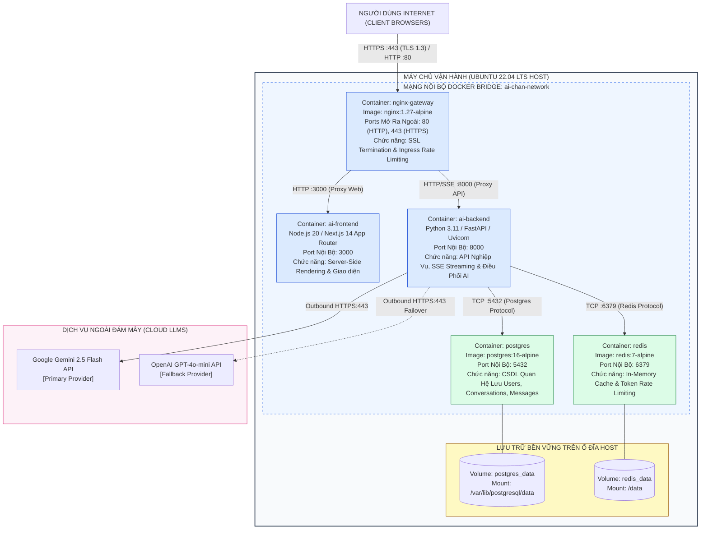

# Sơ Đồ Kiến Trúc Triển Khai (Deployment Topology Diagram)
## Dự Án: Website Chatbot Trợ Lý Ảo (AI-Chan Assistant)

---

| Thông Tin Sơ Đồ | Chi Tiết |
| :--- | :--- |
| **Mã Sơ Đồ** | `DIAG-DEP-001` |
| **Mã Triển Khai** | `DEP-001` |
| **Nguồn Sự Thật Thượng Nguồn** | [docs/06-architecture/deployment-concept.md](file:///c:/Users/PC/Project/ai-chan/docs/06-architecture/deployment-concept.md), [docs/13-operations/deployment-guide.md](file:///c:/Users/PC/Project/ai-chan/docs/13-operations/deployment-guide.md), [ai-infra/compose/docker-compose.yml](file:///c:/Users/PC/Project/ai-chan/ai-infra/compose/docker-compose.yml) |
| **Mục Đích** | Trực quan hóa cấu trúc triển khai container hóa bằng Docker Compose, ranh giới mạng nội bộ và các cổng dịch vụ |

---

## 1. Biểu Đồ Cấu Trúc Triển Khai Container (DEP-001)

---

## 2. Thuyết Minh Ranh Giới Mạng & An Ninh Cổng

1. **Ranh giới cô lập (Network Isolation)**: Chỉ có 2 cổng `80` và `443` của Nginx Gateway được mở ra môi trường Internet.
2. **Bảo vệ CSDL & Cache**: PostgreSQL (cổng `5432`) và Redis (cổng `6379`) nằm hoàn toàn trong mạng nội bộ Docker Bridge, tuyệt đối không mở cổng ra ngoài máy chủ Host, ngăn chặn hoàn toàn nguy cơ quét cổng hoặc tấn công từ bên ngoài.
3. **Tính bền vững dữ liệu**: Các volume `postgres_data` và `redis_data` tách biệt khỏi vòng đời của container, đảm bảo dữ liệu không bị xóa khi nâng cấp hoặc khởi động lại container.
