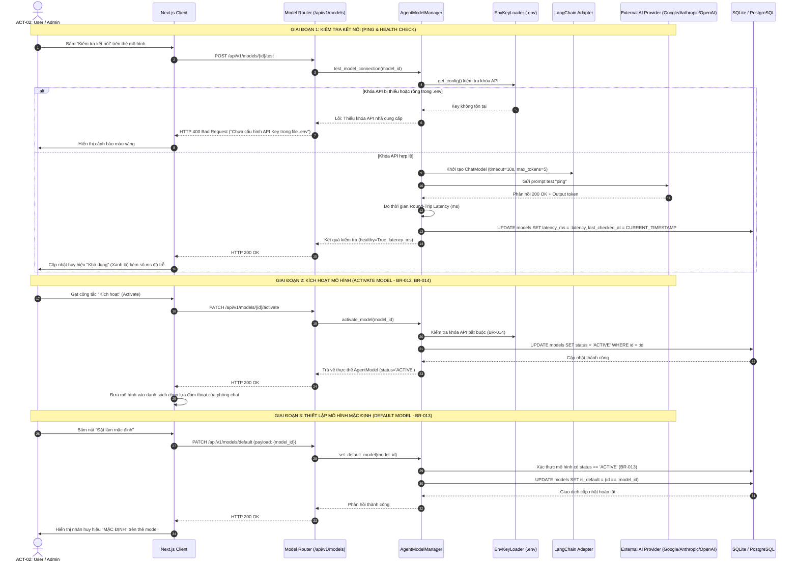

# Sơ Đồ Tuần Tự: Quản Lý & Kích Hoạt Mô Hình Agent Đa Nhà Cung Cấp (Agent Model Management Sequence Diagram)
## Dự Án: Website Chatbot Trợ Lý Ảo (AI-Chan Assistant)

---

| Thông Tin Sơ Đồ | Chi Tiết |
| :--- | :--- |
| **Mã Sơ Đồ** | `DIAG-SEQ-005` |
| **Mã Kịch Bản** | `SEQ-005` |
| **Nguồn Sự Thật Thượng Nguồn** | [docs/09-behavior/sequence-diagrams.md](file:///c:/Users/sv/Desktop/ai-chan/ai-chan/docs/09-behavior/sequence-diagrams.md), [docs/06-architecture/ADR/ADR-006-multi-provider-agent-management.md](file:///c:/Users/sv/Desktop/ai-chan/ai-chan/docs/06-architecture/ADR/ADR-006-multi-provider-agent-management.md) |
| **Mục Đích** | Biểu diễn luồng tương tác thực tế giữa Người dùng, Next.js Client, FastAPI Backend, Agent Model Manager, LangChain Adapter và các nhà cung cấp AI khi kiểm tra ping, kích hoạt mô hình (không xóa cứng) và thiết lập mô hình mặc định |

---

## 1. SEQ-005: Quy Trình Kiểm Tra Kết Nối, Kích Hoạt & Cấu Hình Mặc Định Model

---

## 2. Ghi Chú Ràng Buộc Kỹ Thuật
1. **Chính Sách Bất Biến Không Xóa Cứng (`BR-012`)**: Không tồn tại thao tác `DELETE /api/v1/models/{id}`. Toàn bộ chu trình loại bỏ khỏi giao diện được thực thi qua `PATCH /api/v1/models/{id}/deactivate` (Soft State Toggle).
2. **Bảo Vệ Mô Hình Mặc Định (`BR-013`)**: Nếu người dùng cố tình `deactivate` mô hình mang cờ `is_default = true`, hệ thống ném ngoại lệ `HTTP 400 Bad Request` yêu cầu chỉ định mô hình thay thế trước.
