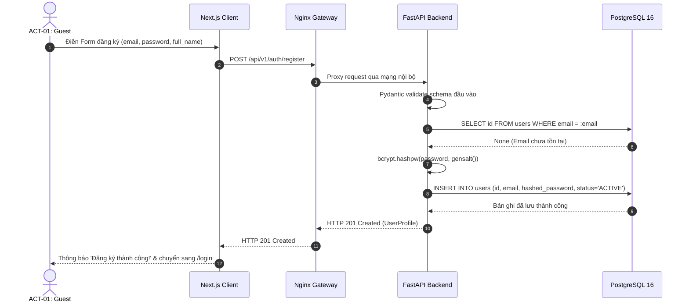
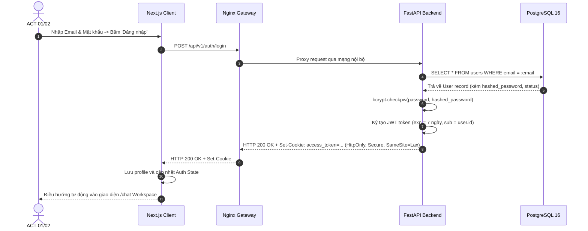

# Sơ Đồ Tuần Tự: Xác Thực & Khởi Tạo Phiên (Authentication Sequence Diagrams)
## Dự Án: Website Chatbot Trợ Lý Ảo (AI-Chan Assistant)

---

| Thông Tin Sơ Đồ | Chi Tiết |
| :--- | :--- |
| **Mã Sơ Đồ** | `DIAG-SEQ-001` |
| **Mã Kịch Bản** | `SEQ-001`, `SEQ-002` |
| **Nguồn Sự Thật Thượng Nguồn** | [docs/09-behavior/sequence-diagrams.md](file:///c:/Users/PC/Project/ai-chan/docs/09-behavior/sequence-diagrams.md), [docs/06-architecture/ADR/ADR-002-httponly-cookie-jwt.md](file:///c:/Users/PC/Project/ai-chan/docs/06-architecture/ADR/ADR-002-httponly-cookie-jwt.md) |
| **Mục Đích** | Mô tả chi tiết trình tự trao đổi thông điệp mạng giữa Client, Ingress Nginx, Backend FastAPI và PostgreSQL trong quá trình đăng ký và đăng nhập |

---

## 1. SEQ-001: Trình Tự Đăng Ký Tài Khoản & Băm Mật Khẩu

---

## 2. SEQ-002: Trình Tự Đăng Nhập & Cấp Phát HttpOnly Cookie

