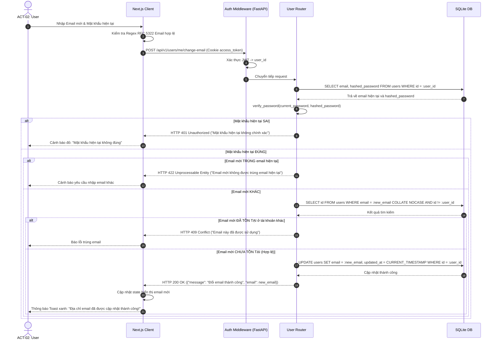

# Sơ Đồ Tuần Tự: Thay Đổi Địa Chỉ Email An Toàn (Secure Email Change Sequence)
## Dự Án: Website Chatbot Trợ Lý Ảo (AI-Chan Assistant)

---

| Thông Tin Sơ Đồ | Chi Tiết |
| :--- | :--- |
| **Mã Sơ Đồ** | `DIAG-SEQ-005` |
| **Mã Kịch Bản** | `SEQ-005` |
| **Nguồn Sự Thật Thượng Nguồn** | [docs/09-behavior/sequence-diagrams.md](file:///c:/Users/PC/Project/ai-chan/docs/09-behavior/sequence-diagrams.md), [docs/02-requirements/functional-requirements.md](file:///c:/Users/PC/Project/ai-chan/docs/02-requirements/functional-requirements.md) (`FR-018`), [docs/02-requirements/business-rules.md](file:///c:/Users/PC/Project/ai-chan/docs/02-requirements/business-rules.md) (`BR-008`, `BR-010`) |
| **Mục Đích** | Mô tả trình tự đổi địa chỉ email đăng nhập với kiểm tra mật khẩu hiện tại và kiểm tra trùng lặp email duy nhất |

---

## 1. Biểu Đồ Tuần Tự SEQ-005: Đổi Email An Toàn

---

## 2. Thuyết Minh Ràng Buộc An Ninh

- **Kiểm soát tính toàn vẹn (Bước 15 - 19)**: Truy vấn `COLLATE NOCASE` đảm bảo không có hai tài khoản trùng email dù viết hoa hay viết thường (ví dụ: `User@example.com` và `user@example.com`).
- **Phòng chống tấn công chiếm đoạt (Bước 7 - 10)**: Bắt buộc `current_password` bảo vệ chủ sở hữu nếu bị kẻ gian thao tác lén trên máy tính (`SEC-006`).
