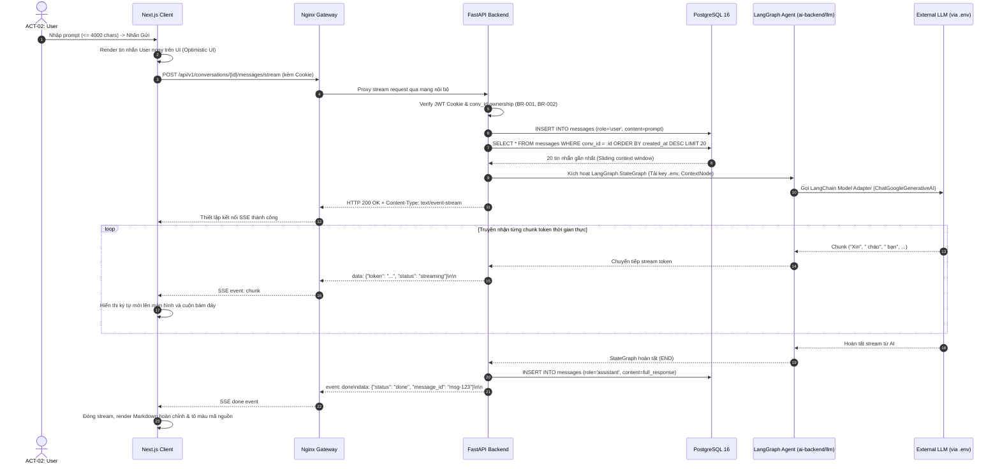

# Sơ Đồ Tuần Tự: Truyền Luồng Chat Thời Gian Thực (Streaming Chat Sequence Diagram)
## Dự Án: Website Chatbot Trợ Lý Ảo (AI-Chan Assistant)

---

| Thông Tin Sơ Đồ | Chi Tiết |
| :--- | :--- |
| **Mã Sơ Đồ** | `DIAG-SEQ-002` |
| **Mã Kịch Bản** | `SEQ-003` |
| **Nguồn Sự Thật Thượng Nguồn** | [docs/09-behavior/sequence-diagrams.md](file:///c:/Users/PC/Project/ai-chan/docs/09-behavior/sequence-diagrams.md), [docs/06-architecture/ADR/ADR-004-sse-streaming-protocol.md](file:///c:/Users/PC/Project/ai-chan/docs/06-architecture/ADR/ADR-004-sse-streaming-protocol.md) |
| **Mục Đích** | Mô tả chi tiết trình tự mở kết nối Server-Sent Events, truyền nhận từng chunk token, và hoàn tất lưu trữ phản hồi |

---

## 1. SEQ-003: Trình Tự Gửi Tin Nhắn & Stream SSE

