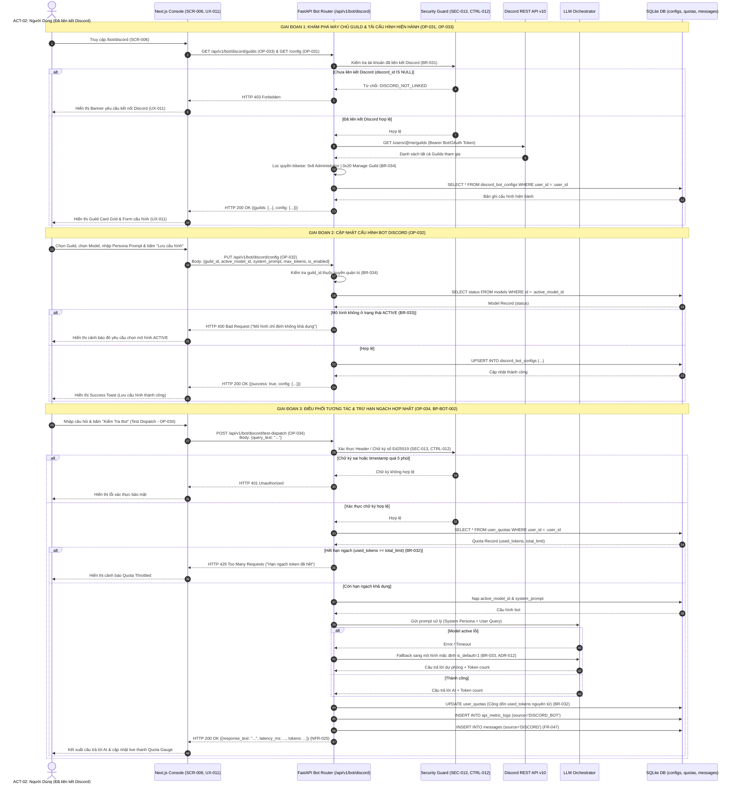

# Sơ Đồ Tuần Tự: Quản Lý Cấu Hình & Điều Phối Bot Discord (Discord Bot Management Sequence Diagram)
## Dự Án: Website Chatbot Trợ Lý Ảo (AI-Chan Assistant)

---

| Thông Tin Sơ Đồ | Chi Tiết |
| :--- | :--- |
| **Mã Sơ Đồ** | `DIAG-SEQ-011` |
| **Mã Kịch Bản** | `SEQ-011` |
| **Nguồn Sự Thật Thượng Nguồn** | [docs/08-api/api-specifications.md](file:///c:/Users/PC/Project/ai-chan/docs/08-api/api-specifications.md) (`OP-031`..`034`), [docs/06-architecture/ADR/ADR-012-discord-bot-management-and-quota-sharing.md](file:///c:/Users/PC/Project/ai-chan/docs/06-architecture/ADR/ADR-012-discord-bot-management-and-quota-sharing.md), [docs/04-use-cases/specifications/UC-BOT-001-discord-bot-configuration.md](file:///c:/Users/PC/Project/ai-chan/docs/04-use-cases/specifications/UC-BOT-001-discord-bot-configuration.md), [docs/02-requirements/business-rules.md](file:///c:/Users/PC/Project/ai-chan/docs/02-requirements/business-rules.md) (`BR-031`..`034`) |
| **Mục Đích** | Mô tả chi tiết trình tự trao đổi thông điệp mạng giữa Người Dùng, Giao diện Next.js Console, FastAPI Backend Router, Security Guard, Discord API v10, LLM Orchestrator và SQLite Database |

---

## 1. SEQ-011: Trình Tự Khám Phá Máy Chủ, Lưu Cấu Hình & Điều Phối Bot Discord

