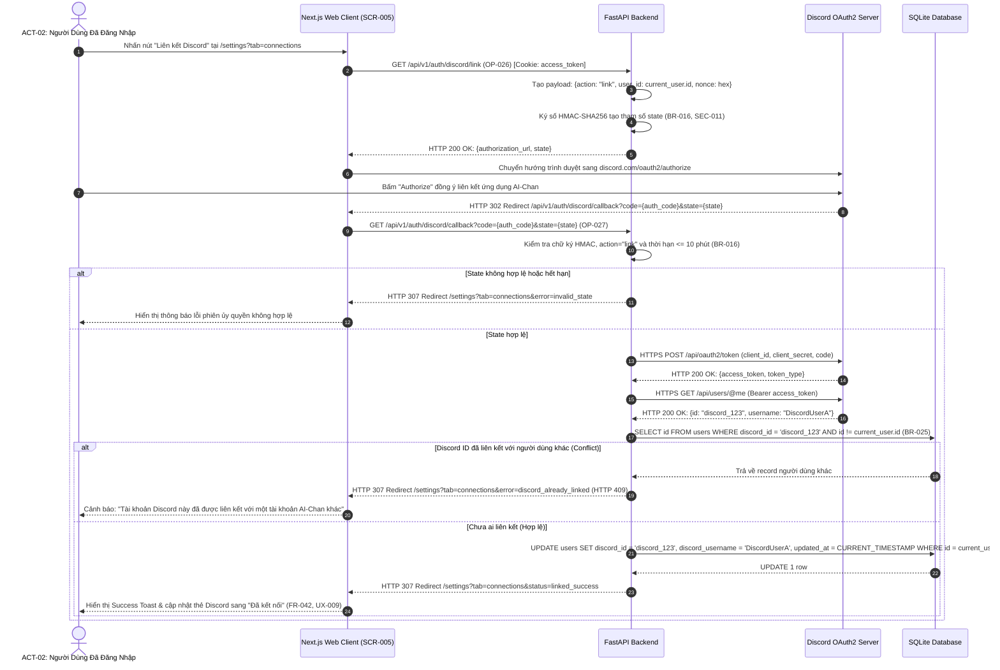
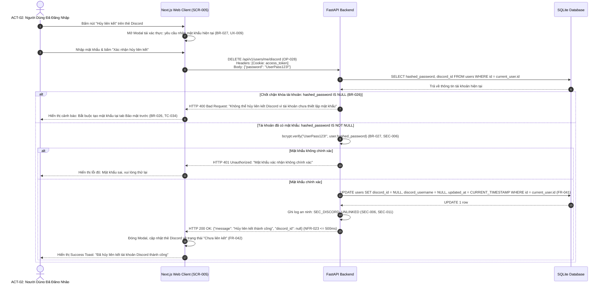

# Sơ Đồ Tuần Tự: Liên Kết & Hủy Liên Kết Tài Khoản Discord (Discord Link & Unlink Sequence Diagram)
## Dự Án: Website Chatbot Trợ Lý Ảo (AI-Chan Assistant)

---

| Thông Tin Sơ Đồ | Chi Tiết |
| :--- | :--- |
| **Mã Sơ Đồ** | `DIAG-SEQ-009` |
| **Mã Kịch Bản** | `SEQ-009` |
| **Nguồn Sự Thật Thượng Nguồn** | [docs/08-api/api-specifications.md](file:///c:/Users/PC/Project/ai-chan/docs/08-api/api-specifications.md) (`OP-026`, `OP-027`, `OP-028`, `OP-029`), [docs/06-architecture/ADR/ADR-010-discord-account-linking-and-unlinking.md](file:///c:/Users/PC/Project/ai-chan/docs/06-architecture/ADR/ADR-010-discord-account-linking-and-unlinking.md), [docs/04-use-cases/specifications/UC-USER-007-link-and-unlink-discord.md](file:///c:/Users/PC/Project/ai-chan/docs/04-use-cases/specifications/UC-USER-007-link-and-unlink-discord.md) |
| **Mục Đích** | Mô tả chi tiết trình tự trao đổi thông điệp mạng giữa Người dùng đã đăng nhập, Next.js Web Client, FastAPI Backend, Máy chủ Discord OAuth2 API và SQLite Database cho cả luồng liên kết và luồng hủy liên kết |

---

## 1. SEQ-009: Trình Tự Liên Kết Tài Khoản Discord Cho Người Dùng Đang Đăng Nhập

---

## 2. SEQ-009 (Phần 2): Trình Tự Hủy Liên Kết Discord Có Chốt Chặn Mật Khẩu An Toàn

