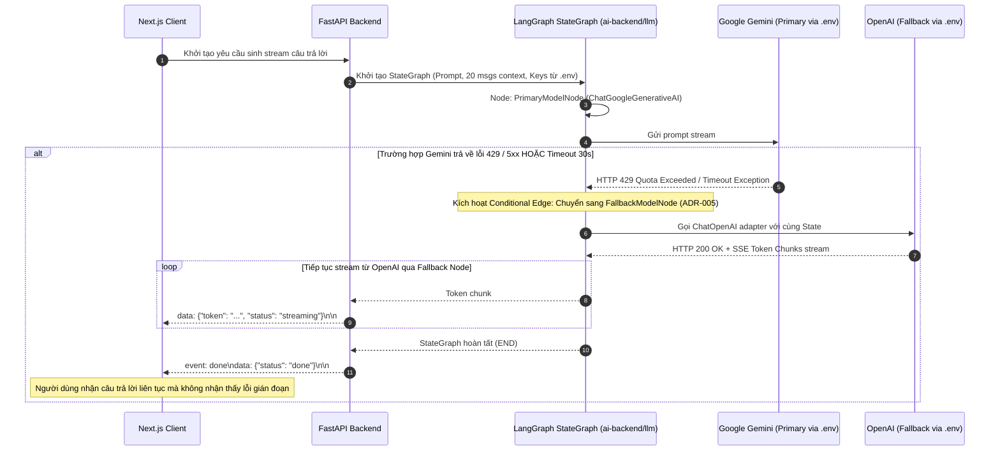

# Sơ Đồ Tuần Tự: Tự Động Chuyển Đổi Dự Phòng LLM (Failover Sequence Diagram)
## Dự Án: Website Chatbot Trợ Lý Ảo (AI-Chan Assistant)

---

| Thông Tin Sơ Đồ | Chi Tiết |
| :--- | :--- |
| **Mã Sơ Đồ** | `DIAG-SEQ-003` |
| **Mã Kịch Bản** | `SEQ-004` |
| **Nguồn Sự Thật Thượng Nguồn** | [docs/09-behavior/sequence-diagrams.md](file:///c:/Users/PC/Project/ai-chan/docs/09-behavior/sequence-diagrams.md), [docs/06-architecture/ADR/ADR-003-multi-provider-llm-failover.md](file:///c:/Users/PC/Project/ai-chan/docs/06-architecture/ADR/ADR-003-multi-provider-llm-failover.md) |
| **Mục Đích** | Mô tả hành vi chuyển đổi dự phòng trong suốt từ Google Gemini sang OpenAI khi gặp lỗi 429 Quota Exceeded hoặc Timeout 30 giây |

---

## 1. SEQ-004: Trình Tự Bắt Ngoại Lệ & Kích Hoạt Dự Phòng (Failover)

