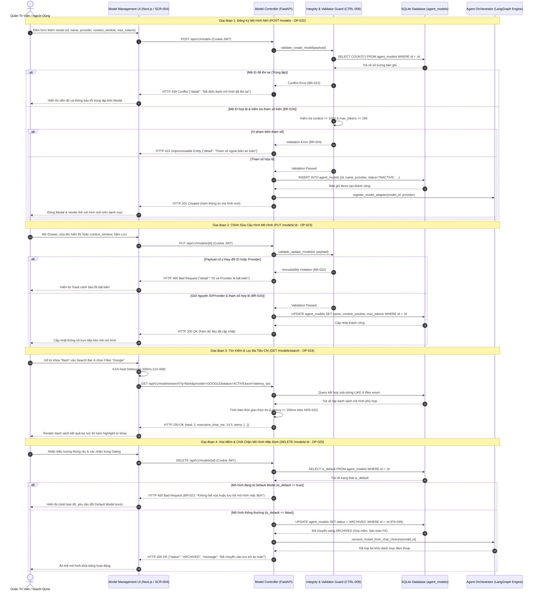

# Sơ Đồ Trình Tự: Quản Trị Đột Biến, Tìm Kiếm & Lưu Trữ Mô Hình (Model Management Sequence)
## Dự Án: Website Chatbot Trợ Lý Ảo (AI-Chan Assistant)

---

| Thông Tin Sơ Đồ | Chi Tiết |
| :--- | :--- |
| **Mã Sơ Đồ** | `DIAG-SEQ-008` |
| **Kịch Bản Tương Tác** | `SEQ-008: Agent Model Management - Registration, Configuration Mutation, Dynamic Filtering and Archival Guard` |
| **Nguồn Sự Thật Thượng Nguồn** | [models/interaction/interactions.yaml](file:///c:/Users/PC/Project/ai-chan/models/interaction/interactions.yaml), [docs/08-api/api-specifications.md](file:///c:/Users/PC/Project/ai-chan/docs/08-api/api-specifications.md) (`OP-022` - `OP-025`), [docs/06-architecture/ADR/ADR-009-extensible-model-management-search-filter.md](file:///c:/Users/PC/Project/ai-chan/docs/06-architecture/ADR/ADR-009-extensible-model-management-search-filter.md) |
| **Mục Đích** | Mô tả chi tiết trình tự tương tác giữa Người dùng, Next.js UI, FastAPI Controller, Integrity Guard, SQLite Database và Agent Router trong toàn bộ các thao tác thêm, sửa, tìm kiếm, lọc và xóa mềm mô hình |

---

## 1. Biểu Đồ Trình Tự SEQ-008: Vòng Đời Đột Biến, Tìm Kiếm & Bảo Vệ Mô Hình Mặc Định

---

## 2. Bảng Phân Tích Các Ranh Giới Kiểm Soát An Ninh & Toàn Vẹn

| Bước Trình Tự | Thao Tác Kiểm Soát | Mã Ràng Buộc | Hành Vi Xử Lý Khi Vi Phạm |
| :---: | :--- | :---: | :--- |
| **3** | Kiểm tra duy nhất toàn cục mã ID mô hình | `BR-022` | Trả về `HTTP 409 Conflict`, ngăn tạo bản ghi trùng lặp |
| **8** | Thẩm định ngưỡng an toàn `context_window` & `max_tokens` | `BR-024` | Trả về `HTTP 422 Unprocessable Entity`, bảo vệ runtime LLM |
| **14** | Chặn đứng hành vi thay đổi `id` hoặc `provider` | `BR-022` | Trả về `HTTP 400 Bad Request`, bảo vệ khóa ngoại bảng `messages` |
| **26** | Cam kết thời gian phản hồi truy vấn tìm kiếm/lọc $\le 200\text{ms}$ | `NFR-022` | Tối ưu hóa chỉ mục SQL và debounce client 300ms (`UX-008`) |
| **33** | Chốt chặn tuyệt đối không cho xóa hoặc lưu trữ mô hình mặc định | `BR-023` | Trả về `HTTP 400 Bad Request`, bảo vệ tính sẵn sàng đàm thoại |
| **36** | Xóa mềm (`status = ARCHIVED`) thay vì xóa cứng vật lý | `BR-012`, `FR-039` | Lưu giữ 100% dữ liệu lịch sử và đo lường liên kết |
