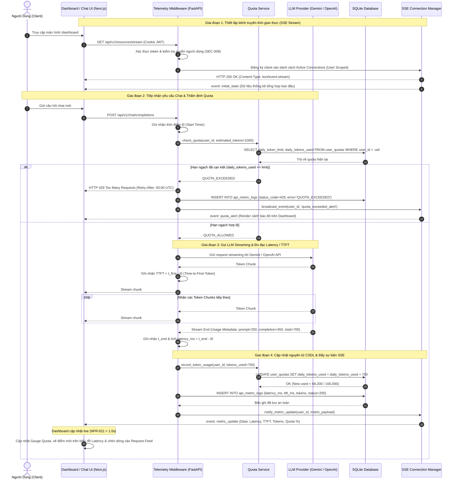

# Sơ Đồ Trình Tự: Thu Thập Telemetry & Phát Luồng Thời Gian Thực (Resource Telemetry Sequence)
## Dự Án: Website Chatbot Trợ Lý Ảo (AI-Chan Assistant)

---

| Thông Tin Sơ Đồ | Chi Tiết |
| :--- | :--- |
| **Mã Sơ Đồ** | `DIAG-SEQ-007` |
| **Kịch Bản Tương Tác** | `SEQ-007: Real-Time Resource Telemetry & SSE Streaming` |
| **Nguồn Sự Thật Thượng Nguồn** | [models/interaction/interactions.yaml](file:///c:/Users/PC/Project/ai-chan/models/interaction/interactions.yaml), [docs/08-api/api-specifications.md](file:///c:/Users/PC/Project/ai-chan/docs/08-api/api-specifications.md) (`OP-018` - `OP-021`), [docs/06-architecture/ADR/ADR-008-resource-telemetry-and-realtime-dashboard.md](file:///c:/Users/PC/Project/ai-chan/docs/06-architecture/ADR/ADR-008-resource-telemetry-and-realtime-dashboard.md) |
| **Mục Đích** | Mô tả chi tiết trình tự thời gian giữa Trình duyệt Web, Telemetry Middleware, Quota Service, LLM Provider, SQLite Database và SSE Connection Manager |

---

## 1. Biểu Đồ Trình Tự SEQ-007: Thu Thập Telemetry & Đẩy Sự Kiện SSE Thời Gian Thực

---

## 2. Bảng Thuyết Minh Thông Điệp Trình Tự (Message Descriptions)

| Bước | Tên Thông Điệp / Tương Tác | Giao Thức / Phương Thức | Mục Đích Kỹ Thuật |
| :--- | :--- | :--- | :--- |
| 2-5 | Khởi tạo SSE Stream | `GET /api/v1/resources/stream` | Thiết lập kết nối streaming HTTP kéo dài giữa Browser và Connection Manager với cơ chế tự động gửi lại (auto-reconnect). |
| 8-11 | Thẩm định Hạn ngạch Quota | Gọi hàm nội bộ & SQL Query | Kiểm tra nghiêm ngặt `BR-020` trước khi chi tiêu tài nguyên máy chủ hoặc phát sinh chi phí gọi dịch vụ LLM. |
| 16-18 | Đo Đạc TTFT | Streaming Chunks | Ghi nhận chính xác mili-giây nhận được token đầu tiên từ LLM để đánh giá hiệu năng mô hình (`FR-029`). |
| 23-25 | Cập Nhật Nguyên Tử & Ghi Log | SQL Transactions | Cập nhật số token đã sử dụng vào `user_quotas` và chèn bản ghi telemetry vào `api_metric_logs` theo `BR-019`. |
| 26-28 | Đẩy Sự Kiện Thời Gian Thực | SSE Event Push | Đẩy tức thì dữ liệu vừa phát sinh lên UI Dashboard trong vòng chưa đầy 1 giây theo `NFR-021`. |
