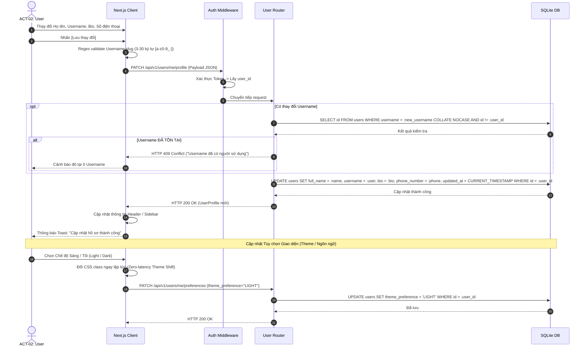

# Sơ Đồ Tuần Tự: Cập Nhật Hồ Sơ & Tùy Chọn Cá Nhân (Profile Update Sequence)
## Dự Án: Website Chatbot Trợ Lý Ảo (AI-Chan Assistant)

---

| Thông Tin Sơ Đồ | Chi Tiết |
| :--- | :--- |
| **Mã Sơ Đồ** | `DIAG-SEQ-006` |
| **Mã Kịch Bản** | `SEQ-006` |
| **Nguồn Sự Thật Thượng Nguồn** | [docs/09-behavior/sequence-diagrams.md](file:///c:/Users/PC/Project/ai-chan/docs/09-behavior/sequence-diagrams.md), [docs/02-requirements/functional-requirements.md](file:///c:/Users/PC/Project/ai-chan/docs/02-requirements/functional-requirements.md) (`FR-016`, `FR-017`, `FR-020`) |
| **Mục Đích** | Mô tả trình tự cập nhật các thông tin cá nhân thường (Họ tên, username slug, bio, avatar và cài đặt theme/language) |

---

## 1. Biểu Đồ Tuần Tự SEQ-006: Cập Nhật Hồ Sơ & Cài Đặt

---

## 2. Thuyết Minh Tương Tác Trực Quan

- **Cải thiện trải nghiệm (Zero-latency UI)**: Khi người dùng đổi theme, giao diện Next.js lập tức kích hoạt hoán đổi theme thông qua CSS class mà không đợi server phản hồi, mang lại cảm giác mượt mà tức thì. Request lên API chạy ngầm để lưu cấu hình bền vững cho các phiên sau.
