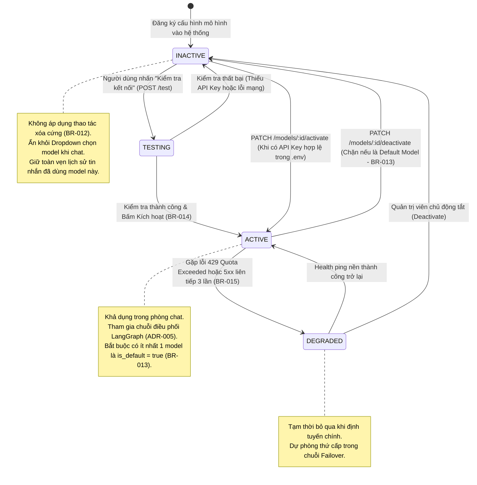

# Sơ Đồ Máy Trạng Thái: Vòng Đời Mô Hình Agent (Agent Model Lifecycle State Machine)
## Dự Án: Website Chatbot Trợ Lý Ảo (AI-Chan Assistant)

---

| Thông Tin Sơ Đồ | Chi Tiết |
| :--- | :--- |
| **Mã Sơ Đồ** | `DIAG-STATE-004` |
| **Mã Trạng Thái** | `STATE-004` |
| **Nguồn Sự Thật Thượng Nguồn** | [docs/09-behavior/state-machines.md](file:///c:/Users/sv/Desktop/ai-chan/ai-chan/docs/09-behavior/state-machines.md), [docs/06-architecture/ADR/ADR-006-multi-provider-agent-management.md](file:///c:/Users/sv/Desktop/ai-chan/ai-chan/docs/06-architecture/ADR/ADR-006-multi-provider-agent-management.md) |
| **Mục Đích** | Mô tả các trạng thái hữu hạn và các biến cố kích hoạt chuyển đổi trạng thái của thực thể AgentModel với quy tắc bất biến không xóa cứng (Soft State) |

---

## 1. STATE-004: Biểu Đồ Trạng Thái Mô Hình Agent

---

## 2. Bảng Thuyết Minh Chuyển Đổi Trạng Thái

| Trạng Thái Nguồn | Biến Cố Kích Hoạt | Trạng Thái Đích | Điều Kiện Nghiệp Vụ / Hành Động Kèm Theo |
| :--- | :--- | :--- | :--- |
| `[*]` | Hệ thống khởi tạo | `INACTIVE` | Nạp metadata từ cấu hình danh mục; trạng thái ban đầu chưa kích hoạt nếu chưa cấu hình key. |
| `INACTIVE` | `POST /test` | `TESTING` | Gửi prompt test tối giản ("ping") tới nhà cung cấp và bấm giờ. |
| `TESTING` | Ping thất bại | `INACTIVE` | Cập nhật lỗi vào log; hiển thị cảnh báo cho người dùng. |
| `TESTING` | Ping thành công | `ACTIVE` | Cập nhật `latency_ms`, `last_checked_at` và kích hoạt model nếu người dùng xác nhận. |
| `INACTIVE` | `PATCH /activate` | `ACTIVE` | Bắt buộc kiểm tra API Key của nhà cung cấp đã có trong `.env` (`BR-014`). |
| `ACTIVE` | `PATCH /deactivate`| `INACTIVE` | Bắt buộc kiểm tra model không phải là mô hình mặc định (`is_default == false`) (`BR-013`). Tuyệt đối không xóa cứng (`BR-012`). |
| `ACTIVE` | 3 lỗi liên tiếp (429/5xx) | `DEGRADED` | Circuit Breaker chuyển trạng thái tạm thời để tránh làm nghẽn luồng người dùng (`BR-015`). |
| `DEGRADED` | Health check thành công | `ACTIVE` | Tự động khôi phục độ ưu tiên định tuyến chính. |
