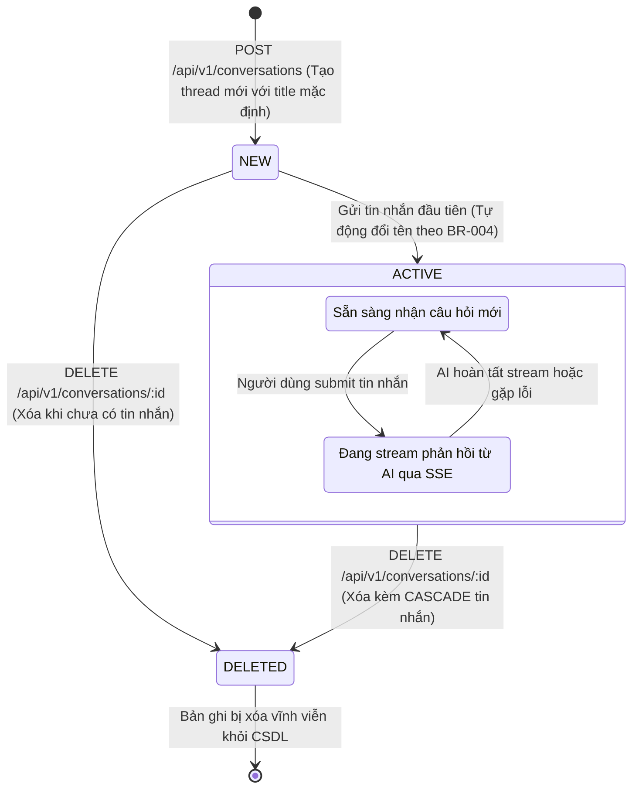

# Sơ Đồ Máy Trạng Thái: Vòng Đời Cuộc Trò Chuyện (Conversation Lifecycle State Machine)
## Dự Án: Website Chatbot Trợ Lý Ảo (AI-Chan Assistant)

---

| Thông Tin Sơ Đồ | Chi Tiết |
| :--- | :--- |
| **Mã Sơ Đồ** | `DIAG-STATE-001` |
| **Mã Trạng Thái** | `STATE-001` |
| **Nguồn Sự Thật Thượng Nguồn** | [docs/09-behavior/state-machines.md](file:///c:/Users/PC/Project/ai-chan/docs/09-behavior/state-machines.md), [docs/07-domain/domain-rules.md](file:///c:/Users/PC/Project/ai-chan/docs/07-domain/domain-rules.md) |
| **Mục Đích** | Mô tả các trạng thái hữu hạn và các biến cố kích hoạt chuyển đổi trạng thái của thực thể Hội thoại (Conversation) |

---

## 1. STATE-001: Biểu Đồ Trạng Thái Cuộc Trò Chuyện

---

## 2. Bảng Thuyết Minh Chuyển Đổi Trạng Thái

| Trạng Thái Đầu | Biến Cố Kích Hoạt (Trigger) | Điều Kiện Ràng Buộc | Trạng Thái Đích | Hành Động Kèm Theo |
| :--- | :--- | :--- | :--- | :--- |
| `[*]` | Người dùng nhấn "+ Cuộc trò chuyện mới" | Đã xác thực JWT Cookie | `NEW` | Tạo bản ghi với tiêu đề "Cuộc trò chuyện mới". |
| `NEW` | Tin nhắn đầu tiên được gửi thành công | Nội dung tin nhắn hợp lệ | `ACTIVE` | Trích xuất 30-40 ký tự đầu làm tiêu đề tự động (`BR-004`). |
| `IDLE` | Người dùng gửi câu hỏi mới | Không đang trong luồng stream | `PROCESSING` | Mở kết nối SSE và khóa nút Gửi. |
| `PROCESSING` | Sự kiện `event: done` hoặc người dùng ấn `Stop` | Stream kết thúc | `IDLE` | Lưu câu trả lời vào DB và mở khóa ô soạn thảo. |
| `ANY` | Gọi `DELETE /api/v1/conversations/:id` | Đúng `user_id` sở hữu (`BR-002`) | `DELETED` | Xóa sạch hội thoại và các tin nhắn con trong DB. |
