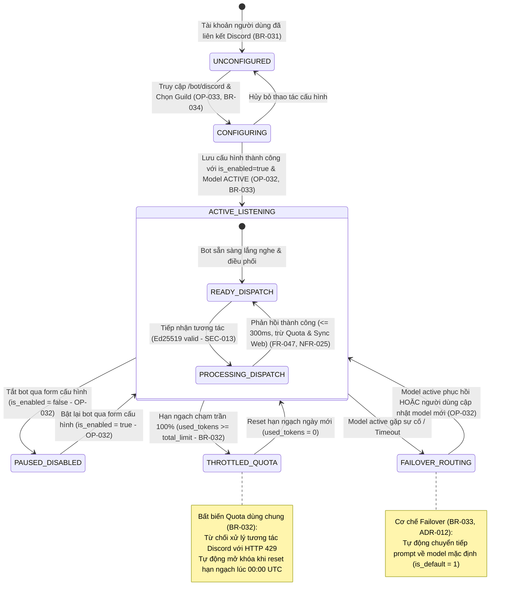

# Sơ Đồ Máy Trạng Thái: Vòng Đời Cấu Hình & Vận Hành Bot Discord (Discord Bot State Machine)
## Dự Án: Website Chatbot Trợ Lý Ảo (AI-Chan Assistant)

---

| Thông Tin Sơ Đồ | Chi Tiết |
| :--- | :--- |
| **Mã Sơ Đồ** | `DIAG-STATE-009` |
| **Mã Trạng Thái** | `STATE-007` |
| **Nguồn Sự Thật Thượng Nguồn** | [docs/09-behavior/state-machines.md](file:///c:/Users/PC/Project/ai-chan/docs/09-behavior/state-machines.md), [docs/07-domain/entities.md](file:///c:/Users/PC/Project/ai-chan/docs/07-domain/entities.md) (`DiscordBotConfig`), [docs/06-architecture/ADR/ADR-012-discord-bot-management-and-quota-sharing.md](file:///c:/Users/PC/Project/ai-chan/docs/06-architecture/ADR/ADR-012-discord-bot-management-and-quota-sharing.md), [docs/02-requirements/business-rules.md](file:///c:/Users/PC/Project/ai-chan/docs/02-requirements/business-rules.md) (`BR-031`..`034`) |
| **Mục Đích** | Mô tả chi tiết vòng đời cấu hình bot, trạng thái sẵn sàng lắng nghe, tạm dừng, khóa hạn ngạch token dùng chung và tự động chuyển vùng dự phòng (Failover) |

---

## 1. STATE-007: Biểu Đồ Trạng Thái Cấu Hình & Vận Hành Bot Discord

---

## 2. Bảng Thuyết Minh Chuyển Đổi Trạng Thái (State Transition Table)

| Trạng Thái Ban Đầu | Biến Cố Kích Hoạt (Event) | Điều Kiện Thẩm Định (Guard) | Trạng Thái Đích | Hành Động Kèm Theo (Action) |
| :--- | :--- | :--- | :--- | :--- |
| `[*]` | Người dùng liên kết Discord | `discord_id IS NOT NULL` (`BR-031`) | `UNCONFIGURED` | Khởi tạo tài khoản đủ điều kiện cấu hình Bot |
| `UNCONFIGURED` | Mở trang `/bot/discord` & Chọn Guild | Người dùng có quyền Admin / Manage Guild (`BR-034`) | `CONFIGURING` | Tải thông tin máy chủ & form cấu hình (`OP-033`) |
| `CONFIGURING` | Nhấn "Lưu cấu hình" | `is_enabled = true` & Model `ACTIVE` (`BR-033`) | `ACTIVE_LISTENING` | UPSERT bản ghi vào `discord_bot_configs` (`OP-032`) |
| `ACTIVE_LISTENING` | Người dùng gạt toggle Tắt | `is_enabled = false` | `PAUSED_DISABLED` | Cập nhật cờ `is_enabled = false` vào DB |
| `PAUSED_DISABLED` | Người dùng gạt toggle Bật | `is_enabled = true` | `ACTIVE_LISTENING` | Cập nhật cờ `is_enabled = true` vào DB |
| `ACTIVE_LISTENING` | Nhận lệnh tương tác Discord | `used_tokens >= total_limit` (`BR-032`) | `THROTTLED_QUOTA` | Trả về `HTTP 429 Too Many Requests` |
| `THROTTLED_QUOTA` | Sang ngày mới (00:00 UTC) | `reset_at <= NOW()` | `ACTIVE_LISTENING` | Thiết lập lại `used_tokens = 0` |
| `ACTIVE_LISTENING` | Gọi LLM Provider thất bại | Model active lỗi hoặc timeout | `FAILOVER_ROUTING` | Tự động chuyển tiếp prompt sang model `is_default = 1` (`BR-033`) |
