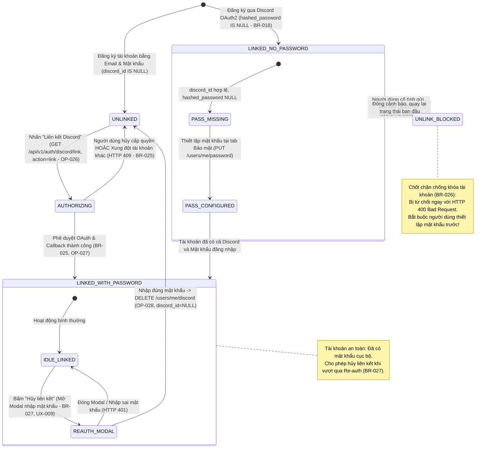

# Sơ Đồ Máy Trạng Thái: Vòng Đời Liên Kết Danh Tính Discord (Discord Identity Linking State Machine)
## Dự Án: Website Chatbot Trợ Lý Ảo (AI-Chan Assistant)

---

| Thông Tin Sơ Đồ | Chi Tiết |
| :--- | :--- |
| **Mã Sơ Đồ** | `DIAG-STATE-007` |
| **Mã Trạng Thái** | `STATE-006` |
| **Nguồn Sự Thật Thượng Nguồn** | [docs/09-behavior/state-machines.md](file:///c:/Users/PC/Project/ai-chan/docs/09-behavior/state-machines.md), [docs/07-domain/entities.md](file:///c:/Users/PC/Project/ai-chan/docs/07-domain/entities.md) (`User`), [docs/06-architecture/ADR/ADR-010-discord-account-linking-and-unlinking.md](file:///c:/Users/PC/Project/ai-chan/docs/06-architecture/ADR/ADR-010-discord-account-linking-and-unlinking.md) |
| **Mục Đích** | Mô tả chi tiết các trạng thái liên kết định danh Discord của tài khoản người dùng, các điều kiện bảo vệ chốt chặn chống mất tài khoản (BR-026) và quy tắc bất biến 1-1 (BR-025) |

---

## 1. STATE-006: Biểu Đồ Trạng Thái Liên Kết Danh Tính Discord

---

## 2. Bảng Thuyết Minh Chuyển Đổi Trạng Thái (State Transition Table)

| Trạng Thái Ban Đầu | Biến Cố Kích Hoạt (Event) | Điều Kiện Thẩm Định (Guard) | Trạng Thái Đích | Hành Động Kèm Theo (Action) |
| :--- | :--- | :--- | :--- | :--- |
| `[*]` | Đăng ký bằng Email | Đăng ký form thành công | `UNLINKED` | Lưu `users` với `discord_id = NULL`. |
| `[*]` | Đăng ký qua Discord | OAuth2 thành công (`CR-004`) | `LINKED_NO_PASSWORD` | Lưu `users` với `discord_id`, `hashed_password = NULL` (`BR-018`). |
| `UNLINKED` | Bấm "Liên kết Discord" | Đang đăng nhập phiên hợp lệ | `AUTHORIZING` | Gọi `GET /auth/discord/link`, sinh state ký HMAC chứa `action=link`. |
| `AUTHORIZING` | Callback OAuth hoàn tất | `discord_id` chưa bị trùng (`BR-025`) | `LINKED_WITH_PASSWORD` | Gán `discord_id`, `discord_username`, redirect về Settings kèm Toast thành công. |
| `AUTHORIZING` | Callback OAuth phát hiện trùng | `discord_id` đã thuộc user khác | `UNLINKED` | Từ chối với HTTP 409 Conflict, hủy giao dịch (`BR-025`). |
| `LINKED_NO_PASSWORD` | Tạo mật khẩu tại Bảo mật | Mật khẩu hợp lệ theo `BR-009` | `LINKED_WITH_PASSWORD` | Băm bcrypt, cập nhật `hashed_password`, mở khóa khả năng hủy liên kết. |
| `LINKED_NO_PASSWORD` | Bấm "Hủy liên kết" | `hashed_password IS NULL` | `UNLINK_BLOCKED` | Chặn đứng với HTTP 400 Bad Request theo Chốt Chặn Khóa Tài Khoản (`BR-026`). |
| `LINKED_WITH_PASSWORD` | Bấm "Hủy liên kết" | Nhấn nút trên UI | `REAUTH_MODAL` | Mở Modal yêu cầu nhập mật khẩu xác nhận (`BR-027`, `UX-009`). |
| `REAUTH_MODAL` | Xác nhận mật khẩu | Mật khẩu khớp bcrypt hash | `UNLINKED` | Gán `discord_id = NULL`, `discord_username = NULL`, ghi log an ninh (`FR-041`). |
| `REAUTH_MODAL` | Nhập sai mật khẩu | Mật khẩu không khớp hash | `IDLE_LINKED` | Báo lỗi HTTP 401 Unauthorized, rung lắc ô nhập liệu. |
