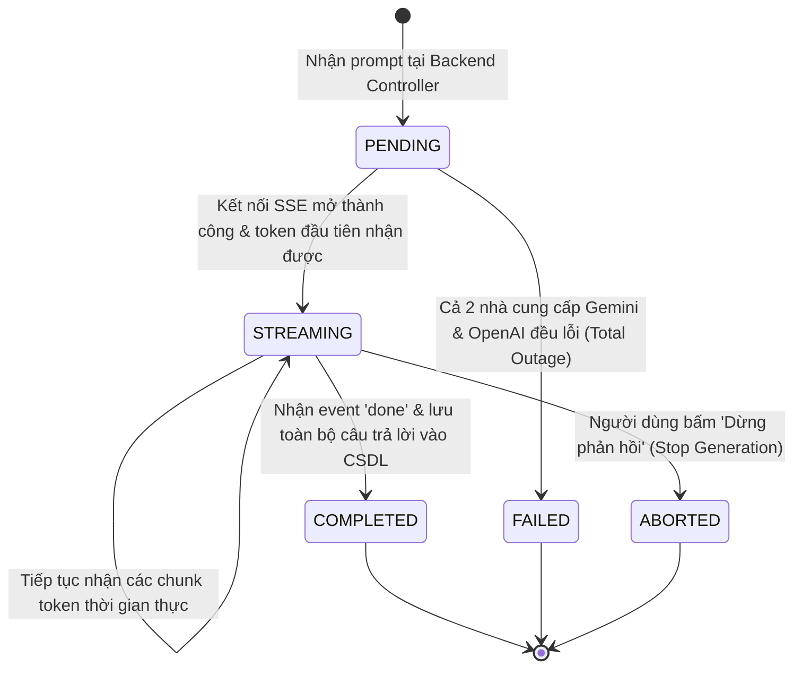

# Sơ Đồ Máy Trạng Thái: Vòng Đời Tin Nhắn Đàm Thoại (Message Delivery State Machine)
## Dự Án: Website Chatbot Trợ Lý Ảo (AI-Chan Assistant)

---

| Thông Tin Sơ Đồ | Chi Tiết |
| :--- | :--- |
| **Mã Sơ Đồ** | `DIAG-STATE-002` |
| **Mã Trạng Thái** | `STATE-002` |
| **Nguồn Sự Thật Thượng Nguồn** | [docs/09-behavior/state-machines.md](file:///c:/Users/PC/Project/ai-chan/docs/09-behavior/state-machines.md), [docs/07-domain/domain-rules.md](file:///c:/Users/PC/Project/ai-chan/docs/07-domain/domain-rules.md) |
| **Mục Đích** | Mô tả trạng thái của tin nhắn phản hồi từ AI trong quá trình kết nối, nhận stream token, hủy luồng hoặc hoàn tất |

---

## 1. STATE-002: Biểu Đồ Trạng Thái Tin Nhắn Đàm Thoại

---

## 2. Thuyết Minh Trạng Thái Kết Thúc

- **`COMPLETED`**: Phản hồi được sinh trọn vẹn, đã ghi nhận bản ghi đầy đủ vào bảng `messages` trong CSDL với vai trò `assistant`.
- **`ABORTED`**: Người dùng chủ động dừng sinh qua nút Stop (`UX-003`). Backend dừng Generator và lưu phần nội dung đã sinh được cho tới lúc dừng vào CSDL.
- **`FAILED`**: Xảy ra khi cả 2 nhà cung cấp AI đều không phản hồi; hiển thị thông báo lỗi và không làm hỏng dữ liệu lịch sử hội thoại.
