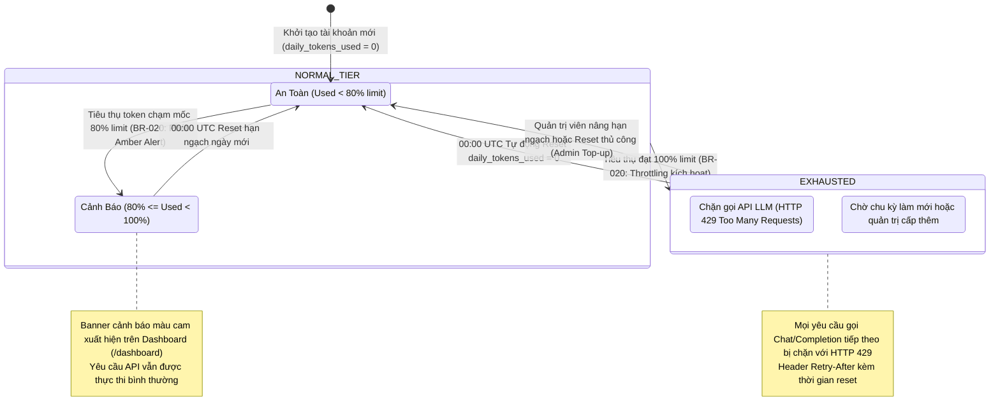

# Sơ Đồ Máy Trạng Thái: Vòng Đời Hạn Ngạch Quota (Quota Lifecycle State Machine)
## Dự Án: Website Chatbot Trợ Lý Ảo (AI-Chan Assistant)

---

| Thông Tin Sơ Đồ | Chi Tiết |
| :--- | :--- |
| **Mã Sơ Đồ** | `DIAG-STATE-005` |
| **Mã Trạng Thái** | `STATE-005` |
| **Nguồn Sự Thật Thượng Nguồn** | [docs/09-behavior/state-machines.md](file:///c:/Users/PC/Project/ai-chan/docs/09-behavior/state-machines.md), [docs/07-domain/entities.md](file:///c:/Users/PC/Project/ai-chan/docs/07-domain/entities.md) (`UserQuota`), [docs/02-requirements/business-rules.md](file:///c:/Users/PC/Project/ai-chan/docs/02-requirements/business-rules.md) (`BR-020`) |
| **Mục Đích** | Mô tả các trạng thái định mức và các biến cố chuyển đổi hạn ngạch tiêu thụ token hàng ngày của người dùng, từ ngưỡng an toàn, ngưỡng cảnh báo 80% tới trạng thái chặn 100% (HTTP 429) |

---

## 1. STATE-005: Biểu Đồ Trạng Thái Hạn Ngạch Quota Người Dùng

---

## 2. Bảng Thuyết Minh Chuyển Đổi Trạng Thái Hạn Ngạch (State Transition Table)

| Trạng Thái Ban Đầu | Biến Cố Kích Hoạt (Event) | Điều Kiện Thẩm Định (Guard) | Trạng Thái Đích | Hành Động Kèm Theo (Action) |
| :--- | :--- | :--- | :--- | :--- |
| `[*]` | Người dùng đăng ký tài khoản thành công | Tài khoản mới được kích hoạt | `COMFORTABLE` | Tạo bản ghi `user_quotas` mặc định (`daily_token_limit = 100,000`, `daily_tokens_used = 0`). |
| `COMFORTABLE` | Hoàn thành yêu cầu Chat AI | `daily_tokens_used >= 80% * daily_token_limit` | `WARNING_80` | Đánh dấu cảnh báo, phát sự kiện SSE hiển thị banner màu cam trên Dashboard. |
| `WARNING_80` | Hoàn thành yêu cầu Chat AI | `daily_tokens_used >= daily_token_limit` | `EXHAUSTED` | Chuyển trạng thái sang cạn kiệt, chặn mọi yêu cầu LLM tiếp theo với `HTTP 429`. |
| `EXHAUSTED` | Người dùng tiếp tục gửi yêu cầu | `daily_tokens_used >= daily_token_limit` | `EXHAUSTED` | Từ chối ngay tại Middleware/Controller, trả về `HTTP 429 Too Many Requests`. |
| `WARNING_80` / `EXHAUSTED` | Chạm mốc 00:00 UTC hàng ngày | `now() >= reset_at` | `COMFORTABLE` | Chạy Scheduled Task nền đặt lại `daily_tokens_used = 0`, khôi phục quyền truy cập đầy đủ. |
| `EXHAUSTED` | Quản trị viên can thiệp | `Admin cập nhật daily_token_limit` | `COMFORTABLE` | Cập nhật `daily_token_limit` lớn hơn, khôi phục trạng thái hoạt động ngay lập tức. |
