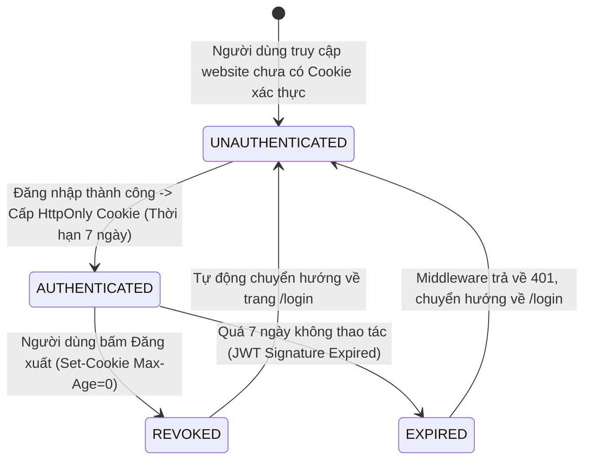

# Sơ Đồ Máy Trạng Thái: Vòng Đời Phiên Người Dùng (Session Lifecycle State Machine)
## Dự Án: Website Chatbot Trợ Lý Ảo (AI-Chan Assistant)

---

| Thông Tin Sơ Đồ | Chi Tiết |
| :--- | :--- |
| **Mã Sơ Đồ** | `DIAG-STATE-003` |
| **Mã Trạng Thái** | `STATE-003` |
| **Nguồn Sự Thật Thượng Nguồn** | [docs/09-behavior/state-machines.md](file:///c:/Users/PC/Project/ai-chan/docs/09-behavior/state-machines.md), [docs/06-architecture/ADR/ADR-002-httponly-cookie-jwt.md](file:///c:/Users/PC/Project/ai-chan/docs/06-architecture/ADR/ADR-002-httponly-cookie-jwt.md) |
| **Mục Đích** | Mô tả trạng thái phiên làm việc của người dùng từ lúc chưa đăng nhập đến khi được cấp Cookie, thu hồi khi đăng xuất hoặc hết hạn |

---

## 1. STATE-003: Biểu Đồ Trạng Thái Phiên Làm Việc

---

## 2. Thuyết Minh Ràng Buộc An Ninh

- **Bất biến**: Không bao giờ tồn tại trạng thái nửa vời (Partial Auth). Một request chỉ hợp lệ khi giải mã được JWT token hợp lệ trong HttpOnly Cookie.
- **Idempotent Logout**: Khi người dùng gọi API `/auth/logout`, dù Cookie đã hết hạn hay không tồn tại, máy chủ vẫn gửi tiêu đề xóa Cookie để đưa trạng thái về `UNAUTHENTICATED`.
