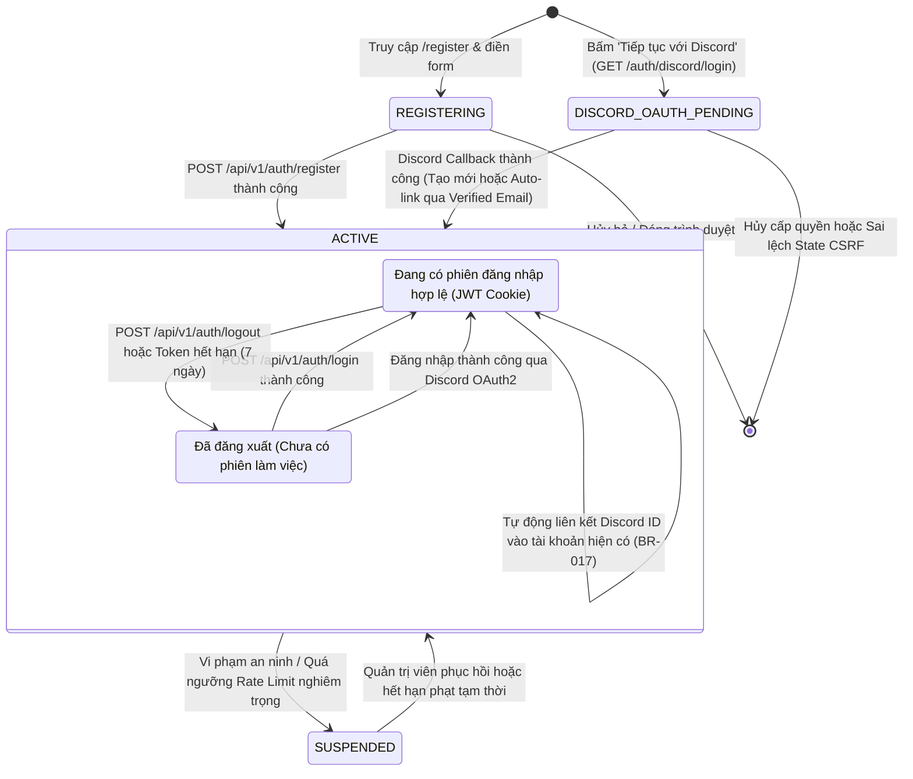

# Sơ Đồ Máy Trạng Thái: Vòng Đời Tài Khoản Người Dùng (User Account Lifecycle State Machine)
## Dự Án: Website Chatbot Trợ Lý Ảo (AI-Chan Assistant)

---

| Thông Tin Sơ Đồ | Chi Tiết |
| :--- | :--- |
| **Mã Sơ Đồ** | `DIAG-STATE-004` |
| **Mã Trạng Thái** | `STATE-004` |
| **Nguồn Sự Thật Thượng Nguồn** | [docs/09-behavior/state-machines.md](file:///c:/Users/PC/Project/ai-chan/docs/09-behavior/state-machines.md), [docs/07-domain/entities.md](file:///c:/Users/PC/Project/ai-chan/docs/07-domain/entities.md) (`User`) |
| **Mục Đích** | Mô tả các trạng thái hữu hạn và các biến cố kích hoạt chuyển đổi trạng thái của tài khoản người dùng từ lúc khởi tạo và trong suốt quá trình hoạt động |

---

## 1. STATE-004: Biểu Đồ Trạng Thái Tài Khoản Người Dùng

---

## 2. Bảng Thuyết Minh Chuyển Đổi Trạng Thái (State Transition Table)

| Trạng Thái Ban Đầu | Biến Cố Kích Hoạt (Event) | Điều Kiện Thẩm Định (Guard) | Trạng Thái Đích | Hành Động Kèm Theo (Action) |
| :--- | :--- | :--- | :--- | :--- |
| `[*]` | Khách đăng ký tài khoản | Email hợp lệ, mật khẩu đủ mạnh | `ACTIVE` | Băm bcrypt, lưu bản ghi `users`, chuyển hướng sang `/login`. |
| `[*]` | Khách đăng ký qua Discord | State hợp lệ, Email Discord verified (`BR-017`) | `ACTIVE` | Tạo User mới (`discord_id`, `password=NULL`, `BR-018`), cấp JWT Cookie, vào `/chat`. |
| `LOGGED_OUT` | Đăng nhập tài khoản truyền thống | Đúng Email & Mật khẩu, status = ACTIVE | `LOGGED_IN` | Cấp phát JWT HttpOnly Cookie, cập nhật `last_login_at`. |
| `LOGGED_OUT` | Đăng nhập qua Discord | State hợp lệ, đã có discord_id hoặc email khớp verified | `LOGGED_IN` | Cập nhật `last_login_at` / liên kết tài khoản, cấp JWT Cookie, vào `/chat`. |
| `LOGGED_IN` | Người dùng đổi mật khẩu | Nhập đúng mật khẩu cũ, mật khẩu mới đạt chuẩn | `LOGGED_IN` | Băm mật khẩu mới, cập nhật `password_changed_at`, thu hồi token cũ. |
| `LOGGED_IN` | Người dùng đăng xuất | Nhấn "Đăng xuất" | `LOGGED_OUT` | Thu hồi Cookie bằng cách gửi `Max-Age=0`. |
| `ACTIVE` | Vi phạm an ninh hệ thống | Vượt ngưỡng rate limit nghiêm trọng / Quản trị viên khóa | `SUSPENDED` | Đánh dấu tài khoản tạm ngưng, chặn quyền truy cập API. |

