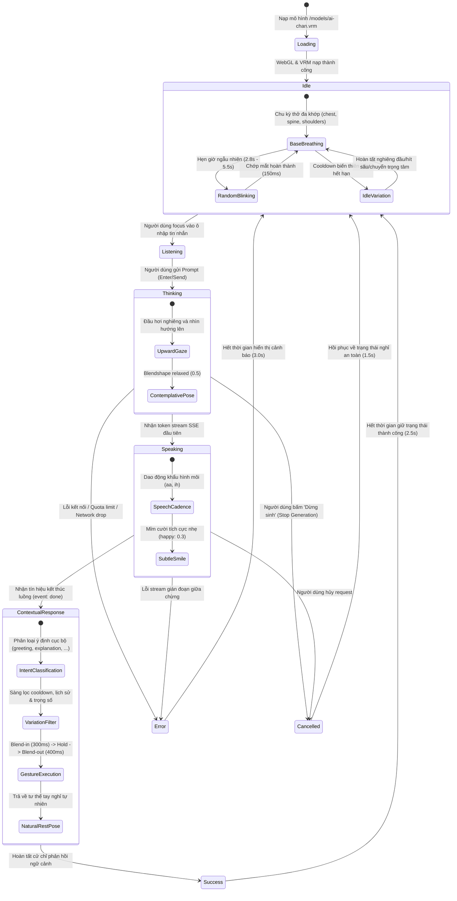

# Biểu Đồ Trạng Thái Hoạt Họa 3D VRM Avatar (STATE-003)

## 1. Định Danh & Mô Tả
- **Mã Trạng Thái**: `STATE-003`
- **Tên Phân Hệ**: VRM Companion Animation & Behavioral Choreography Lifecycle
- **Yêu Cầu Truy Vết**: `FR-049`, `FR-050`, `FR-053`, `FR-054`, `FR-055`, `FR-056`, `BR-035`

---

## 2. Biểu Đồ Trạng Thái (Mermaid State Diagram)

---

## 3. Bảng Chuyển Trạng Thái (State Transition Table)

| Trạng Thái Hiện Tại | Sự Kiện Kích Hoạt | Trạng Thái Đích | Hành Vi Mô Hình 3D (Blendshapes, Bones & Choreography) |
| :--- | :--- | :--- | :--- |
| `loading` | Nạp file `.vrm` qua WebGL | `idle` | Khởi tạo Humanoid rig, áp dụng Resting Arm Pose (`z = ±1.22`). |
| `idle` | Chu kỳ thời gian rảnh | `idle` | Thở đa khớp (`chest`, `spine`), chớp mắt ngẫu nhiên (`blink`), biến thiên idle (`curious_tilt`, `deep_breath`). |
| `idle` | Người dùng focus soạn thảo | `listening` | Đầu và ánh mắt hướng về phía camera (`lookAt`), biểu cảm chú ý nhẹ (`neutral`: 0.6, `relaxed`: 0.35). |
| `listening` | Nhấn gửi prompt | `thinking` | Chuyển điểm nhìn lên trên, đầu hơi nghiêng (`head.z += 0.06`), biểu cảm thư thái (`relaxed`: 0.5). |
| `thinking` | Nhận token stream SSE | `speaking` | Khẩu hình môi mở/đóng liên tục (`aa`, `ih`), nụ cười nhẹ (`happy`: 0.3). Không kích hoạt cử chỉ tay lớn. |
| `speaking` | Nhận `event: done` | `success` | Phân loại ý định, chọn cử chỉ không lặp, blend-in cử chỉ (300ms), giữ, blend-out (400ms) trả về Resting Pose. |
| `thinking`/`speaking` | Người dùng nhấn Dừng | `cancelled` | Hủy cử chỉ đang diễn ra ngay lập tức, trả về biểu cảm trung tính (`neutral`: 0.9), phục hồi idle sau 1.5s. |
| `thinking`/`speaking` | Lỗi API / Network | `error` | Biểu cảm lo âu/bất ngờ (`sad`: 0.6, `surprised`: 0.3), đầu hơi cúi, duy trì 3.0s trước khi về idle. |
| `success`/`error`/`cancelled` | Timeout hoàn tất | `idle` | Trở về tư thế nghỉ tự nhiên và biểu cảm trung tính (`neutral`: 0.8). |
