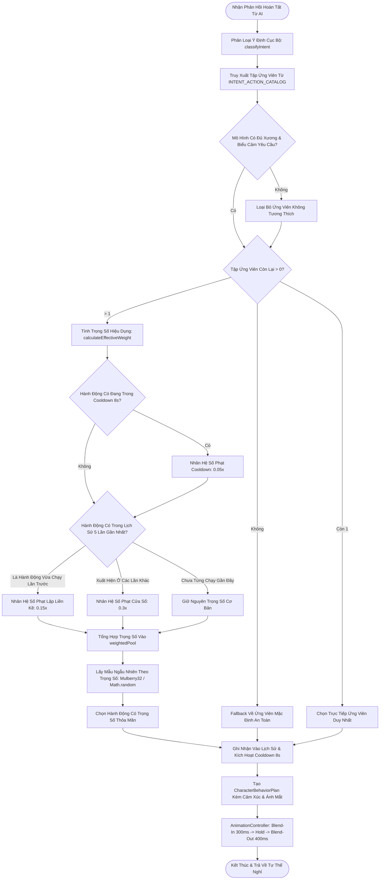

# Lưu Đồ Thuật Toán Lựa Chọn Hành Động & Chống Lặp Cử Chỉ VRM

## 1. Định Danh & Mô Tả
- **Mã Sơ Đồ**: `DIAG-ACT-VAR-001`
- **Tên Phân Hệ**: VRM Non-Repetitive Action Variation Engine
- **Yêu Cầu Truy Vết**: `FR-055`, `FR-056`, `ADR-013`

---

## 2. Lưu Đồ Lựa Chọn Hành Động (Mermaid Flowchart)

---

## 3. Quy Tắc & Tham Số Cốt Lõi (Core Parameters)

| Tham Số | Giá Trị Mặc Định | Mục Đích |
| :--- | :--- | :--- |
| `historySize` | 5 | Kích thước bộ đệm lịch sử theo dõi các cử chỉ vừa kích hoạt. |
| `repeatCooldownMs` | 8.000 ms | Thời gian hồi chiêu tối thiểu trước khi một hành động được coi là sẵn sàng 100%. |
| `repeatPenaltyFactor` | 0.30 | Hệ số chiết khấu trọng số khi hành động nằm trong cửa sổ lịch sử. |
| `immediatePredecessorFactor`| 0.15 | Hệ số chiết khấu bổ sung cho hành động vừa thực thi ở ngay lượt trước. |
| `cooldownPenaltyFactor` | 0.05 | Hệ số ép giảm trọng số nếu hành động vẫn đang trong thời gian hồi chiêu. |
| `blendInMs` | 300 ms | Thời gian làm mềm mở đầu cử chỉ (smooth sine easing). |
| `blendOutMs` | 400 ms | Thời gian làm mềm kết thúc cử chỉ trả về tư thế nghỉ tự nhiên. |
