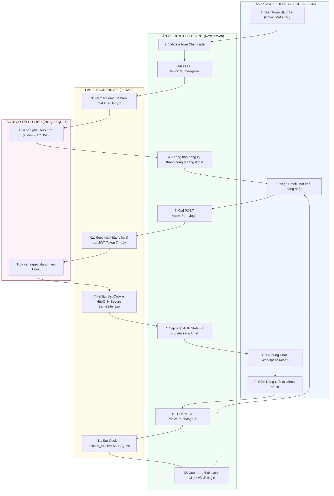

# Sơ Đồ Swimlane: Quy Trình Xác Thực & Quản Lý Phiên (Authentication Swimlane)
## Dự Án: Website Chatbot Trợ Lý Ảo (AI-Chan Assistant)

---

| Thông Tin Sơ Đồ | Chi Tiết |
| :--- | :--- |
| **Mã Sơ Đồ** | `DIAG-SWIM-001` |
| **Quy Trình Nghiệp Vụ** | `BP-AUTH-001 [PROC-001]`, `BP-AUTH-002 [PROC-002]`, `BP-AUTH-003 [PROC-003]` |
| **Nguồn Sự Thật Thượng Nguồn** | [docs/03-business-process/actor-interactions.md](file:///c:/Users/PC/Project/ai-chan/docs/03-business-process/actor-interactions.md), [docs/06-architecture/ADR/ADR-002-httponly-cookie-jwt.md](file:///c:/Users/PC/Project/ai-chan/docs/06-architecture/ADR/ADR-002-httponly-cookie-jwt.md) |
| **Mục Đích** | Phân định trách nhiệm đa làn (Multi-Lane) giữa Người dùng, Giao diện Client, Ingress Gateway, Backend API và Cơ sở dữ liệu |

---

## 1. Biểu Đồ Swimlane Xác Thực Người Dùng

---

## 2. Phân Định Trách Nhiệm Từng Làn (Lane Responsibility Matrix)

- **Làn Người dùng**: Cung cấp thông tin xác thực, kích hoạt các sự kiện tương tác.
- **Làn Frontend**: Kiểm tra form hợp lệ, duy trì trạng thái đăng nhập trong ứng dụng, điều hướng trang.
- **Làn Backend**: Thực hiện băm mật khẩu, sinh và giải mã JWT token, kiểm soát Cookie bảo mật.
- **Làn Cơ sở dữ liệu**: Đảm bảo tính toàn vẹn dữ liệu (duy nhất của email) và lưu trữ bền vững.
