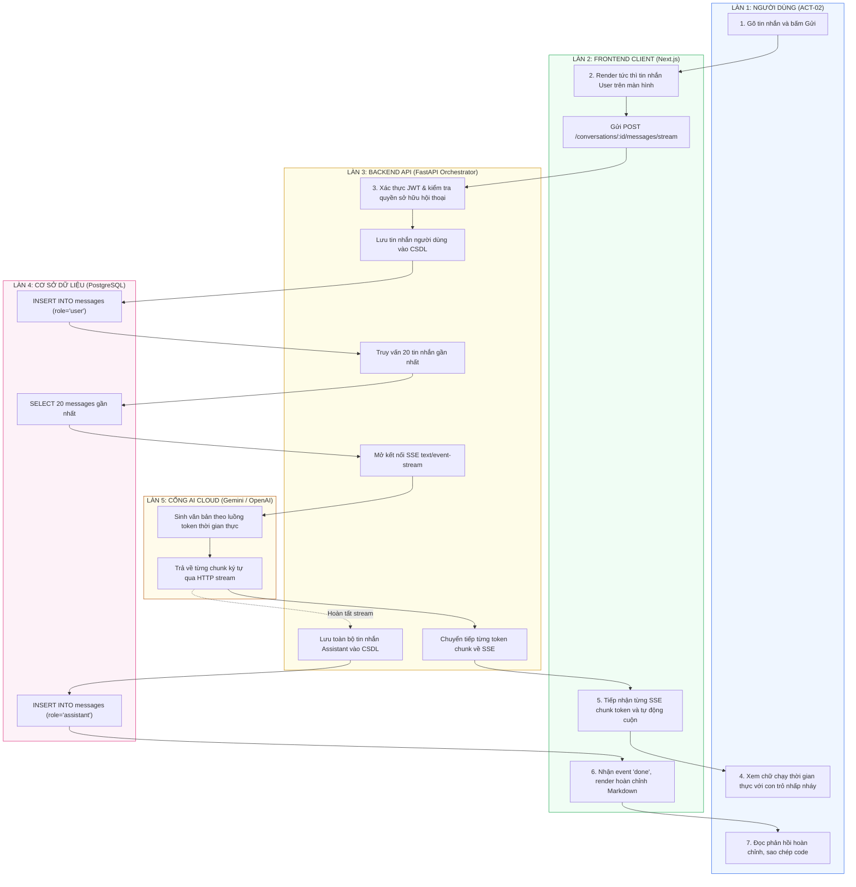

# Sơ Đồ Swimlane: Quy Trình Truyền Luồng Chat Thời Gian Thực (Streaming Chat Swimlane)
## Dự Án: Website Chatbot Trợ Lý Ảo (AI-Chan Assistant)

---

| Thông Tin Sơ Đồ | Chi Tiết |
| :--- | :--- |
| **Mã Sơ Đồ** | `DIAG-SWIM-002` |
| **Quy Trình Nghiệp Vụ** | `BP-CHAT-001 [PROC-008]`, `BP-AI-001 [PROC-009]` |
| **Nguồn Sự Thật Thượng Nguồn** | [docs/03-business-process/actor-interactions.md](file:///c:/Users/PC/Project/ai-chan/docs/03-business-process/actor-interactions.md), [docs/06-architecture/ADR/ADR-004-sse-streaming-protocol.md](file:///c:/Users/PC/Project/ai-chan/docs/06-architecture/ADR/ADR-004-sse-streaming-protocol.md) |
| **Mục Đích** | Thể hiện sự phối hợp đa làn giữa Người dùng, Web Client, Backend API, PostgreSQL và Nhà cung cấp LLM trong quá trình streaming SSE |

---

## 1. Biểu Đồ Swimlane Truyền Luồng Thời Gian Thực

