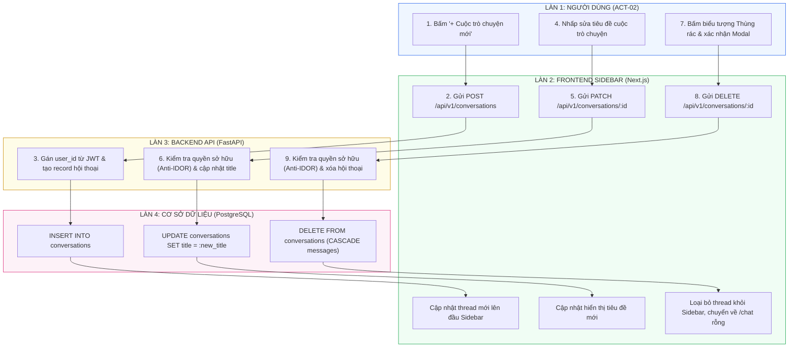

# Sơ Đồ Swimlane: Vòng Đời Quản Lý Cuộc Trò Chuyện (Conversation Lifecycle Swimlane)
## Dự Án: Website Chatbot Trợ Lý Ảo (AI-Chan Assistant)

---

| Thông Tin Sơ Đồ | Chi Tiết |
| :--- | :--- |
| **Mã Sơ Đồ** | `DIAG-SWIM-003` |
| **Quy Trình Nghiệp Vụ** | `BP-CONV-001..004 [PROC-004..007]` |
| **Nguồn Sự Thật Thượng Nguồn** | [docs/03-business-process/process-flows.md](file:///c:/Users/PC/Project/ai-chan/docs/03-business-process/process-flows.md), [docs/02-requirements/functional-requirements.md](file:///c:/Users/PC/Project/ai-chan/docs/02-requirements/functional-requirements.md) (`FR-005`, `FR-006`) |
| **Mục Đích** | Thể hiện sự phối hợp đa làn khi Tạo mới, Tải danh sách, Đổi tên tiêu đề và Xóa cuộc trò chuyện kèm cơ chế chống IDOR |

---

## 1. Biểu Đồ Swimlane Vòng Đời Cuộc Trò Chuyện

---

## 2. Thuyết Minh Kiểm Soát Cách Ly Dữ Liệu (Anti-IDOR Policy)

- Tại mọi thao tác truy vấn, đổi tên (`PATCH`) hoặc xóa (`DELETE`), Backend luôn truy vấn với điều kiện kép:
  `WHERE id = :conversation_id AND user_id = :jwt_user_id`.
- Nếu không tìm thấy, hệ thống trả về mã lỗi `HTTP 404 Not Found` thay vì `403 Forbidden` để ngăn chặn kẻ tấn công suy đoán hoặc dò quét sự tồn tại của các ID hội thoại thuộc người dùng khác (`SEC-002`, `CTRL-002`).
