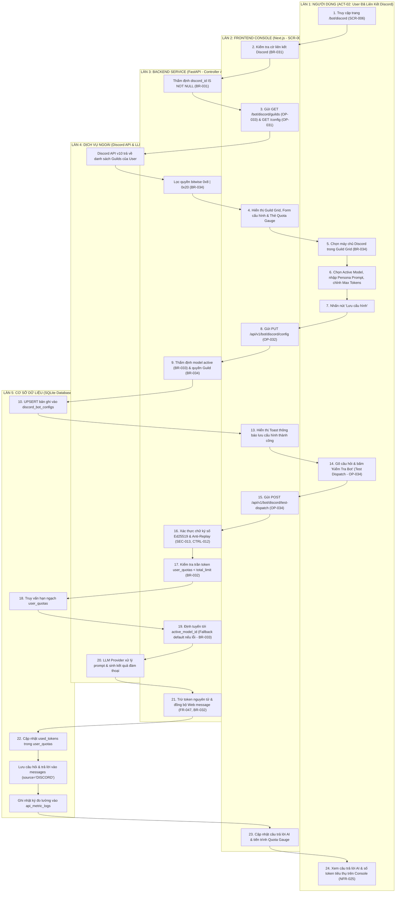

# Sơ Đồ Swimlane: Quy Trình Đa Làn Quản Lý & Tương Tác Bot Discord (Discord Bot Swimlane)
## Dự Án: Website Chatbot Trợ Lý Ảo (AI-Chan Assistant)

---

| Thông Tin Sơ Đồ | Chi Tiết |
| :--- | :--- |
| **Mã Sơ Đồ** | `DIAG-SWIM-010` |
| **Quy Trình Nghiệp Vụ** | `BP-BOT-001 [PROC-022]` & `BP-BOT-002 [PROC-023]` |
| **Nguồn Sự Thật Thượng Nguồn** | [docs/03-business-process/business-process-catalog.md](file:///c:/Users/PC/Project/ai-chan/docs/03-business-process/business-process-catalog.md), [docs/02-requirements/functional-requirements.md](file:///c:/Users/PC/Project/ai-chan/docs/02-requirements/functional-requirements.md) (`FR-044`..`047`), [docs/02-requirements/business-rules.md](file:///c:/Users/PC/Project/ai-chan/docs/02-requirements/business-rules.md) (`BR-031`..`034`), [docs/06-architecture/ADR/ADR-012-discord-bot-management-and-quota-sharing.md](file:///c:/Users/PC/Project/ai-chan/docs/06-architecture/ADR/ADR-012-discord-bot-management-and-quota-sharing.md) |
| **Mục Đích** | Phân định ranh giới trách nhiệm đa làn (5-Lane): Người Dùng -> Next.js Frontend Console -> FastAPI Backend Service -> Discord API & LLM Providers -> SQLite Database |

---

## 1. Biểu Đồ Swimlane Quản Lý & Tương Tác Bot Discord

