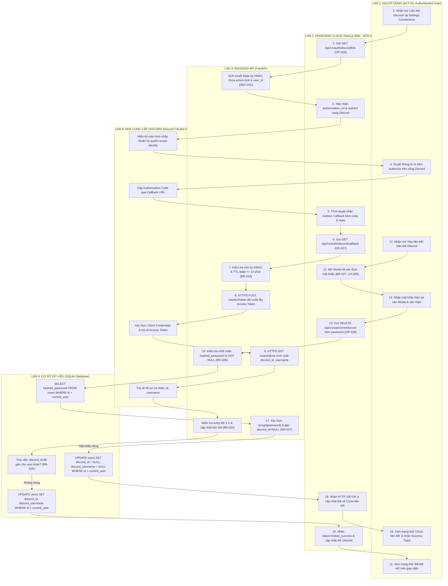

# Sơ Đồ Swimlane: Quy Trình Đa Làn Liên Kết & Hủy Liên Kết Tài Khoản Discord (Discord Link & Unlink Swimlane)
## Dự Án: Website Chatbot Trợ Lý Ảo (AI-Chan Assistant)

---

| Thông Tin Sơ Đồ | Chi Tiết |
| :--- | :--- |
| **Mã Sơ Đồ** | `DIAG-SWIM-008` |
| **Quy Trình Nghiệp Vụ** | `BP-USER-003 [PROC-019]` & `BP-USER-004 [PROC-020]` |
| **Nguồn Sự Thật Thượng Nguồn** | [docs/03-business-process/business-process-catalog.md](file:///c:/Users/PC/Project/ai-chan/docs/03-business-process/business-process-catalog.md), [docs/02-requirements/functional-requirements.md](file:///c:/Users/PC/Project/ai-chan/docs/02-requirements/functional-requirements.md) (`FR-040`, `FR-041`, `FR-042`), [docs/06-architecture/ADR/ADR-010-discord-account-linking-and-unlinking.md](file:///c:/Users/PC/Project/ai-chan/docs/06-architecture/ADR/ADR-010-discord-account-linking-and-unlinking.md) |
| **Mục Đích** | Phân định ranh giới trách nhiệm và chuỗi điều phối 5 làn (5-Lane): Người dùng -> Next.js Frontend -> FastAPI Backend -> Discord OAuth2 API -> SQLite Database |

---

## 1. Biểu Đồ Swimlane Liên Kết & Hủy Liên Kết Discord

