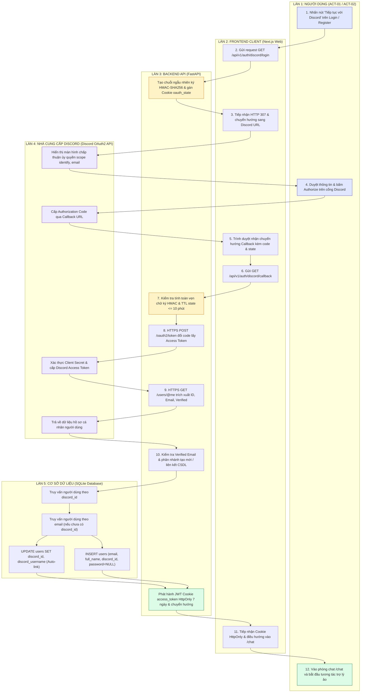

# Sơ Đồ Swimlane: Quy Trình Xác Thực Đa Làn Discord OAuth2 (Discord OAuth Swimlane)
## Dự Án: Website Chatbot Trợ Lý Ảo (AI-Chan Assistant)

---

| Thông Tin Sơ Đồ | Chi Tiết |
| :--- | :--- |
| **Mã Sơ Đồ** | `DIAG-SWIM-005` |
| **Quy Trình Nghiệp Vụ** | `BP-AUTH-004 [PROC-014]` |
| **Nguồn Sự Thật Thượng Nguồn** | [docs/03-business-process/business-process-catalog.md](file:///c:/Users/PC/Project/ai-chan/docs/03-business-process/business-process-catalog.md), [docs/06-architecture/ADR/ADR-007-discord-oauth2-authentication.md](file:///c:/Users/PC/Project/ai-chan/docs/06-architecture/ADR/ADR-007-discord-oauth2-authentication.md) |
| **Mục Đích** | Phân định ranh giới trách nhiệm và chuỗi điều phối 5 làn (5-Lane): Người dùng -> Next.js Frontend -> FastAPI Backend -> Discord OAuth2 API -> SQLite Database |

---

## 1. Biểu Đồ Swimlane Xác Thực & Đăng Ký Discord OAuth2

---

## 2. Bảng Phân Định Ma Trận Trách Nhiệm RACI Theo Làn (RACI Matrix)

| Giai Đoạn Quy Trình | Làn Người Dùng | Làn Frontend | Làn Backend | Làn Discord API | Làn Cơ Sở Dữ Liệu |
| :--- | :---: | :---: | :---: | :---: | :---: |
| **Khởi tạo đăng nhập** | **A** (Kích hoạt) | **R** (Điều hướng) | **R** (Sinh State HMAC) | **I** (Chờ request) | **-** |
| **Ủy quyền & Cấp code** | **A** (Chấp thuận) | **I** (Nhận URL) | **-** | **R** (Cấp Auth Code) | **-** |
| **Bảo vệ chống CSRF** | **-** | **I** (Truyền state) | **A / R** (Xác minh ký số) | **-** | **-** |
| **Trao đổi Token & Profile** | **-** | **-** | **A / R** (Bảo vệ Client Secret) | **R** (Trả token & User) | **-** |
| **Phân nhánh tài khoản** | **-** | **-** | **A** (Thực thi BR-017, BR-018) | **-** | **R** (Lưu trữ DDL mới) |
| **Phát hành phiên & Vào App** | **I** (Sử dụng /chat) | **R** (Cập nhật Auth State) | **A / R** (Cấp Cookie JWT) | **-** | **-** |
