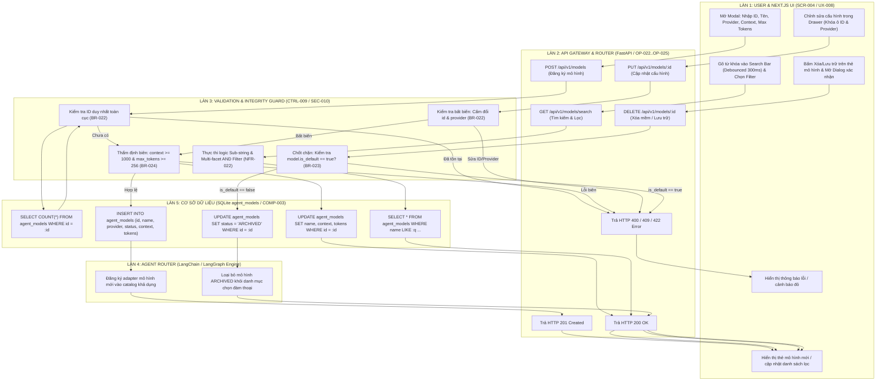

# Sơ Đồ Swimlane: Quản Lý Mô Hình Đa Làn (Model Management Swimlane)
## Dự Án: Website Chatbot Trợ Lý Ảo (AI-Chan Assistant)

---

| Thông Tin Sơ Đồ | Chi Tiết |
| :--- | :--- |
| **Mã Sơ Đồ** | `DIAG-SWIM-007` |
| **Quy Trình Nghiệp Vụ** | `BP-MOD-001 [PROC-017]` & `BP-MOD-002 [PROC-018]` |
| **Nguồn Sự Thật Thượng Nguồn** | [docs/03-business-process/business-process-catalog.md](file:///c:/Users/PC/Project/ai-chan/docs/03-business-process/business-process-catalog.md), [docs/06-architecture/ADR/ADR-009-extensible-model-management-search-filter.md](file:///c:/Users/PC/Project/ai-chan/docs/06-architecture/ADR/ADR-009-extensible-model-management-search-filter.md) |
| **Mục Đích** | Phân định ranh giới trách nhiệm và chuỗi tương tác phối hợp 5 làn (5-Lane): User & Next.js UI -> API Gateway & Router -> Validation & Integrity Engine -> Agent Router -> SQLite Database |

---

## 1. Biểu Đồ Swimlane Quy Trình Quản Lý & Vòng Đời Mô Hình Mở Rộng

---

## 2. Ma Trận Phân Định Trách Nhiệm Giữa Các Làn (RACI Matrix)

| Hành Động Nghiệp Vụ | Làn 1: UI | Làn 2: API Gateway | Làn 3: Integrity Engine | Làn 4: Agent Router | Làn 5: SQLite Database |
| :--- | :---: | :---: | :---: | :---: | :---: |
| **Đăng ký mô hình mới (`OP-022`)** | Responsible | Accountable | Consulted (`BR-022`, `BR-024`) | Informed | Responsible |
| **Hiệu chỉnh cấu hình (`OP-023`)** | Responsible | Accountable | Consulted (`BR-022`, `BR-024`) | Informed | Responsible |
| **Tìm kiếm & Lọc nhanh (`OP-024`)** | Responsible | Accountable | Consulted (`NFR-022`) | Informed | Responsible |
| **Lưu trữ mềm mô hình (`OP-025`)** | Responsible | Accountable | Consulted (`BR-023`) | Responsible | Responsible |
