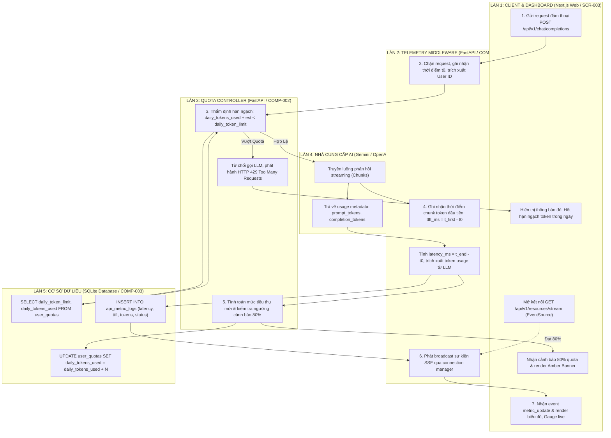

# Sơ Đồ Swimlane: Quản Lý Tài Nguyên Đa Làn (Resource Management Swimlane)
## Dự Án: Website Chatbot Trợ Lý Ảo (AI-Chan Assistant)

---

| Thông Tin Sơ Đồ | Chi Tiết |
| :--- | :--- |
| **Mã Sơ Đồ** | `DIAG-SWIM-006` |
| **Quy Trình Nghiệp Vụ** | `BP-RES-001 [PROC-015]` & `BP-RES-002 [PROC-016]` |
| **Nguồn Sự Thật Thượng Nguồn** | [docs/03-business-process/business-process-catalog.md](file:///c:/Users/PC/Project/ai-chan/docs/03-business-process/business-process-catalog.md), [docs/06-architecture/ADR/ADR-008-resource-telemetry-and-realtime-dashboard.md](file:///c:/Users/PC/Project/ai-chan/docs/06-architecture/ADR/ADR-008-resource-telemetry-and-realtime-dashboard.md) |
| **Mục Đích** | Phân định ranh giới trách nhiệm và chuỗi tương tác phối hợp 5 làn (5-Lane): Client Dashboard -> Telemetry Middleware -> Quota Controller -> LLM Providers -> SQLite Database |

---

## 1. Biểu Đồ Swimlane Quy Trình Quản Lý Tài Nguyên & Telemetry Thời Gian Thực

---

## 2. Bảng Phân Trách Nhiệm Theo Làn (RACI Matrix)

| Giai Đoạn Hoạt Động | Client Dashboard | Telemetry Middleware | Quota Controller | LLM Providers | SQLite Database |
| :--- | :--- | :--- | :--- | :--- | :--- |
| **Thẩm Định Quota Ban Đầu** | Informed (Nhận 429 nếu hết hạn ngạch) | Responsible (Chuyển tiếp) | Accountable (Kiểm tra điều kiện) | None | Consulted (Cung cấp số liệu) |
| **Đo Đạc Độ Trễ & TTFT** | Consulted | Accountable (Bấm giờ t0, t_first, t_end) | None | Responsible (Stream chunks) | None |
| **Cập Nhật Hạn Ngạch & Ghi Log** | None | Responsible (Chuẩn bị payload log) | Accountable (Cộng dồn token) | Consulted (Trả usage metadata) | Responsible (Lưu trữ atomic) |
| **Hiển Thị Thời Gian Thực** | Responsible (Render Dashboard UI) | Accountable (Đẩy SSE Stream) | None | None | Consulted (Cung cấp lịch sử) |
