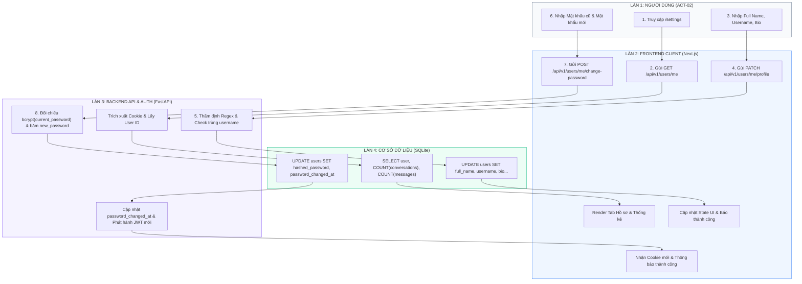

# Sơ Đồ Swimlane: Quản Lý Tài Khoản & Hồ Sơ Cá Nhân (User Management Swimlane)
## Dự Án: Website Chatbot Trợ Lý Ảo (AI-Chan Assistant)

---

| Thông Tin Sơ Đồ | Chi Tiết |
| :--- | :--- |
| **Mã Sơ Đồ** | `DIAG-SWIM-004` |
| **Quy Trình Nghiệp Vụ** | `BP-USER-001 [PROC-011]`, `BP-USER-002 [PROC-012]` |
| **Nguồn Sự Thật Thượng Nguồn** | [docs/03-business-process/actor-interactions.md](file:///c:/Users/PC/Project/ai-chan/docs/03-business-process/actor-interactions.md), [docs/08-api/api-specifications.md](file:///c:/Users/PC/Project/ai-chan/docs/08-api/api-specifications.md) |
| **Mục Đích** | Phân định ranh giới trách nhiệm đa làn (Multi-lane) giữa Người dùng, Giao diện Client (Next.js), Lớp API / Xác thực (FastAPI), và Lớp Cơ sở dữ liệu (SQLite) |

---

## 1. Biểu Đồ Swimlane Quản Lý Tài Khoản

---

## 2. Bảng Phân Định Trách Nhiệm Từng Làn (Responsibility Assignment)

| Thành Phần (Lane) | Trách Nhiệm Chính |
| :--- | :--- |
| **Làn 1: Người dùng** | Cung cấp thông tin hồ sơ, khởi xướng các thao tác đổi mật khẩu/email và xác nhận trong các Modal nhạy cảm. |
| **Làn 2: Frontend (Next.js)** | Xác thực định dạng sơ bộ (Client-side regex), hiển thị giao diện động các Tab, thanh đo độ mạnh mật khẩu và xử lý Cookie tự động. |
| **Làn 3: Backend API (FastAPI)** | Thẩm định Pydantic schema, kiểm tra quyền sở hữu IDOR, kiểm tra mật khẩu hiện tại bằng Bcrypt (`SEC-006`), cấp phát lại JWT Token và thu hồi phiên. |
| **Làn 4: Database (SQLite)** | Lưu trữ bền vững, thực thi ràng buộc duy nhất (`UNIQUE COLLATE NOCASE`). |
