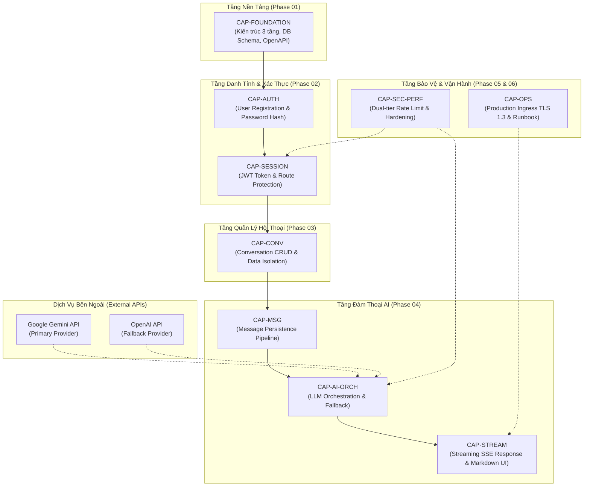

# PHÂN TÍCH PHỤ THUỘC NĂNG LỰC HỆ THỐNG (CAPABILITY DEPENDENCY ANALYSIS)
## Hệ Thống Website Chatbot Trợ Lý Ảo (AI-Chan Assistant)

---

| Thông Tin Tài Liệu | Chi Tiết |
| :--- | :--- |
| **Dự án** | Website Chatbot Trợ Lý Ảo (`ai-chan`) |
| **Mã tài liệu** | `DEP-ANALYSIS-001` |
| **Mục đích** | Phân loại và làm rõ các mối quan hệ phụ thuộc giữa các năng lực hệ thống để ngăn ngừa việc triển khai sai thứ tự |
| **Nguyên tắc** | Chỉ phân tích phụ thuộc thực tế, không tạo phụ thuộc giả định hoặc dư thừa |

---

## 1. Sơ Đồ Phụ Thuộc Năng Lực Trực Quan (Mermaid Dependency Graph)



---

## 2. Luồng Phụ Thuộc Thực Thể Khái Niệm (Conceptual Entity Lifecycle Flow)

Hệ thống tuân thủ nghiêm ngặt chuỗi sinh thành dữ liệu theo thứ tự tự nhiên:
```text
User (Người dùng được khởi tạo & băm mật khẩu)
  ↓ [Bắt buộc: Khóa chính User ID]
Session / Auth Token (JWT được cấp phát cho User)
  ↓ [Bắt buộc: User ID gắn vào Conversation]
Conversation (Cuộc trò chuyện được tạo thuộc sở hữu của User)
  ↓ [Bắt buộc: Conversation ID gắn vào Message]
User Message (Tin nhắn người dùng nhập vào)
  ↓ [Bắt buộc: Prompt + Context truyền sang LLM Manager]
AI Request (Yêu cầu gọi ra Gemini / Fallback OpenAI)
  ↓ [Bắt buộc: Dữ liệu văn bản sinh ra từ AI]
AI Response Message (Tin nhắn phản hồi của AI lưu vào Conversation)
```

---

## 3. Phân Loại Chi Tiết Các Mối Quan Hệ Phụ Thuộc (Dependency Taxonomy)

### 3.1 Phụ Thuộc Cứng (Hard Dependencies)
*Các phụ thuộc bắt buộc về mặt logic nghiệp vụ và kiến trúc dữ liệu, không thể đảo ngược hoặc bỏ qua:*
1. **`CAP-AUTH` phụ thuộc `CAP-ARCH`**: Không thể tạo bảng người dùng hay xử lý xác thực nếu chưa có kiến trúc kết nối cơ sở dữ liệu và thiết kế lược đồ bảng `users`.
2. **`CAP-CONV` phụ thuộc `CAP-AUTH` (`BR-001`)**: Một cuộc trò chuyện bắt buộc phải có `user_id` sở hữu. Không thể lưu trữ cuộc trò chuyện độc lập nếu chưa có thực thể người dùng đã xác thực.
3. **`CAP-MSG` phụ thuộc `CAP-CONV`**: Một tin nhắn bắt buộc phải thuộc về một `conversation_id`. Không thể gửi hoặc lưu tin nhắn vào khoảng trống dữ liệu.
4. **`CAP-STREAM` phụ thuộc `CAP-AI-ORCH`**: Giao diện không thể hiển thị dòng chữ streaming nếu bộ điều phối LLM chưa nhận và xử lý luồng dữ liệu từ nhà cung cấp AI.

### 3.2 Phụ Thuộc Kỹ Thuật (Technical Dependencies)
*Các phụ thuộc về mặt giao thức, thư viện và hạ tầng:*
1. **Frontend API Client phụ thuộc OpenAPI Spec**: Giao diện Next.js chỉ có thể hoàn thiện các hàm gọi API khi hợp đồng OpenAPI 3.1 tại Phase 01 đã chốt cấu trúc request/response.
2. **FastAPI Route Protection phụ thuộc JWT Core Utility**: Các endpoint cần bảo vệ bắt buộc phải import hàm dependency `get_current_user` từ module bảo mật.
3. **Dual-Tier Rate Limiting phụ thuộc Redis / In-memory Store**: Bộ đếm trượt cần vùng nhớ tạm thời để lưu vết tần suất gửi yêu cầu theo IP.

### 3.3 Phụ Thuộc Bên Ngoài (External Dependencies)
*Các thành phần nằm ngoài tầm kiểm soát nội bộ của máy chủ:*
1. **Google Gemini API Availability**: Hoạt động của trợ lý ảo dựa vào tính khả dụng và thời gian phản hồi của máy chủ Google Generative AI.
2. **OpenAI API Availability**: Cơ chế chuyển vùng dự phòng (Fallback) yêu cầu tài khoản và khóa API OpenAI có số dư hợp lệ để sẵn sàng tiếp quản khi Gemini gặp sự cố.
3. **Mạng Internet Quốc tế**: Máy chủ dịch vụ phải có đường truyền ra ngoài thông suốt để kết nối tới các endpoint API quốc tế.

### 3.4 Phụ Thuộc Mềm & Tùy Chọn (Soft & Optional Dependencies)
*Các tính năng bổ trợ làm tăng trải nghiệm nhưng không làm nghẽn luồng chính:*
1. **Tự động sinh tiêu đề (`WP-CONV-02`)**: Là phụ thuộc mềm đối với việc gửi tin nhắn; nếu logic tóm tắt tiêu đề gặp lỗi thì tin nhắn vẫn phải được gửi và phản hồi bình thường với tiêu đề mặc định.
2. **Tùy chọn Model AI (`FR-010`)**: Nếu người dùng không chỉ định model, hệ thống tự động gán model mặc định (Gemini Flash/Pro).

---

## 4. Bảng Tổng Hợp Ma Trận Phụ Thuộc (Dependency Matrix)

| Năng Lực (Target Capability) | Phụ Thuộc Vào (Depends On) | Loại Phụ Thuộc | Lý Do Bắt Buộc | Tác Động Nếu Bị Nghẽn |
| :--- | :--- | :---: | :--- | :--- |
| `CAP-AUTH` | `CAP-ARCH` | **Hard** | Cần DB Connection & Schema | Hoãn toàn bộ việc viết logic đăng ký |
| `CAP-CONV` | `CAP-AUTH` | **Hard** | Cần `user_id` để gán sở hữu | Không thể tạo và lưu cuộc trò chuyện |
| `CAP-MSG` | `CAP-CONV` | **Hard** | Cần `conversation_id` | Không thể lưu tin nhắn vào cơ sở dữ liệu |
| `CAP-AI-ORCH` | External AI APIs | **External** | Cần LLM sinh nội dung | Phải kích hoạt Fallback hoặc báo lỗi 503 |
| `CAP-STREAM` | `CAP-AI-ORCH` | **Technical** | Cần backend stream chunks | Fallback về dạng hiển thị văn bản tĩnh |
| `CAP-SEC-PERF` | Nginx & Backend Core | **Technical** | Cần gateway tiếp nhận gói tin | Nguy cơ bị tấn công lạm dụng tài nguyên |
| `CAP-OPS` | All Previous Capabilities | **Business** | Cần hệ thống hoàn chỉnh | Không thể phát hành bản chính thức |
