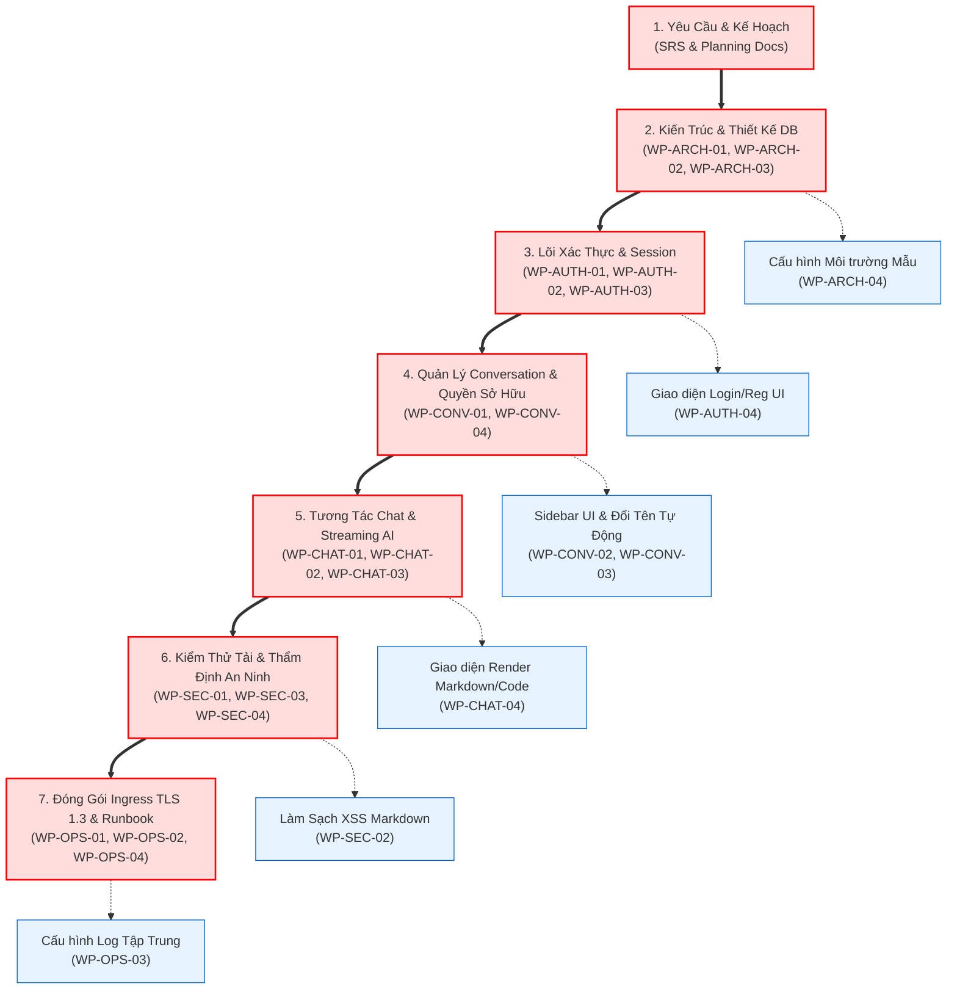

# ĐƯỜNG GĂNG DỰ ÁN & PHÂN TÍCH ĐIỂM NGHẼN (CRITICAL PATH ANALYSIS)
## Hệ Thống Website Chatbot Trợ Lý Ảo (AI-Chan Assistant)

---

| Thông Tin Tài Liệu | Chi Tiết |
| :--- | :--- |
| **Dự án** | Website Chatbot Trợ Lý Ảo (`ai-chan`) |
| **Mã tài liệu** | `CPA-SPEC-001` |
| **Mục đích** | Xác định chuỗi công việc quyết định thời gian hoàn thành dự án (Đường găng - Critical Path), nhận diện các nút thắt cổ chai tiềm ẩn và giải pháp bảo vệ tiến độ |
| **Nguyên tắc** | Bất kỳ sự chậm trễ nào trên Đường Găng sẽ làm trễ toàn bộ thời điểm phát hành của dự án |

---

## 1. Sơ Đồ Đường Găng Trọng Tâm (Primary Critical Path Graph)

---

## 2. Đặc Tả Tuyến Đường Găng Cốt Lõi (Critical Path Steps)

Tuyến đường găng chính bao gồm **7 bước logic tuần tự không thể rút ngắn**:

1. **Bước 1 (Requirements & Master Plan)**: Chốt danh mục yêu cầu trong `SRS.md` và kế hoạch tại `docs/01-planning/`.
   - *Rủi ro chậm trễ*: Nếu yêu cầu còn mâu thuẫn hoặc chưa phân định In/Out of Scope, toàn bộ các bước sau bị đình trệ.
2. **Bước 2 (System Architecture & Database Schema)**: Thiết kế lược đồ bảng PostgreSQL (`users`, `conversations`, `messages`) và hợp đồng OpenAPI.
   - *Rủi ro chậm trễ*: Bất kỳ sự thay đổi cấu trúc bảng nào sau bước này sẽ kéo theo việc viết lại model, API và giao diện.
3. **Bước 3 (Authentication Core & JWT Middleware)**: Hiện thực hóa bảng người dùng, băm mật khẩu Argon2id và kiểm soát phiên token.
   - *Rủi ro chậm trễ*: Nút thắt chặn toàn bộ logic phân quyền của cuộc trò chuyện.
4. **Bước 4 (Conversation Persistence & Data Isolation)**: Tạo API cuộc trò chuyện và ràng buộc cách ly dữ liệu `user_id`.
   - *Rủi ro chậm trễ*: Nút thắt chặn việc lưu trữ tin nhắn chat.
5. **Bước 5 (AI Chat Pipeline & Multi-Provider Failover)**: Tích hợp gọi LLM Gemini, cơ chế tự động Fallback OpenAI và luồng Streaming SSE.
   - *Rủi ro chậm trễ*: Trọng tâm kỹ thuật phức tạp nhất của dự án, dễ phát sinh lỗi timeout và streaming chunk.
6. **Bước 6 (Security Hardening & 100-User Load Testing)**: Rà soát không lộ secret, kiểm tra rate limit và chạy test tải 100 concurrent users.
   - *Rủi ro chậm trễ*: Nếu phát hiện rò rỉ secret hoặc sập kết nối khi chịu tải, bắt buộc phải quay lại bước 3/5 để tối ưu.
7. **Bước 7 (Production Compose, TLS 1.3 & Operations Runbook)**: Cấu hình Ingress Nginx bảo mật, đóng cổng cơ sở dữ liệu và hoàn thiện sổ tay vận hành.
   - *Rủi ro chậm trễ*: Bước cuối cùng để chuyển giao sản phẩm đưa vào sử dụng.

---

## 3. Phân Tích Điểm Nghẽn & Chiến Lược Bảo Vệ Tiến Độ (Bottlenecks & Lead Time Protection)

### 3.1 Điểm Nghẽn 1: Thiết Kế Database Schema & OpenAPI
- **Vấn đề**: Cả lập trình viên Backend và Frontend đều bị chặn nếu lược đồ dữ liệu và OpenAPI chưa được chốt.
- **Biện pháp bảo vệ**:
  - Ưu tiên tối đa hoàn thiện `WP-ARCH-02` và `WP-ARCH-03` ngay trong Phase 01.
  - Sử dụng công cụ mock API tạm thời từ OpenAPI file để đội Frontend có thể thiết kế giao diện song song mà không cần đợi Backend hoàn thành code.

### 3.2 Điểm Nghẽn 2: Phụ Thuộc Vào Tính Sẵn Sàng & Quota Của AI Provider
- **Vấn đề**: Trong quá trình phát triển Phase 04, nếu tài khoản Google Gemini hoặc OpenAI hết quota hoặc mạng chập chờn, tiến độ kiểm thử sẽ bị đình trệ.
- **Biện pháp bảo vệ**:
  - Xây dựng một **Mock LLM Provider** trong môi trường dev (`BaseLLMProvider` trả về chuỗi giả lập tức thì) để đội phát triển có thể kiểm thử luồng streaming và giao diện mà không tiêu tốn token thật.

### 3.3 Điểm Nghẽn 3: Kiểm Thử An Ninh & Quét Secret Ở Giai Đoạn Cuối
- **Vấn đề**: Nếu đến Phase 05 mới kiểm tra bảo mật và phát hiện API Key bị hardcode từ Phase 02, dự án sẽ phải revoke key và sửa lại toàn bộ lịch sử git.
- **Biện pháp bảo vệ**:
  - Thực thi kiểm tra bảo mật sớm (Shift-Left Security): Bật toàn bộ các hook tự động trong [.agents/hooks.json](file:///c:/Users/PC/Project/ai-chan/.agents/hooks.json) (`sensitive-file-review`, `destructive-command-review`) ngay từ ngày đầu tiên viết code.
