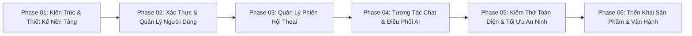

# KẾ HOẠCH PHÁT TRIỂN DỰ ÁN TỔNG THỂ (MASTER PROJECT DEVELOPMENT PLAN)
## Dự Án: Website Chatbot Trợ Lý Ảo (AI-Chan Assistant)

---

| Thông Tin Kế Hoạch | Chi Tiết |
| :--- | :--- |
| **Dự án** | Website Chatbot Trợ Lý Ảo (`ai-chan`) |
| **Mã tài liệu** | `PDP-001` |
| **Phiên bản** | v1.0.0-BASELINE |
| **Vai trò xây dựng** | Senior Business Analyst + Product Manager + Solution Architect |
| **Đầu vào chính** | [docs/SRS.md](file:///c:/Users/PC/Project/ai-chan/docs/SRS.md), Hiện trạng Codebase 3 tầng (`ai-backend`, `ai-frontend`, `ai-infra`) |
| **Quy định ràng buộc** | **GIAI ĐOẠN PLANNING THUẦN TÚY — KHÔNG VIẾT SOURCE CODE** |

---

## 1. Tổng Quan Dự Án & Mục Tiêu Nghiệp Vụ

### 1.1 Tổng Quan Dự Án (Project Overview)
Dự án **AI-Chan Assistant** hướng đến việc xây dựng một hệ thống website chatbot đàm thoại thông minh đa tầng, cung cấp cho người dùng môi trường tương tác mượt mà, lưu trữ lịch sử cuộc trò chuyện an toàn, và tận dụng sức mạnh của các mô hình ngôn ngữ lớn (Generative AI) tiên tiến nhất thông qua cơ chế điều phối đa nhà cung cấp có khả năng tự phục hồi (Multi-Provider AI Orchestration with Failover).

### 1.2 Mục Tiêu Nghiệp Vụ Trọng Tâm (Business Objectives)
- **BO-01 (Trải nghiệm tương tác)**: Đảm bảo thời gian phản hồi nhanh, trực quan thông qua streaming văn bản và định dạng Markdown/Code syntax.
- **BO-02 (Tối ưu sẵn sàng & Chi phí)**: Sử dụng Google Gemini làm nhà cung cấp chính với chi phí tối ưu, tự động chuyển vùng dự phòng sang OpenAI khi gặp sự cố quota hoặc nghẽn mạng.
- **BO-03 (Bảo toàn ngữ cảnh & Danh tính)**: Quản lý người dùng tập trung, phân tách và lưu trữ các phiên trò chuyện độc lập theo quyền sở hữu của từng cá nhân.
- **BO-04 (An toàn dữ liệu & Phòng thủ lạm dụng)**: Ngăn chặn triệt để lộ API Key, chống tấn công tiêm nhiễm câu lệnh (Prompt Injection), áp dụng Rate Limiting 2 tầng (Ingress Nginx và Application FastAPI).

---

## 2. Chiến Lược Triển Khai Dự Án (Development Strategy)

Dự án áp dụng mô hình phát triển **Incremental, Dependency-Aware, Risk-First & Documentation-Driven Delivery**:
1. **Tài Liệu Dẫn Dắt (Documentation-Driven)**: Mọi tính năng kỹ thuật bắt buộc phải có thiết kế kiến trúc (SAD), hợp đồng API (OpenAPI) và mô hình dữ liệu trước khi bắt đầu viết code.
2. **Nhận Thức Phụ Thuộc (Dependency-Aware)**: Chỉ triển khai tầng cao (UI, AI chat) khi tầng nền tảng (Database, Authentication, Identity Management) đã hoàn tất và kiểm thử thành công.
3. **Ưu Tiên Rủi Ro Hàng Đầu (Risk-First)**: Các hạng mục bảo vệ khóa API, quản lý chi phí token, chống DDoS/Abuse và cơ chế Failover của AI được thiết kế và kiểm soát ngay từ phase nền tảng, không để dồn vào cuối dự án.
4. **Bàn Giao Tăng Dần & Có Thể Kiểm Chứng (Testable Incremental Delivery)**: Mỗi phase kết thúc bằng một tập Artifact hoàn chỉnh và có bộ kiểm tra nghiệm thu cụ thể theo Acceptance Criteria.

---

## 3. Phạm Vi Phát Triển (Project Scope)

```
┌────────────────────────────────────────────────────────────────────────┐
│                        AI-CHAN PROJECT SCOPE                           │
├───────────────────────────────────┬────────────────────────────────────┤
│ IN SCOPE (MVP Release)            │ OUT OF SCOPE                       │
│ - Xác thực: Đăng ký, Đăng nhập,  │ - Cổng thanh toán (Billing)        │
│   Đăng xuất, JWT Session.         │ - Mobile Apps (iOS/Android Native) │
│ - Quản lý Conversation: Tạo,      │ - Huấn luyện Model riêng           │
│   Liệt kê, Đổi tên, Xóa.          │ - Đàm thoại âm thanh Real-time     │
│ - Tương tác Chat & Streaming.     ├────────────────────────────────────┤
│ - Multi-Provider AI Fallback.     │ FUTURE SCOPE                       │
│ - 2-Tier Rate Limiting & Nginx.   │ - Upload file/RAG tài liệu         │
│                                   │ - Admin Portal quản trị prompt     │
│                                   │ - Đăng nhập OAuth2 Social          │
└───────────────────────────────────┴────────────────────────────────────┘
```

---

## 4. Các Năng Lực Cốt Lõi (Core Capabilities)

| Nhóm Năng Lực | Mã Năng Lực | Yêu Cầu SRS Liên Quan | Độ Ưu Tiên | Trạng Thái Kế Hoạch |
| :--- | :--- | :--- | :--- | :--- |
| **Kiến Trúc & Nền Tảng Dữ Liệu** | `CAP-FOUNDATION` | Toàn bộ kiến trúc 3 tầng, NFRs | `Must Have` | Ready for Design |
| **Xác Thực & Danh Tính** | `CAP-AUTH` | `FR-001`, `FR-002`, `FR-003`, `BR-001` | `Must Have` | Planned (Phase 02) |
| **Quản Lý Phiên Hội Thoại** | `CAP-CONV` | `FR-004`, `FR-005`, `FR-006`, `FR-007`, `BR-002` | `Must Have` | Planned (Phase 03) |
| **Tương Tác Chat & AI Engine** | `CAP-CHAT-AI` | `FR-008`, `FR-009`, `FR-010`, `FR-011`, `BR-005` | `Must Have` | Planned (Phase 04) |
| **Bảo Vệ & Phòng Thủ An Ninh** | `CAP-SEC-PERF` | `BR-006`, `NFR-SEC-01..05`, `NFR-PERF-01..03` | `Must Have` | Continuous |
| **Vận Hành & Quan Sát** | `CAP-OPS` | `NFR-OBS-01`, `NFR-REL-01..03` | `Should Have`| Planned (Phase 06) |

---

## 5. Phân Kỳ Phát Triển (Development Phases Overview)

Dự án được phân rã thành **6 Phase logic tuần tự**:



- **Phase 01 (System Architecture & Foundation Design)**: Xây dựng System Architecture Document (SAD), mô hình thực thể quan hệ cơ sở dữ liệu (PostgreSQL Schema), hợp đồng giao tiếp OpenAPI, cấu hình môi trường chuẩn.
- **Phase 02 (Authentication & User Management)**: Hiện thực hóa năng lực đăng ký, đăng nhập mật khẩu băm an toàn, cấp phát và thu hồi JWT/Session Cookie, Middleware xác thực tại Backend.
- **Phase 03 (Conversation Lifecycle & Persistence)**: Hiện thực hóa bảng lưu trữ conversation, API CRUD cuộc trò chuyện, phân quyền cô lập dữ liệu theo `user_id`, tích hợp Sidebar giao diện Frontend.
- **Phase 04 (Chat Interaction & AI Orchestration)**: Tích hợp hoàn chỉnh luồng gửi tin nhắn, lưu vết `messages`, gọi LLM Manager, cơ chế tự động Fallback Gemini -> OpenAI, và tính năng Streaming phản hồi ra UI.
- **Phase 05 (Security Hardening, Testing & Quality Assurance)**: Kiểm thử tải, rà soát mô hình đe dọa (Threat Modeling), kiểm tra rò rỉ secret, đo đạc TTFT và tỷ lệ chịu lỗi.
- **Phase 06 (Deployment, Observability & Release Readiness)**: Tinh chỉnh cấu hình Production Docker Compose, bảo mật SSL TLS 1.3, thiết lập cấu hình ghi nhật ký tập trung và sổ tay vận hành (Runbook).

---

## 6. Kế Hoạch Các Cột Mốc (Milestones Plan)

| Mã Mốc | Tên Cột Mốc | Mục Tiêu Đạt Được | Tiêu Chí Nghiệm Thu Thoát Mốc |
| :---: | :--- | :--- | :--- |
| **M01** | **Architecture & Design Baseline** | Hoàn tất toàn bộ tài liệu thiết kế hệ thống, API Contract, DB Schema và kế hoạch kiểm thử. | Đạt Quality Gate G2 (Design Ready), 0 open blockers. |
| **M02** | **Identity & Security Core Ready** | Người dùng có thể đăng ký, đăng nhập, bảo vệ phiên qua JWT; các API được bảo vệ bởi auth middleware. | Vượt qua bộ kiểm thử `AC-001`, mật khẩu băm an toàn. |
| **M03** | **Conversation Foundation Ready** | Khởi tạo, đổi tên, lưu trữ và xóa cuộc trò chuyện hoạt động ổn định trên cả UI và API. | Vượt qua bộ kiểm thử `AC-002`, bảo đảm cách ly dữ liệu `BR-002`. |
| **M04** | **AI Chat MVP Ready** | Chatbot phản hồi mượt mà, hỗ trợ streaming, hiển thị Markdown và tự động fallback khi lỗi provider. | Vượt qua bộ kiểm thử `AC-003` & `AC-004`. |
| **M05** | **Production Release Candidate** | Toàn bộ cụm Docker Ingress Nginx HTTPS hoạt động ổn định, đạt kiểm thử bảo mật và tải đồng thời. | Vượt qua `AC-005`, Quality Gate G6 (Release Ready). |

---

## 7. Định Nghĩa Sản Phẩm Tối Thiểu (MVP Definition)

Sản phẩm MVP (Minimum Viable Product) được định nghĩa là **tập hợp năng lực tối thiểu nhưng đầy đủ để mang lại giá trị nghiệp vụ hoàn chỉnh** cho người dùng:
- **Bao gồm trong MVP**:
  1. Giao diện Web tương thích đa màn hình (Desktop & Mobile).
  2. Đăng ký & Đăng nhập bằng Email/Password (JWT authentication).
  3. Quản lý danh sách các cuộc trò chuyện trên Sidebar (Tạo mới, Đổi tên, Xóa).
  4. Trò chuyện văn bản với AI Assistant (Định dạng Markdown, Code highlighting, Streaming phản hồi).
  5. Cơ chế chuyển đổi dự phòng Gemini -> OpenAI đảm bảo dịch vụ không gián đoạn.
  6. Rate limiting 2 lớp ngăn chặn lạm dụng tài nguyên.
- **Loại trừ khỏi MVP (Để lại Post-MVP / Future)**:
  - Tải lên tệp tài liệu PDF/Docx để phân tích (RAG).
  - Đăng nhập qua mạng xã hội (Google/GitHub/Discord).
  - Quản trị viên quản lý danh mục prompt hoặc bảng thống kê tài chính nâng cao.

---

## 8. Quản Trị Rủi Ro Cốt Lõi (Critical Risks Summary)

| Mã Rủi Ro | Phân Loại | Mô Tả | Mức Độ | Chiến Lược Giảm Thiểu |
| :---: | :--- | :--- | :---: | :--- |
| **RSK-AI-01** | AI External | Nhà cung cấp AI chính (Gemini) chạm hạn mức quota hoặc mất kết nối. | **HIGH** | Triển khai tự động chuyển vùng dự phòng (Fallback) sang OpenAI đã tích hợp sẵn trong mã nguồn. |
| **RSK-SEC-01** | Bảo Mật | Lộ lọt API Key ra phía Client/Browser hoặc trong mã nguồn mở. | **CRITICAL** | Cô lập toàn bộ lệnh gọi API qua Backend; kiểm tra bằng công cụ hook `sensitive-file-guard.py`. |
| **RSK-COST-01**| Tài Chính | Người dùng spam prompt dài dẫn đến cạn kiệt ngân sách token. | **HIGH** | Áp dụng giới hạn 4,000 ký tự (`BR-003`), rate limit 60 req/phút/IP và cắt ngắn ngữ cảnh quá hạn. |
| **RSK-PERF-01**| Hiệu Năng | Độ trễ phản hồi đàm thoại AI quá lâu làm suy giảm trải nghiệm. | **MEDIUM** | Bắt buộc sử dụng Streaming chunk-by-chunk qua ReadableStream để TTFT < 2.0s. |

---

## 9. Khuyến Nghị Giai Đoạn Tiếp Theo (Recommended Next Phase)

Sau khi hoàn thành và phê duyệt bộ tài liệu kế hoạch này trong `docs/01-planning/`, dự án **chưa được phép lập trình ngay**, mà cần chuyển sang:
> **PHASE 01: SYSTEM ARCHITECTURE & SYSTEM DESIGN**
> - Soạn thảo **System Architecture Document (SAD)** tại `docs/07-architecture/`.
> - Đặc tả **OpenAPI 3.1 Specification** tại `docs/08-api/openapi.yaml`.
> - Thiết kế **Conceptual & Logical Data Models** tại `models/domain/` và `docs/05-domain/`.
> - Xây dựng **Sequence Diagrams** cho các luồng nghiệp vụ tại `diagrams/sequence/`.
