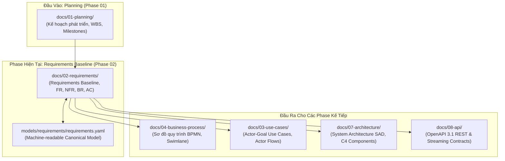

# KHÔNG GIAN ĐẶC TẢ YÊU CẦU DỰ ÁN (REQUIREMENTS ENGINEERING BASELINE)
## Hệ Thống Website Chatbot Trợ Lý Ảo (AI-Chan Assistant)

---

## 1. Mục Đích Của Giai Đoạn (Phase Objective)
Thư mục `docs/02-requirements/` là không gian đặc tả yêu cầu nghiệp vụ chính thức (**Authoritative Requirements Space**) của dự án **AI-Chan Assistant**.

Giai đoạn Requirements Engineering tiếp nhận các đầu vào từ Khảo sát hiện trạng (`docs/00-discovery/`), Kế hoạch tổng thể (`docs/01-planning/`) và Bản phác thảo yêu cầu ban đầu (`docs/SRS.md`) để:
1. **Chuẩn hóa (Normalize) toàn bộ yêu cầu**: Đảm bảo mỗi yêu cầu đều có mã định danh duy nhất (`FR-###`, `NFR-###`, `BR-###`, `SEC-###`), không mâu thuẫn, nguyên tử (atomic), đo lường được và có tiêu chí nghiệm thu rõ ràng.
2. **Xây dựng Nguồn Sự Thật Duy Nhất (Authoritative Source of Truth)**: Xác lập mốc chuẩn yêu cầu (**Requirements Baseline**) được phê duyệt chính thức làm đầu vào cho các giai đoạn tiếp theo: Phân tích Quy trình Nghiệp vụ (03-business-process), Ca Sử Dụng (03-use-cases), Thiết kế Kiến trúc (07-architecture) và Thiết kế Hợp đồng API (08-api).
3. **Tuyệt đối không Coding (No Coding Rule)**: Không tạo mã nguồn, không thiết kế database schema chi tiết, không tạo API implementation trong giai đoạn này.

---

## 2. Phân Tích Nguồn Sự Thật & Trạng Thái Tài Liệu (Source of Truth Analysis)

Theo cấu trúc vòng đời tài liệu chuẩn của hệ thống tại [.agents/config/document-map.yaml](file:///c:/Users/PC/Project/ai-chan/.agents/config/document-map.yaml), trạng thái nguồn sự thật được phân định rõ ràng như sau:

| Vị Trí Tài Liệu | Vai Trò & Hiện Trạng | Đánh Giá Nguồn Sự Thật | Hướng Xử Lý |
| :--- | :--- | :---: | :--- |
| `docs/00-discovery/current-db-observations.md` | Bằng chứng khảo sát hiện trạng cơ sở dữ liệu ban đầu | **Reference** (Bằng chứng tham chiếu) | Giữ nguyên trạng để đối chiếu lịch sử |
| `docs/SRS.md` & `docs/01-requirements/SRS.md` | Bản thảo đặc tả ban đầu (Initial Draft SRS) | **Draft Baseline** (Bản phác thảo tiền đề) | Chuyển dịch toàn bộ nội dung đã chuẩn hóa sang `docs/02-requirements/`. Thư mục `docs/01-requirements/` được đánh dấu là bản nháp cũ (**DEPRECATED DRAFT**). |
| `models/requirements/requirements.yaml` | Mô hình dữ liệu yêu cầu chuẩn máy đọc (Canonical Model) | **Canonical Model** (Nguồn sự thật máy đọc) | Duy trì đồng bộ 100% với các tài liệu trong `docs/02-requirements/` |
| **`docs/02-requirements/` (Thư mục này)** | Tập hợp đặc tả yêu cầu nghiệp vụ chuẩn hóa toàn diện | **AUTHORITATIVE REQUIREMENTS BASELINE** (Nguồn sự thật duy nhất của dự án) | **Làm chuẩn đầu vào chính thức cho mọi phase thiết kế và phát triển tiếp theo** |

---

## 3. Cấu Trúc Tài Liệu Trong Thư Mục (Document Structure)

| Tên File | Vai Trò & Nội Dung Trọng Tâm |
| :--- | :--- |
| **[requirements-baseline.md](file:///c:/Users/PC/Project/ai-chan/docs/02-requirements/requirements-baseline.md)** | **Tài liệu Yêu cầu Cốt lõi (Master Baseline)**: Bức tranh toàn cảnh chuẩn hóa về Scope, Actors, Goals, FRs, NFRs, BRs, SECs, Constraints và Baseline Status. |
| **[capability-model.md](file:///c:/Users/PC/Project/ai-chan/docs/02-requirements/capability-model.md)** | **Mô Hình Cây Năng Lực**: Phân rã đầy đủ các năng lực chính và năng lực bổ trợ (Supporting Capabilities) của hệ thống. |
| **[functional-requirements.md](file:///c:/Users/PC/Project/ai-chan/docs/02-requirements/functional-requirements.md)** | **Chi Tiết Yêu Cầu Chức Năng**: Đặc tả chi tiết từ `FR-001` đến `FR-014` (Preconditions, Main Flow, Alternate/Exception Flows, Postconditions). |
| **[non-functional-requirements.md](file:///c:/Users/PC/Project/ai-chan/docs/02-requirements/non-functional-requirements.md)** | **Chi Tiết Yêu Cầu Phi Chức Năng**: Đặc tả định lượng các tiêu chuẩn từ `NFR-001` đến `NFR-019` (Performance, Security, Availability, Usability...). |
| **[business-rules.md](file:///c:/Users/PC/Project/ai-chan/docs/02-requirements/business-rules.md)** | **Quy Tắc Nghiệp Vụ**: Đặc tả chuẩn hóa các luật nghiệp vụ từ `BR-001` đến `BR-006`. |
| **[acceptance-criteria.md](file:///c:/Users/PC/Project/ai-chan/docs/02-requirements/acceptance-criteria.md)** | **Tiêu Chí Chấp Nhận Định Lượng**: Toàn bộ tiêu chí nghiệm thu được viết theo chuẩn kiểm thử `Given... When... Then...`. |
| **[requirement-traceability.md](file:///c:/Users/PC/Project/ai-chan/docs/02-requirements/requirement-traceability.md)** | **Ma Trận Truy Vết Toàn Diện**: Đối chiếu 2 chiều: Business Goal -> Capability -> Requirement -> Acceptance Criteria -> Business Process / Use Case. |
| **[requirement-dependencies.md](file:///c:/Users/PC/Project/ai-chan/docs/02-requirements/requirement-dependencies.md)** | **Mối Quan Hệ Phụ Thuộc Yêu Cầu**: Sơ đồ và phân loại phụ thuộc cứng (Hard), kỹ thuật (Technical), và bên ngoài (External). |
| **[assumptions.md](file:///c:/Users/PC/Project/ai-chan/docs/02-requirements/assumptions.md)** | **Danh Mục Giả Định Nghiệp Vụ & Kỹ Thuật**: Phân loại và phân tích rủi ro nếu giả định không chính xác. |
| **[open-questions.md](file:///c:/Users/PC/Project/ai-chan/docs/02-requirements/open-questions.md)** | **Sổ Theo Dõi Vấn Đề Chờ Làm Rõ & Mâu Thuẫn**: Ghi nhận các mục `[TBD]`, `[CONFLICT]`, `[OPEN QUESTION]` và đề xuất phương án giải quyết. |

---

## 4. Mối Quan Hệ Phụ Thuộc Liên Tầng (Inter-Phase Dependencies)

---

## 5. Hướng Dẫn Sử Dụng Dành Cho Agent Coding & Kỹ Sư

1. **Không code dựa trên suy đoán**: Bất kỳ tính năng nào trước khi implement phải tra cứu mã `FR-###` trong [functional-requirements.md](file:///c:/Users/PC/Project/ai-chan/docs/02-requirements/functional-requirements.md).
2. **Tuân thủ Acceptance Criteria**: Kiểm thử nghiệm thu mã nguồn phải bám sát kịch bản `Given-When-Then` trong [acceptance-criteria.md](file:///c:/Users/PC/Project/ai-chan/docs/02-requirements/acceptance-criteria.md).
3. **Bảo tồn mã định danh (Stable IDs)**: Tuyệt đối không thay đổi mã định danh (`FR-001`, `BR-001`, `SEC-001`, `NFR-001`...) trong tài liệu hoặc ghi chú code.
