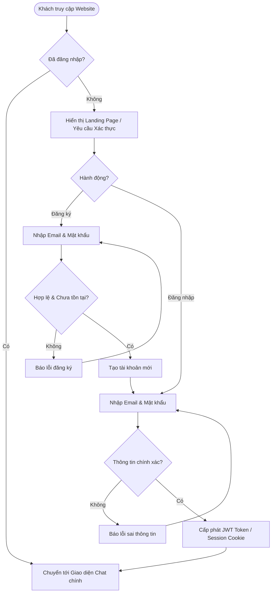
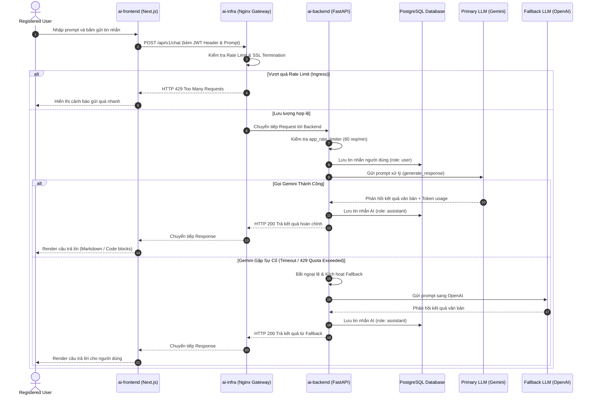
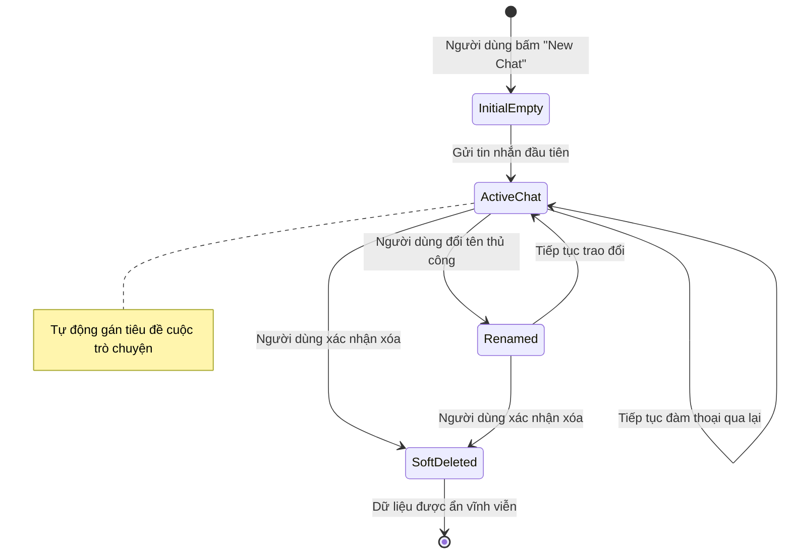

# SOFTWARE REQUIREMENTS SPECIFICATION (SRS)
## Hệ Thống Website Chatbot Trợ Lý Ảo (AI-Chan Assistant)

---

| Thông Tin Tài Liệu | Chi Tiết |
| :--- | :--- |
| **Dự án** | Website Chatbot Trợ Lý Ảo (`ai-chan`) |
| **Tài liệu** | Software Requirements Specification (SRS) |
| **Phiên bản** | v1.0.0-DRAFT |
| **Trạng thái** | Review Ready (Đã thẩm định BA / SA / Architect) |
| **Tác giả** | Senior Business Analyst + System Analyst + Software Architect |
| **Phân loại thông tin** | `FACT` (Bằng chứng hiện hữu) \| `ASSUMPTION` (Giả định nghiệp vụ) \| `DECISION` (Quyết định thống nhất) \| `OPEN QUESTION` (Câu hỏi mở) \| `TBD` (Chờ làm rõ) |
| **Quy định ràng buộc** | **NO CODING PHASE** — Chỉ xây dựng tài liệu kỹ thuật và đặc tả yêu cầu |

---

## MỤC LỤC
1. [1. Giới Thiệu (Introduction)](#1-giới-thiệu-introduction)
2. [2. Mô Tả Tổng Quan Hệ Thống (Overall Description)](#2-mô-tả-tổng-quan-hệ-thống-overall-description)
3. [3. Phạm Vi Hệ Thống (System Scope)](#3-phạm-vi-hệ-thống-system-scope)
4. [4. Các Bên Liên Quan & Tác Nhân (Stakeholders & Actors)](#4-các-bên-liên-quan--tác-nhân-stakeholders--actors)
5. [5. Yêu Cầu Chức Năng (Functional Requirements - FR)](#5-yêu-cầu-chức-năng-functional-requirements---fr)
6. [6. Yêu Cầu Phi Chức Năng (Non-Functional Requirements - NFR)](#6-yêu-cầu-phi-chức-năng-non-functional-requirements---nfr)
7. [7. Quy Tắc Nghiệp Vụ (Business Rules - BR)](#7-quy-tắc-nghiệp-vụ-business-rules---br)
8. [8. Quy Trình & Luồng Hoạt Động Hệ Thống (System Workflows)](#8-quy-trình--luồng-hoạt-động-hệ-thống-system-workflows)
9. [9. Hệ Thống Ngoài & Tích Hợp (External Systems & Integrations)](#9-hệ-thống-ngoài--tích-hợp-external-systems--integrations)
10. [10. Yêu Cầu Dữ Liệu Khái Niệm (Conceptual Data Requirements)](#10-yêu-cầu-dữ-liệu-khái-niệm-conceptual-data-requirements)
11. [11. Yêu Cầu An Toàn & Bảo Mật (Security Requirements)](#11-yêu-cầu-an-toàn--bảo-mật-security-requirements)
12. [12. Yêu Cầu Xử Lý Lỗi & Ngoại Lệ (Error & Exception Requirements)](#12-yêu-cầu-xử-lý-lỗi--ngoại-lệ-error--exception-requirements)
13. [13. Tiêu Chí Nghiệm Thu Cấp Cao (Acceptance Criteria - AC)](#13-tiêu-chí-nghiệm-thu-cấp-cao-acceptance-criteria---ac)
14. [14. Rủi Ro, Giả Định & Vấn Đề Cần Làm Rõ (Risks & Open Questions)](#14-rủi-ro-giả-định--vấn-đề-cần-làm-rõ-risks--open-questions)
15. [15. Ma Trận Truy Vết Yêu Cầu (Traceability Matrix)](#15-ma-trận-truy-vết-yêu-cầu-traceability-matrix)

---

## 1. Giới Thiệu (Introduction)

### 1.1 Mục Đích (Purpose)
Tài liệu **Software Requirements Specification (SRS)** này xác định toàn diện các yêu cầu nghiệp vụ (Business Requirements), yêu cầu chức năng (Functional Requirements), yêu cầu phi chức năng (Non-Functional Requirements), cùng với các quy tắc nghiệp vụ và ràng buộc hệ thống cho dự án **Website Chatbot Trợ Lý Ảo (AI-Chan Assistant)**.
Tài liệu này đóng vai trò là nguồn sự thật chuẩn (Baseline Requirements) để phục vụ các giai đoạn tiếp theo: System Architecture Design (SAD), API Specification, Database Schema Design, UI/UX Wireframing, Implementation Planning (`/plan`), và Verification/Testing, **tuyệt đối không triển khai mã nguồn (No Coding) trong giai đoạn này**.

### 1.2 Phạm Vi Tài Liệu (Scope of Document)
Tài liệu bao quát ranh giới hệ thống ứng dụng web chatbot 3 tầng (`ai-frontend`, `ai-backend`, `ai-infra`), tương tác giữa người dùng và AI Assistant, luồng quản lý phiên làm việc, lưu trữ lịch sử hội thoại, và tích hợp đa nhà cung cấp mô hình ngôn ngữ lớn (LLM Providers).

### 1.3 Tổng Quan Sản Phẩm (Product Overview)
AI-Chan Assistant là giải pháp cổng thông tin tương tác thông minh trên nền tảng web, cung cấp cho người dùng khả năng trao đổi trực tiếp, giải đáp thông tin, tư vấn nội dung theo ngữ cảnh thời gian thực thông qua công nghệ Generative AI. Hệ thống vận hành độc lập với hạ tầng bảo mật nghiêm ngặt (HTTPS TLS 1.3, rate limit, kiểm soát tải), đảm bảo tính sẵn sàng cao và bảo vệ toàn vẹn thông tin người dùng.

### 1.4 Mục Tiêu Nghiệp Vụ (Business Objectives)
- **BO-01 (Nâng cao trải nghiệm tương tác)**: Cung cấp giao diện đàm thoại tự nhiên, phản hồi nhanh chóng và mạch lạc cho người dùng cuối.
- **BO-02 (Tối ưu hóa chi phí & sẵn sàng dịch vụ)**: Cho phép chuyển đổi linh hoạt giữa các nhà cung cấp LLM (Gemini, OpenAI, v.v.), có cơ chế fallback khi một dịch vụ gặp sự cố hạn mức hoặc quá tải.
- **BO-03 (Bảo toàn ngữ cảnh trao đổi)**: Lưu trữ và phân tách độc lập các phiên hội thoại (conversations) của người dùng nhằm duy trì tính liền mạch trong các tác vụ làm việc dài hạn.
- **BO-04 (An toàn dữ liệu & Kiểm soát vận hành)**: Ngăn ngừa lạm dụng tài nguyên tính toán (Anti-Abuse/DDoS), bảo vệ bí mật khóa API (API Key Hardening), và minh bạch hóa chi phí tiêu thụ token.

### 1.5 Bài Toán Cần Giải Quyết (Problem Statement)
- **Vấn đề hiện tại**: Người dùng cần một trợ lý ảo trực quan trên trình duyệt để tương tác tức thì mà không cần cài đặt phức tạp; đồng thời các hệ thống AI đơn lẻ thường dễ gián đoạn khi nhà cung cấp LLM chạm ngưỡng quota hoặc lỗi mạng.
- **Nhu cầu giải quyết**: Xây dựng nền tảng web chatbot hỗ trợ phiên hội thoại phân tán, có cơ chế xác thực an toàn, quản lý lịch sử theo từng cá nhân, và có tầng Gateway/Backend đệm kiểm soát an toàn để điều phối request tới các mô hình AI.

### 1.6 Đối Tượng Đọc Tài Liệu (Intended Audience)
- **Product Owners & Business Stakeholders**: Thẩm định phạm vi nghiệp vụ và tiêu chí nghiệm thu.
- **System Architects & Software Engineers**: Sử dụng làm đặc tả đầu vào cho bản vẽ kiến trúc, thiết kế API REST/Streaming và cơ sở dữ liệu.
- **QA / Test Engineers**: Sử dụng để xây dựng ma trận kiểm thử (Test Plan / Test Cases).
- **Security & DevOps Engineers**: Sử dụng để rà soát mô hình đe dọa và kiểm soát hạ tầng mạng.

### 1.7 Định Nghĩa & Thuật Ngữ (Definitions and Terminology)
- **Conversation (Phiên hội thoại)**: Một luồng trao đổi có chủ đề xác định giữa người dùng và AI, gồm tập hợp các tin nhắn tuần tự.
- **Message (Tin nhắn)**: Một lượt giao tiếp đơn lẻ từ người dùng (`role: user`) hoặc phản hồi từ trợ lý ảo (`role: assistant`).
- **LLM Provider**: Nhà cung cấp mô hình AI lớn bên thứ ba (ví dụ: Google Gemini API, OpenAI API).
- **Fallback**: Cơ chế tự động chuyển hướng gọi API sang nhà cung cấp phụ khi nhà cung cấp chính thất bại hoặc hết hạn mức.
- **Streaming Response**: Kỹ thuật truyền dữ liệu phản hồi từng từ/ký tự (Server-Sent Events hoặc Chunked Transfer) về trình duyệt để giảm độ trễ hiển thị trực quan (TTFT - Time To First Token).
- **Rate Limiting**: Cơ chế giới hạn tần suất gửi yêu cầu trong một đơn vị thời gian nhằm bảo vệ hệ thống trước tấn công hoặc lạm dụng.

### 1.8 Tài Liệu Tham Khảo (References)
- Bằng chứng mã nguồn hiện có: [main.py](file:///c:/Users/PC/Project/ai-chan/ai-backend/src/main.py), [router.py](file:///c:/Users/PC/Project/ai-chan/ai-backend/src/api/v1/router.py), [client.py](file:///c:/Users/PC/Project/ai-chan/ai-backend/llm/client.py).
- Bằng chứng hạ tầng hiện có: [docker-compose.yml](file:///c:/Users/PC/Project/ai-chan/ai-infra/compose/docker-compose.yml), [nginx.conf](file:///c:/Users/PC/Project/ai-chan/ai-infra/docker/nginx/nginx.conf).
- Khảo sát dữ liệu hiện hữu: [current-db-observations.md](file:///c:/Users/PC/Project/ai-chan/docs/00-discovery/current-db-observations.md).
- Quy tắc hệ sinh thái Antigravity: [core.md](file:///c:/Users/PC/Project/ai-chan/.agents/rules/core.md), [security.md](file:///c:/Users/PC/Project/ai-chan/.agents/rules/security.md).

---

## 2. Mô Tả Tổng Quan Hệ Thống (Overall Description)

### 2.1 Góc Nhìn Sản Phẩm (Product Perspective)
Hệ thống AI-Chan hoạt động độc lập theo kiến trúc 3 tầng chuẩn mực:
```
[Client Browser] 
      │ HTTPS (TLS 1.3)
      ▼
[ai-infra: Nginx Ingress Gateway] (Rate limit: 10r/s API, 30r/s UI; SSL Termination)
      ├────────────────────────┬────────────────────────┐
      │ Proxy (Port 3000)      │ Proxy (Port 8000)      │
      ▼                        ▼                        ▼
[ai-frontend (Next.js)]   [ai-backend (FastAPI)]   [PostgreSQL 16 & Redis 7]
                               │
                               ├─► Primary: Gemini API
                               └─► Fallback: OpenAI API
```
- **Tầng Trình Diễn (`ai-frontend`)**: Giao diện Next.js cung cấp UI tương tác chat, quản trị sidebar phiên hội thoại.
- **Tầng Xử Lý Nghiệp Vụ (`ai-backend`)**: Xử lý logic nghiệp vụ, điều phối AI, kiểm soát bảo mật ứng dụng.
- **Tầng Lưu Trữ & Hạ Tầng (`ai-infra`)**: Đóng gói Nginx Gateway, PostgreSQL (lưu thực thể quan hệ: User, Conversation, Message) và Redis (lưu session cache/tần suất).

### 2.2 Các Khối Chức Năng Chính (Product Functions)
1. **Xác thực & Danh tính (Identity & Authentication)**: Đăng ký, đăng nhập, bảo vệ phiên qua JWT/Secure Cookie, đăng xuất.
2. **Không Gian Trò Chuyện (Chat Workspace)**: Nhập prompt, gửi tin nhắn, nhận phản hồi (hỗ trợ hiển thị Markdown, code snippets).
3. **Quản Lý Phiên Hội Thoại (Conversation Lifecycle)**: Khởi tạo đoạn chat mới, đổi tên, lưu trữ danh sách, xóa cuộc trò chuyện.
4. **Điều Phối AI Đa Nền Tảng (Multi-Provider AI Orchestration)**: Tự động phân luồng tới model AI mặc định hoặc người dùng chọn, xử lý dự phòng lỗi.
5. **Giám Sát Vận Hành & Bảo Vệ Tài Nguyên (Protection & Telemetry)**: Giới hạn lưu lượng chống spam, ghi log chi phí token và vết kiểm toán.

### 2.3 Đặc Điểm & Nhóm Người Dùng (User Classes and Characteristics)
- **Guest (Khách vãng lai)**:
  - *Mô tả*: Người dùng truy cập website nhưng chưa thực hiện đăng nhập.
  - *Đặc quyền*: Được xem trang giới thiệu; có thể trải nghiệm chat thử nghiệm có giới hạn nghiêm ngặt `[ASSUMPTION]` hoặc bắt buộc chuyển hướng tới trang đăng nhập để lưu trữ phiên `[DECISION]`.
- **Registered User (Người dùng đã đăng ký)**:
  - *Mô tả*: Người dùng cá nhân đã xác thực tài khoản.
  - *Đặc quyền*: Khởi tạo nhiều conversation, lưu toàn bộ lịch sử trò chuyện cá nhân, tùy chỉnh thông tin tài khoản cơ bản.
- **Administrator (Quản trị viên hệ thống) `[FUTURE SCOPE]`**:
  - *Mô tả*: Người vận hành hệ thống nội bộ.
  - *Đặc quyền*: Quản lý danh mục model, theo dõi nhật ký hệ thống, thống kê token tiêu thụ.

### 2.4 Môi Trường Vận Hành (Operating Environment)
- **Client**: Trình duyệt hiện đại hỗ trợ ECMAScript 6+ và Fetch API Streams (Chrome 90+, Firefox 88+, Safari 14+, Edge 90+).
- **Máy chủ Backend**: Python 3.11+, Uvicorn ASGI Server, FastAPI.
- **Máy chủ Frontend**: Node.js 18+ LTS, Next.js 14 runtime.
- **Hạ tầng Container**: Docker Engine 24+, Docker Compose v2.

### 2.5 Ràng Buộc Hệ Thống (System Constraints)
- **CST-01 (Bảo mật Khóa API)**: Tuyệt đối không bao giờ trả API Key của các nhà cung cấp AI về phía Client/Browser. Mọi cuộc gọi AI đều phải thông qua Gateway Backend.
- **CST-02 (Ràng buộc Mạng & Cổng)**: Mọi giao tiếp từ Internet chỉ được phép đi qua Nginx cổng 443 (HTTPS) và 80 (chuyển hướng sang 443). Các port 3000, 8000, 5432, 6379 phải đóng kín trong mạng nội bộ docker network khi đưa lên môi trường sản xuất.
- **CST-03 (Chính sách Không Code trong Phase này)**: Mọi yêu cầu phát sinh phải được biểu diễn bằng tài liệu phân tích, không sửa đổi source code trong pha này.

### 2.6 Giả Định & Sự Phụ Thuộc (Assumptions and Dependencies)
- **DEP-01**: Tính khả dụng của API từ bên thứ ba (Google Cloud AI Platform / OpenAI API).
- **DEP-02**: Hệ thống cơ sở dữ liệu PostgreSQL 16 và Redis hoạt động ổn định trên hạ tầng máy chủ cục bộ hoặc Docker host.
- **ASM-01**: Kết nối Internet của máy chủ luôn thông suốt tới các máy chủ API LLM ở nước ngoài.
- **ASM-02**: Mỗi phiên hội thoại của người dùng lưu trữ dữ liệu văn bản (text/markdown) là trọng tâm; tính năng tải tệp đa phương tiện (file upload) được đưa vào phạm vi tương lai.

---

## 3. Phạm Vi Hệ Thống (System Scope)

| Phân Loại | Mã Hạng Mục | Mô Tả Chi Tiết |
| :--- | :--- | :--- |
| **IN SCOPE** *(Bắt buộc hoàn thiện đặc tả và xây dựng trong pha hiện tại)* | **SC-IN-01** | **Xác thực tài khoản cơ bản**: Đăng ký (Email/Password), Đăng nhập, Đăng xuất, Lưu trữ phiên an toàn qua JWT. |
| | **SC-IN-02** | **Quản lý phiên hội thoại (Conversations)**: Tạo mới, liệt kê danh sách, xem chi tiết, đổi tên tự động/thủ công, xóa conversation. |
| | **SC-IN-03** | **Tương tác đàm thoại AI**: Gửi tin nhắn, nhận phản hồi đầy đủ từ AI Assistant, hiển thị định dạng văn bản Markdown và code block. |
| | **SC-IN-04** | **Phối hợp AI Model & Fallback**: Backend điều phối gọi Gemini (mặc định) và tự động fallback sang OpenAI khi lỗi. |
| | **SC-IN-05** | **Bảo vệ ứng dụng & Rate Limiting**: Thực thi giới hạn tốc độ tại tầng Nginx và tầng FastAPI (`app_rate_limiter`). |
| **OUT OF SCOPE** *(Tuyệt đối không thực hiện trong giai đoạn này)* | **SC-OUT-01** | Tích hợp cổng thanh toán trực tuyến hoặc mua gói thành viên (Payment / Subscription billing). |
| | **SC-OUT-02** | Xây dựng ứng dụng di động bản địa (Native Mobile Apps cho iOS / Android). |
| | **SC-OUT-03** | Tự huấn luyện (Fine-tuning / Pre-training) mô hình AI riêng trên máy chủ cục bộ. |
| | **SC-OUT-04** | Tích hợp voice/âm thanh thời gian thực (Real-time Speech-to-Speech). |
| **FUTURE SCOPE** *(Được thiết kế mở nhưng chỉ phát triển ở các giai đoạn sau)* | **SC-FUT-01** | **Tải lên & Xử lý tệp (File Upload / RAG Document Analysis)**: Tải file PDF, DOCX để AI phân tích ngữ cảnh. |
| | **SC-FUT-02** | **Cổng Quản Trị Hệ Thống (Admin Dashboard)**: Giao diện quản trị số lượng người dùng, quản lý prompt mẫu, theo dõi chi phí API. |
| | **SC-FUT-03** | **Đăng nhập Mạng xã hội (OAuth2 Social Login)**: Google, GitHub, Discord authentication. |
| | **SC-FUT-04** | **Chia sẻ cuộc trò chuyện công khai (Public Conversation Sharing)**: Xuất bản permalink cho đoạn chat. |
| **UNKNOWN / TBD** *(Nội dung chờ xác nhận từ phía Business Owner)* | **SC-TBD-01** | Có cho phép Guest (người chưa đăng nhập) trò chuyện với hạn mức số câu hỏi nhất định (ví dụ 3 lượt) hay bắt buộc 100% phải Login trước khi chat? |
| | **SC-TBD-02** | Giới hạn tối đa số lượng ký tự trên mỗi prompt và số lượng tin nhắn lưu trong một phiên chat là bao nhiêu? |

---

## 4. Các Bên Liên Quan & Tác Nhân (Stakeholders & Actors)

### 4.1 Danh Sách Stakeholders
- **Product Owner (PO)**: Người quyết định chiến lược, duyệt phạm vi tính năng và mức độ ưu tiên.
- **End Users**: Người dùng cuối trực tiếp tương tác với trợ lý ảo.
- **Development & Architecture Team**: Chịu trách nhiệm chuyển hóa SRS thành kiến trúc và mã nguồn an toàn.
- **Infrastructure & Security Team**: Giám sát vận hành cụm máy chủ và bảo đảm an toàn dữ liệu.

### 4.2 Danh Sách Actors
```
           ┌───────────────────────┐
           │        Actors         │
           └───────────┬───────────┘
                       │
       ┌───────────────┼───────────────┐
       ▼               ▼               ▼
 ┌───────────┐   ┌───────────┐   ┌───────────┐
 │   Guest   │   │Registered │   │System AI  │
 │           │   │   User    │   │ Provider  │
 └───────────┘   └───────────┘   └───────────┘
```

| Actor ID | Tên Tác Nhân | Trách Nhiệm & Quyền Hạn | Tương Tác Với Hệ Thống |
| :--- | :--- | :--- | :--- |
| **ACT-01** | **Guest** (Khách vãng lai) | Người dùng chưa xác thực truy cập vào website. | Xem giao diện Landing Page, xem form đăng nhập/đăng ký. `[OPEN QUESTION]`: Có được chat thử hay không. |
| **ACT-02** | **Registered User** (Người dùng chính thức) | Người dùng đã có tài khoản và đăng nhập hợp lệ. | Tạo, đổi tên, xóa conversation; gửi tin nhắn; nhận và đọc câu trả lời của AI; đăng xuất. |
| **ACT-03** | **External AI Provider** (Hệ thống AI đối tác) | Dịch vụ AI đám mây (Google Gemini, OpenAI). | Tiếp nhận prompt và ngữ cảnh từ Backend; sinh câu trả lời và thông tin số lượng token. |
| **ACT-04** | **System Background Scheduler** | Bộ tiến trình ngầm của hệ thống (Cron/Worker). | Dọn dẹp token hết hạn, thống kê dữ liệu nhật ký không đồng bộ. |

---

## 5. Yêu Cầu Chức Năng (Functional Requirements - FR)

### 5.1 Nhóm Chức Năng Xác Thực & Người Dùng (Identity & Access Management)

#### FR-001: Đăng Ký Tài Khoản (User Registration)
- **Mã Yêu Cầu**: `FR-001`
- **Mô Tả**: Cho phép người dùng mới tạo tài khoản bằng Email và Mật khẩu.
- **Tác Nhân (Actor)**: Guest.
- **Điều Kiện Tiên Quyết (Preconditions)**: Khách chưa đăng nhập; email chưa tồn tại trong hệ thống.
- **Luồng Chính (Main Flow)**:
  1. Người dùng truy cập trang Đăng ký (`/register`).
  2. Người dùng nhập Email hợp lệ, Mật khẩu (đáp ứng tiêu chuẩn độ phức tạp) và Xác nhận mật khẩu.
  3. Người dùng nhấn nút "Đăng ký".
  4. Hệ thống kiểm tra tính hợp lệ dữ liệu đầu vào (format email, độ dài mật khẩu >= 8 ký tự, mật khẩu khớp nhau).
  5. Hệ thống băm mật khẩu an toàn (Argon2id hoặc Bcrypt với salt).
  6. Hệ thống tạo bản ghi người dùng mới với trạng thái kích hoạt `ACTIVE`.
  7. Hệ thống thông báo đăng ký thành công và chuyển hướng tới trang Đăng nhập.
- **Luồng Rẽ Nhánh (Alternative Flow)**: `Không có`.
- **Luồng Ngoại Lệ (Exception Flow)**:
  - *EF-01*: Email đã tồn tại -> Hệ thống hiển thị thông báo lỗi "Email này đã được sử dụng".
  - *EF-02*: Mật khẩu không đủ mạnh -> Hệ thống yêu cầu bổ sung chữ hoa, số hoặc ký tự đặc biệt.
- **Điều Kiện Sau (Postconditions)**: Tài khoản mới được ghi nhận trong cơ sở dữ liệu.
- **Độ Ưu Tiên**: `Must Have` (P1).
- **Phụ Thuộc (Dependencies)**: Không có.
- **Ghi Chú / Giả Định**: `[DECISION]`: Ở phiên bản MVP v1, chưa yêu cầu luồng gửi email xác thực mã kích hoạt để tối ưu thời gian tiếp cận.

#### FR-002: Đăng Nhập Hệ Thống (User Login)
- **Mã Yêu Cầu**: `FR-002`
- **Mô Tả**: Xác thực danh tính người dùng và thiết lập phiên làm việc an toàn.
- **Tác Nhân (Actor)**: Guest.
- **Điều Kiện Tiên Quyết (Preconditions)**: Người dùng đã có tài khoản trong hệ thống.
- **Luồng Chính (Main Flow)**:
  1. Người dùng truy cập trang Đăng nhập (`/login`).
  2. Nhập Email và Mật khẩu, sau đó nhấn "Đăng nhập".
  3. Hệ thống kiểm tra tài khoản theo email và đối chiếu hash mật khẩu.
  4. Khớp thông tin -> Hệ thống sinh cặp mã thông báo (Access Token và Refresh Token) dưới dạng JWT hoặc HttpOnly Cookie an toàn.
  5. Hệ thống điều hướng người dùng vào giao diện Chat chính (`/`).
- **Luồng Ngoại Lệ (Exception Flow)**:
  - *EF-01*: Sai thông tin email hoặc mật khẩu -> Báo lỗi chung "Email hoặc mật khẩu không chính xác" (tránh lộ thông tin email tồn tại).
  - *EF-02*: Tài khoản bị khóa -> Báo lỗi "Tài khoản của bạn đã bị vô hiệu hóa".
- **Điều Kiện Sau (Postconditions)**: Phiên làm việc được thiết lập; Header request mang thông tin định danh hợp lệ.
- **Độ Ưu Tiên**: `Must Have` (P1).
- **Phụ Thuộc (Dependencies)**: `FR-001`.

#### FR-003: Đăng Xuất Hệ Thống (User Logout)
- **Mã Yêu Cầu**: `FR-003`
- **Mô Tả**: Hủy bỏ phiên làm việc hiện tại của người dùng.
- **Tác Nhân (Actor)**: Registered User.
- **Điều Kiện Tiên Quyết (Preconditions)**: Đang trong trạng thái đăng nhập.
- **Luồng Chính (Main Flow)**:
  1. Người dùng nhấn nút "Đăng xuất" trên giao diện.
  2. Hệ thống hủy Cookie/Token phiên làm việc, xóa cache session tương ứng trên máy chủ nếu có.
  3. Hệ thống điều hướng người dùng về trang Đăng nhập hoặc Landing page.
- **Điều Kiện Sau (Postconditions)**: Người dùng trở về trạng thái Guest, không thể truy cập các API yêu cầu xác thực.
- **Độ Ưu Tiên**: `Must Have` (P1).
- **Phụ Thuộc (Dependencies)**: `FR-002`.

---

### 5.2 Nhóm Chức Năng Quản Lý Phiên Hội Thoại (Conversation Management)

#### FR-004: Khởi Tạo Cuộc Trò Chuyện Mới (Create Conversation)
- **Mã Yêu Cầu**: `FR-004`
- **Mô Tả**: Cho phép người dùng tạo một luồng trao đổi mới với AI Assistant.
- **Tác Nhân (Actor)**: Registered User.
- **Điều Kiện Tiên Quyết (Preconditions)**: Người dùng đã đăng nhập thành công.
- **Luồng Chính (Main Flow)**:
  1. Người dùng nhấn nút "Cuộc trò chuyện mới" (New Chat) trên sidebar.
  2. Hệ thống tạo một bản ghi Conversation mới gắn với `user_id` hiện tại, tiêu đề mặc định là "Cuộc trò chuyện mới".
  3. Giao diện mở ra màn hình chat trống với thông điệp chào mừng của trợ lý ảo.
- **Điều Kiện Sau (Postconditions)**: Khởi tạo ID hội thoại (`conversation_id`) mới và sẵn sàng tiếp nhận tin nhắn.
- **Độ Ưu Tiên**: `Must Have` (P1).
- **Phụ Thuộc (Dependencies)**: `FR-002`.

#### FR-005: Xem Danh Sách Lịch Sử Hội Thoại (List Conversations)
- **Mã Yêu Cầu**: `FR-005`
- **Mô Tả**: Hiển thị danh sách các cuộc trò chuyện trước đây của người dùng trên thanh điều hướng (Sidebar).
- **Tác Nhân (Actor)**: Registered User.
- **Điều Kiện Tiên Quyết (Preconditions)**: Người dùng đã đăng nhập.
- **Luồng Chính (Main Flow)**:
  1. Khi người dùng mở giao diện chat, client gửi yêu cầu lấy danh sách conversation của tài khoản.
  2. Hệ thống truy vấn các conversation thuộc về `user_id`, sắp xếp theo thời gian cập nhật gần nhất (`updated_at DESC`).
  3. Client hiển thị danh sách tiêu đề cuộc trò chuyện trên sidebar.
- **Luồng Ngoại Lệ (Exception Flow)**:
  - Người dùng chưa có cuộc trò chuyện nào -> Hiển thị danh sách trống cùng nút gợi ý bắt đầu chat.
- **Điều Kiện Sau (Postconditions)**: Danh sách hội thoại hiển thị đầy đủ, cho phép chọn chuyển đổi.
- **Độ Ưu Tiên**: `Must Have` (P1).
- **Phụ Thuộc (Dependencies)**: `FR-004`.

#### FR-006: Đổi Tên Cuộc Trò Chuyện (Rename Conversation)
- **Mã Yêu Cầu**: `FR-006`
- **Mô Tả**: Cho phép đổi tiêu đề cuộc trò chuyện thủ công hoặc tự động tóm tắt sau câu hỏi đầu tiên.
- **Tác Nhân (Actor)**: Registered User, Hệ thống (tự động).
- **Điều Kiện Tiên Quyết (Preconditions)**: Cuộc trò chuyện tồn tại và thuộc quyền sở hữu của người dùng.
- **Luồng Chính (Main Flow - Thủ công)**:
  1. Người dùng chọn biểu tượng "Đổi tên" bên cạnh tiêu đề cuộc trò chuyện.
  2. Người dùng nhập tên mới (1 - 100 ký tự) và xác nhận.
  3. Hệ thống cập nhật trường `title` của conversation trong cơ sở dữ liệu.
- **Luồng Phụ (Alternative Flow - Tự động)**:
  - Khi người dùng gửi tin nhắn đầu tiên, hệ thống tự động trích xuất 30-50 ký tự đầu làm tiêu đề ban đầu nếu tiêu đề vẫn là mặc định.
- **Điều Kiện Sau (Postconditions)**: Tiêu đề mới được cập nhật trên giao diện và lưu trữ vĩnh viễn.
- **Độ Ưu Tiên**: `Should Have` (P2).
- **Phụ Thuộc (Dependencies)**: `FR-004`.

#### FR-007: Xóa Cuộc Trò Chuyện (Delete Conversation)
- **Mã Yêu Cầu**: `FR-007`
- **Mô Tả**: Cho phép người dùng xóa vĩnh viễn một cuộc trò chuyện và toàn bộ tin nhắn liên quan.
- **Tác Nhân (Actor)**: Registered User.
- **Điều Kiện Tiên Quyết (Preconditions)**: Cuộc trò chuyện tồn tại và thuộc sở hữu của người dùng.
- **Luồng Chính (Main Flow)**:
  1. Người dùng chọn biểu tượng "Xóa" trên cuộc trò chuyện muốn xóa.
  2. Hệ thống hiển thị hộp thoại cảnh báo xác nhận xóa.
  3. Người dùng xác nhận "Đồng ý xóa".
  4. Hệ thống xóa cuộc trò chuyện (hoặc đánh dấu Soft Delete `deleted_at`) và các tin nhắn liên quan.
  5. Giao diện cập nhật bỏ cuộc trò chuyện khỏi danh sách; nếu đang mở cuộc trò chuyện đó thì chuyển về màn hình New Chat.
- **Điều Kiện Sau (Postconditions)**: Toàn bộ dữ liệu tin nhắn của cuộc trò chuyện không còn hiển thị với người dùng.
- **Độ Ưu Tiên**: `Must Have` (P1).
- **Phụ Thuộc (Dependencies)**: `FR-005`.

---

### 5.3 Nhóm Chức Năng Tương Tác Hội Thoại & Trí Tuệ Nhân Tạo (Chat & AI Interaction)

#### FR-008: Gửi Tin Nhắn Văn Bản (Send Message)
- **Mã Yêu Cầu**: `FR-008`
- **Mô Tả**: Tiếp nhận nội dung văn bản do người dùng nhập và gửi tới hệ thống xử lý.
- **Tác Nhân (Actor)**: Registered User.
- **Điều Kiện Tiên Quyết (Preconditions)**: Đang ở trong một `conversation_id` hợp lệ; nội dung tin nhắn không rỗng.
- **Luồng Chính (Main Flow)**:
  1. Người dùng nhập văn bản vào khung chat và nhấn nút "Gửi" (hoặc phím Enter).
  2. Client kiểm tra chuỗi (không chỉ chứa khoảng trắng, độ dài <= 4000 ký tự).
  3. Client hiển thị tin nhắn ngay lập tức trên màn hình với trạng thái "Đang gửi...".
  4. Client gọi API `POST /api/v1/chat` gửi nội dung kèm `conversation_id`.
  5. Hệ thống lưu tin nhắn của người dùng vào cơ sở dữ liệu (`role: user`).
- **Luồng Ngoại Lệ (Exception Flow)**:
  - Tin nhắn vượt quá số ký tự cho phép -> Chặn gửi và cảnh báo người dùng rút ngắn nội dung.
- **Điều Kiện Sau (Postconditions)**: Tin nhắn được ghi nhận vào lịch sử phiên làm việc.
- **Độ Ưu Tiên**: `Must Have` (P1).
- **Phụ Thuộc (Dependencies)**: `FR-004`.

#### FR-009: Nhận Phản Hồi Từ AI (Receive AI Response)
- **Mã Yêu Cầu**: `FR-009`
- **Mô Tả**: Hệ thống gọi mô hình ngôn ngữ lớn để sinh câu trả lời và hiển thị cho người dùng.
- **Tác Nhân (Actor)**: Registered User, External AI Provider.
- **Điều Kiện Tiên Quyết (Preconditions)**: Tin nhắn người dùng đã gửi thành công tới Backend.
- **Luồng Chính (Main Flow)**:
  1. Backend tập hợp ngữ cảnh các tin nhắn gần nhất của cuộc trò chuyện.
  2. Backend gọi engine LLM ([llm_manager](file:///c:/Users/PC/Project/ai-chan/ai-backend/llm/client.py)).
  3. Mô hình AI phân tích và trả về nội dung hoàn chỉnh kèm số lượng token tiêu thụ.
  4. Backend lưu tin nhắn phản hồi của AI vào cơ sở dữ liệu (`role: assistant`).
  5. Backend trả kết quả về cho Client; Client kết xuất định dạng Markdown, danh sách và khối mã nguồn (Syntax Highlighting).
- **Luồng Phụ (Alternative Flow - Streaming)**:
  - Client yêu cầu stream -> Backend truyền dữ liệu chunk-by-chunk qua ReadableStream ([apiClient.ts](file:///c:/Users/PC/Project/ai-chan/ai-frontend/src/services/apiClient.ts)), giao diện hiển thị hiệu ứng gõ phím theo thời gian thực.
- **Luồng Ngoại Lệ (Exception Flow)**:
  - *EF-01*: Nhà cung cấp AI chính lỗi/timeout -> Kích hoạt cơ chế Fallback sang nhà cung cấp phụ (`FR-011`).
  - *EF-02*: Cả hai nhà cung cấp đều thất bại -> Trả về thông báo lỗi thân thiện: "Hệ thống AI hiện đang bận, vui lòng thử lại sau giây lát."
- **Điều Kiện Sau (Postconditions)**: Cuộc trò chuyện được cập nhật câu trả lời mới nhất; trạng thái chờ phản hồi kết thúc.
- **Độ Ưu Tiên**: `Must Have` (P1).
- **Phụ Thuộc (Dependencies)**: `FR-008`.

#### FR-010: Tùy Chọn Mô Hình AI (Select AI Model/Provider)
- **Mã Yêu Cầu**: `FR-010`
- **Mô Tả**: Cho phép người dùng lựa chọn mô hình AI mong muốn (ví dụ: Gemini 1.5 Pro/Flash, GPT-4o) trước khi bắt đầu gửi câu hỏi.
- **Tác Nhân (Actor)**: Registered User.
- **Điều Kiện Tiên Quyết (Preconditions)**: Các mô hình đã được cấu hình và kích hoạt trên hệ thống.
- **Luồng Chính (Main Flow)**:
  1. Người dùng bấm vào thanh chọn Model trên đầu giao diện chat.
  2. Hệ thống hiển thị danh sách các model khả dụng.
  3. Người dùng chọn model mong muốn.
  4. Các yêu cầu gửi tin nhắn tiếp theo trong phiên đó sẽ truyền kèm tham số `provider` và `model`.
- **Điều Kiện Sau (Postconditions)**: Yêu cầu chat được điều hướng tới đúng model đã chọn.
- **Độ Ưu Tiên**: `Should Have` (P2).
- **Phụ Thuộc (Dependencies)**: `FR-008`.

#### FR-011: Tự Động Chuyển Đổi Dự Phòng Nhà Cung Cấp (Provider Failover / Fallback)
- **Mã Yêu Cầu**: `FR-011`
- **Mô Tả**: Đảm bảo dịch vụ không bị gián đoạn bằng cách tự động gọi sang provider dự phòng khi provider chính gặp sự cố (Rate Limit 429, Quota Exceeded, 5xx).
- **Tác Nhân (Actor)**: Backend LLM Orchestration Engine.
- **Điều Kiện Tiên Quyết (Preconditions)**: Hệ thống cấu hình ít nhất 2 providers (Gemini & OpenAI) kèm khóa API hợp lệ.
- **Luồng Chính (Main Flow)**:
  1. Backend gửi yêu cầu tới Provider chính (mặc định Gemini).
  2. Provider chính phản hồi lỗi ngoại lệ (HTTP 429, 500, 503 hoặc Timeout > 30s).
  3. `LLMManager` bắt ngoại lệ, ghi log cảnh báo và ngay lập tức chuyển hướng payload sang Provider phụ (OpenAI).
  4. Provider phụ xử lý thành công và trả về kết quả cho người dùng.
- **Điều Kiện Sau (Postconditions)**: Người dùng vẫn nhận được câu trả lời mà không phải thao tác lại; hệ thống ghi log sự kiện failover.
- **Độ Ưu Tiên**: `Must Have` (P1).
- **Phụ Thuộc (Dependencies)**: `FR-009`.

---

## 6. Yêu Cầu Phi Chức Năng (Non-Functional Requirements - NFR)

### 6.1 Hiệu Năng (Performance) - `NFR-PERF`
- **NFR-PERF-01 (Thời gian phản hồi giao diện)**: Tải trang web lần đầu (First Contentful Paint) < 1.5 giây trên kết nối mạng tiêu chuẩn băng thông rộng.
- **NFR-PERF-02 (Độ trễ ký tự đầu tiên - TTFT)**: Đối với chế độ Streaming response, ký tự đầu tiên từ AI phải bắt đầu hiển thị trên màn hình người dùng trong vòng 2.0 giây kể từ khi gửi tin nhắn (với điều kiện LLM Provider không bị nghẽn).
- **NFR-PERF-03 (Tải đồng thời)**: Hạ tầng Backend FastAPI và Nginx phải chịu tải tối thiểu 100 người dùng hoạt động đồng thời (concurrent active users) mà không bị sập dịch vụ hoặc lỗi timeout kết nối.

### 6.2 An Ninh & Bảo Mật (Security) - `NFR-SEC`
- **NFR-SEC-01 (Mã hóa truyền tải)**: 100% lưu lượng mạng giữa Trình duyệt và Nginx Ingress Gateway bắt buộc sử dụng giao thức HTTPS với chuẩn bảo mật TLS 1.3 tối tân. Cổng 80 HTTP tự động chuyển hướng 301 sang 443 HTTPS.
- **NFR-SEC-02 (Bảo vệ Thông Tin Xác Thực / Khóa API)**:
  - Khóa API của các nhà cung cấp bên thứ ba (`GEMINI_API_KEY`, `OPENAI_API_KEY`) chỉ lưu trong biến môi trường máy chủ hoặc Secret Manager.
  - Tuyệt đối không lưu secret trong git repository, file tĩnh client hoặc trả về qua response body/header.
- **NFR-SEC-03 (Bảo vệ Mật Khẩu)**: Mật khẩu người dùng trong cơ sở dữ liệu phải được băm một chiều bằng thuật toán hiện đại có muối ngẫu nhiên (Bcrypt hoặc Argon2id), không lưu mật khẩu dạng plain-text.
- **NFR-SEC-04 (Bảo Vệ Tầng Mạng & Chống DoS)**:
  - Nginx Gateway giới hạn tần suất gửi yêu cầu tối đa 10 req/s cho các endpoint `/api/` và tối đa 20 kết nối đồng thời trên mỗi địa chỉ IP.
  - Tầng Backend thực thi bổ sung bộ lọc trượt [InMemoryRateLimiter](file:///c:/Users/PC/Project/ai-chan/ai-backend/src/core/security.py) (60 req/phút/IP).
- **NFR-SEC-05 (Kiểm Soát Nhập Liệu & Chống Tiêm Nhiễm)**: Toàn bộ dữ liệu gửi lên phải được kiểm tra schema nghiêm ngặt thông qua Pydantic tại Backend; hiển thị phía Frontend phải được khử khuẩn (Sanitize) để chống tấn công Cross-Site Scripting (XSS).

### 6.3 Độ Tin Cậy & Tính Sẵn Sàng (Reliability & Availability) - `NFR-REL`
- **NFR-REL-01 (Tính sẵn sàng dịch vụ)**: Hệ thống đạt chỉ số sẵn sàng tối thiểu 99.5% thời gian hoạt động (uptime) hàng tháng, ngoại trừ lịch bảo trì định kỳ được thông báo trước.
- **NFR-REL-02 (Tự phục hồi dịch vụ)**: Các dịch vụ trong Docker Compose được cấu hình chính sách `restart: unless-stopped`; khi một container bị crash, Docker Daemon tự động khởi động lại container trong vòng 10 giây.
- **NFR-REL-03 (Cô lập lỗi AI)**: Lỗi từ nhà cung cấp AI bên thứ ba không được phép làm crash tiến trình chính của Backend. Mọi lỗi gọi API ngoài phải được cô lập bằng khối `try-except` và kích hoạt fallback hoặc trả mã lỗi tiêu chuẩn.

### 6.4 Khả Năng Mở Rộng (Scalability) - `NFR-SCA`
- **NFR-SCA-01 (Mở rộng phi trạng thái)**: Tầng Backend FastAPI được thiết kế theo mô hình Stateless, cho phép mở rộng theo chiều ngang (Horizontal Scaling) bằng cách nâng số lượng worker hoặc scale số lượng container đứng sau Nginx upstream load balancer.
- **NFR-SCA-02 (Tách biệt dữ liệu)**: Cơ sở dữ liệu PostgreSQL và bộ đệm Redis được cô lập thành các service riêng biệt, sẵn sàng tách sang cụm Database Managed Service độc lập khi khối lượng dữ liệu vượt ngưỡng tải của một máy chủ vật lý.

### 6.5 Khả Năng Bảo Trì (Maintainability) - `NFR-MNT`
- **NFR-MNT-01 (Tính module hóa)**: Kiến trúc code tuân thủ phân tách ranh giới rõ ràng: Tầng trình diễn (Frontend), Tầng API/Routing, Tầng dịch vụ nghiệp vụ, Tầng tích hợp LLM Provider riêng biệt.
- **NFR-MNT-02 (Tài liệu hóa hợp đồng API)**: Tự động phát sinh tài liệu OpenAPI / Swagger Interactive Docs tại đường dẫn nội bộ `/docs` và ReDoc tại `/redoc`.

### 6.6 Trải Nghiệm & Tính Dễ Sử Dụng (Usability) - `NFR-USB`
- **NFR-USB-01 (Thiết kế đáp ứng - Responsive Design)**: Giao diện web tương thích hoàn hảo trên các kích thước màn hình từ điện thoại di động (tối thiểu 360px width), máy tính bảng đến máy tính để bàn (Desktop full HD 1920x1080).
- **NFR-USB-02 (Trực quan hóa trạng thái)**: Mọi thao tác gửi tin nhắn phải hiển thị rõ ràng chỉ báo đang xử lý (Loading indicator / Typing animation) để người dùng nắm được trạng thái hệ thống.

### 6.7 Quyền Riêng Tư & Bảo Vệ Dữ Liệu (Privacy & Data Protection) - `NFR-PRV`
- **NFR-PRV-01 (Cô lập dữ liệu người dùng)**: Người dùng chỉ được phép truy vấn, đọc và thao tác trên lịch sử cuộc trò chuyện thuộc quyền sở hữu của chính mình; nghiêm cấm rò rỉ dữ liệu chéo giữa các tài khoản (IDOR defense).
- **NFR-PRV-02 (Quyền xóa dữ liệu)**: Khi người dùng yêu cầu xóa cuộc trò chuyện hoặc tài khoản, toàn bộ dữ liệu nội dung tin nhắn tương ứng phải được xóa khỏi trạng thái hiển thị của hệ thống.

### 6.8 Khả Năng Quan Sát (Observability) - `NFR-OBS`
- **NFR-OBS-01 (Nhật ký truy vết)**: Hệ thống ghi log có cấu trúc cho các sự kiện: Đăng nhập thất bại, Lỗi gọi nhà cung cấp AI, Kích hoạt chuyển đổi Fallback, và Lỗi máy chủ 500, bao gồm timestamp, client IP ẩn danh một phần và mã lỗi. Tuyệt đối không log nội dung mật khẩu hoặc Authorization Header.

---

## 7. Quy Tắc Nghiệp Vụ (Business Rules - BR)

| Mã Quy Tắc | Tên Quy Tắc Nghiệp Vụ | Nội Dung Quy Tắc & Ràng Buộc | Trạng Thái / Phân Loại |
| :--- | :--- | :--- | :--- |
| **BR-001** | **Bắt Buộc Xác Thực Để Lưu Lịch Sử** | Chỉ có người dùng đã đăng nhập hợp lệ (Registered User) mới được tạo, lưu trữ và xem lại các phiên hội thoại trên máy chủ. Khách vãng lai (Guest) không được cấp kho lưu trữ dữ liệu vĩnh viễn. | `DECISION` (Đã xác nhận) |
| **BR-002** | **Cách Ly Dữ Liệu Phiên Chat** | Một cuộc trò chuyện (`conversation`) thuộc sở hữu của duy nhất một `user_id`. Mọi truy vấn đọc, sửa, xóa phải xác thực quyền sở hữu trước khi thực thi; vi phạm sẽ bị trả về mã lỗi HTTP 403 Forbidden. | `DECISION` (Đã xác nhận) |
| **BR-003** | **Giới Hạn Độ Dài Đầu Vào** | Mỗi tin nhắn người dùng gửi lên không được rỗng và không vượt quá 4,000 ký tự văn bản để phòng ngừa cạn kiệt token và tràn bộ đệm. | `DECISION` (Đã xác nhận) |
| **BR-004** | **Quy Ước Tiêu Đề Hội Thoại Tự Động** | Khi một cuộc trò chuyện mới được tạo, tiêu đề mặc định là "Cuộc trò chuyện mới". Sau khi nhận được tin nhắn đầu tiên từ người dùng, hệ thống sẽ tự động gán 30 ký tự đầu của tin nhắn đó làm tiêu đề hiển thị nếu người dùng chưa đặt tên thủ công. | `DECISION` (Đã xác nhận) |
| **BR-005** | **Thứ Tự Ưu Tiên Điều Phối Nhà Cung Cấp** | Thứ tự gọi nhà cung cấp mặc định là: 1. Google Gemini -> 2. OpenAI. Nếu người dùng chọn đích danh một model cụ thể nhưng model đó lỗi, hệ thống chỉ fallback nếu có sự đồng ý của chính sách hệ thống. | `DECISION` (Theo hiện trạng code) |
| **BR-006** | **Chính Sách Xử Lý Khi Vượt Rate Limit** | Khi một địa chỉ IP hoặc tài khoản gửi quá tần suất quy định (60 req/phút tại Backend hoặc 10 req/s tại Ingress), hệ thống từ chối phục vụ ngay lập tức với mã HTTP 429 Too Many Requests và thông điệp yêu cầu đợi. | `FACT` (Đã có trong code) |

---

## 8. Quy Trình & Luồng Hoạt Động Hệ Thống (System Workflows)

### 8.1 Luồng Khách Vãng Lai Tiếp Cận & Đăng Ký / Đăng Nhập


### 8.2 Luồng Hội Thoại Chat & Xử Lý Fallback AI


### 8.3 Luồng Vòng Đời Cuộc Trò Chuyện (Conversation Lifecycle)


---

## 9. Hệ Thống Ngoài & Tích Hợp (External Systems & Integrations)

| Hệ Thống Ngoài | Vai Trò Tích Hợp | Phương Thức Kết Nối | Trạng Thái Bằng Chứng |
| :--- | :--- | :--- | :--- |
| **Google Gemini API** | Nhà cung cấp AI chính (Primary LLM Provider) để sinh câu trả lời đàm thoại. | REST API / Python Google Generative AI SDK qua Internet bảo mật. | `FACT` (Đã tích hợp trong [gemini_provider.py](file:///c:/Users/PC/Project/ai-chan/ai-backend/llm/providers/gemini_provider.py)). |
| **OpenAI API** | Nhà cung cấp AI dự phòng (Fallback LLM Provider) khi Gemini lỗi hoặc quá tải. | REST API / Python OpenAI SDK qua Internet bảo mật. | `FACT` (Đã tích hợp trong [openai_provider.py](file:///c:/Users/PC/Project/ai-chan/ai-backend/llm/providers/openai_provider.py)). |
| **PostgreSQL 16** | Hệ quản trị cơ sở dữ liệu quan hệ lưu trữ Users, Conversations, Messages. | Cổng kết nối nội bộ Docker Compose qua giao thức TCP chuẩn 5432. | `FACT` (Đã cấu hình service trong [docker-compose.yml](file:///c:/Users/PC/Project/ai-chan/ai-infra/compose/docker-compose.yml)). |
| **Redis 7** | Bộ nhớ đệm (Cache) lưu trạng thái phiên làm việc và khóa tốc độ tập trung. | Cổng kết nối nội bộ Docker Compose qua giao thức Redis 6379. | `FACT` (Đã cấu hình service trong [docker-compose.yml](file:///c:/Users/PC/Project/ai-chan/ai-infra/compose/docker-compose.yml)). |
| **OAuth2 Identity Providers** | Cung cấp đăng nhập qua Google, GitHub `[POTENTIAL]`. | OAuth2 / OpenID Connect qua HTTPS callback. | `FUTURE SCOPE` / `POTENTIAL`. |
| **S3-compatible Object Storage** | Lưu trữ tệp đính kèm khi mở rộng tính năng upload tài liệu `[POTENTIAL]`. | S3 API / HTTPS. | `FUTURE SCOPE` / `POTENTIAL`. |

---

## 10. Yêu Cầu Dữ Liệu Khái Niệm (Conceptual Data Requirements)

> *Lưu ý*: Phần này chỉ mô tả các thực thể dữ liệu và mối quan hệ ở mức khái niệm (Conceptual Model), **không thiết kế DDL SQL cụ thể** trong giai đoạn này.

### 10.1 Danh Sách Thực Thể Khái Niệm (Entities)
1. **User (Người dùng)**:
   - Đại diện cho tài khoản người dùng đăng ký trong hệ thống.
   - Các thuộc tính chính: Định danh duy nhất (`id`), Địa chỉ thư điện tử (`email`), Mật khẩu băm (`password_hash`), Họ tên hiển thị (`display_name`), Trạng thái tài khoản (`status`), Thời điểm tạo (`created_at`).
2. **Conversation (Cuộc trò chuyện)**:
   - Đại diện cho một phiên làm việc đàm thoại của người dùng.
   - Các thuộc tính chính: Định danh cuộc trò chuyện (`id`), Khóa ngoại liên kết (`user_id`), Tiêu đề (`title`), Mô hình AI đang sử dụng (`model_name`), Thời điểm tạo (`created_at`), Thời điểm cập nhật cuối (`updated_at`), Cờ xóa mềm (`is_deleted`).
3. **Message (Tin nhắn)**:
   - Đại diện cho một lượt gửi tin nhắn của người dùng hoặc phản hồi của trợ lý ảo.
   - Các thuộc tính chính: Định danh tin nhắn (`id`), Thuộc cuộc trò chuyện nào (`conversation_id`), Vai trò người phát biểu (`role: 'user' | 'assistant' | 'system'`), Nội dung văn bản (`content`), Số lượng token ước tính (`tokens_used`), Thời điểm ghi nhận (`created_at`).
4. **AI Provider Log (Nhật ký giao tiếp AI - Khái niệm)**:
   - Ghi nhận vết giao dịch gọi API ra bên ngoài nhằm phục vụ tính toán chi phí và theo dõi lỗi.
   - Các thuộc tính chính: Tên nhà cung cấp (`provider`), Trạng thái (`success | failed`), Thời gian xử lý (`latency_ms`), Mã lỗi nếu có (`error_code`).

### 10.2 Sơ Đồ Mối Quan Hệ Khái Niệm (Conceptual Entity Relationships)
```
   ┌──────────────┐
   │     User     │
   └──────┬───────┘
          │ 1
          │ sở hữu
          │ N
   ┌──────▼───────┐
   │ Conversation │
   └──────┬───────┘
          │ 1
          │ chứa
          │ N
   ┌──────▼───────┐
   │   Message    │
   └──────────────┘
```

---

## 11. Yêu Cầu An Toàn & Bảo Mật Cấp Hệ Thống (Security Requirements)

- **SEC-01 (Bảo Vệ Bí Mật Khóa API - Credential Hardening)**: Toàn bộ khóa bí mật kết nối tới Google Gemini và OpenAI API phải được cô lập tuyệt đối tại máy chủ backend (`ai-backend`). Nghiêm cấm client browser truy cập trực tiếp các dịch vụ này.
- **SEC-02 (Chống Tấn Công Phun Prompt - Prompt Injection Mitigation)**:
  - Tách bạch cấu trúc giữa chỉ thị hệ thống (`system instruction`) và dữ liệu đầu vào người dùng (`user prompt`).
  - Dữ liệu người dùng được truyền qua trường nội dung riêng biệt, không nối chuỗi thô vào các chỉ thị kiểm soát cốt lõi.
- **SEC-03 (Phòng Chống Tấn Công XSS - Cross-Site Scripting)**: Giao diện web hiển thị câu trả lời AI (vốn chứa định dạng Markdown và mã nguồn HTML) phải sử dụng bộ parser an toàn (bật tính năng loại bỏ thẻ `<script>`, `onerror`, `javascript:` protocol).
- **SEC-04 (Bảo Vệ Phiên Làm Việc - Session Protection)**:
  - Token xác thực JWT được mã hóa với khóa bí mật đủ mạnh (HMAC-SHA256, độ dài tối thiểu 256 bits).
  - Khuyến nghị lưu trữ token trong Cookie với đầy đủ các cờ bảo mật: `HttpOnly`, `Secure`, `SameSite=Strict`.
- **SEC-05 (Kiểm Soát Tải & Chống Lạm Dụng - Anti-Abuse Rate Limiting)**:
  - Thiết lập phòng thủ 2 lớp (Defense-in-depth):
    - *Lớp 1 (Ingress Edge)*: Nginx Gateway giới hạn 10 request/giây trên IP, cắt tỉa kết nối vượt quá 20 socket đồng thời.
    - *Lớp 2 (Application Core)*: Bộ đếm trượt [InMemoryRateLimiter](file:///c:/Users/PC/Project/ai-chan/ai-backend/src/core/security.py) giới hạn 60 request/phút trên mỗi Client IP đối với các thao tác chat.
- **SEC-06 (An Toàn Nhật Ký - Sensitive Data Redaction in Logs)**: Nhật ký hệ thống không được chứa mật khẩu người dùng, dữ liệu băm mật khẩu, token xác thực đầy đủ hoặc toàn văn thông tin cá nhân nhạy cảm.

---

## 12. Yêu Cầu Xử Lý Lỗi & Ngoại Lệ (Error and Exception Requirements)

| Tình Huống Lỗi | Mã Lỗi HTTP | Phản Hồi Trả Về Phía Client | Hành Động Phía Hệ Thống |
| :--- | :--- | :--- | :--- |
| **Dữ liệu đầu vào không hợp lệ** (Rỗng, vượt quá 4000 ký tự, sai format JSON) | `400 Bad Request` hoặc `422 Unprocessable Entity` | Thông báo chi tiết trường bị lỗi: "Nội dung tin nhắn không được vượt quá 4000 ký tự." | Chặn yêu cầu tại tầng validation, không gọi xuống tầng cơ sở dữ liệu hay mô hình AI. |
| **Chưa xác thực danh tính** | `401 Unauthorized` | "Phiên làm việc đã hết hạn. Vui lòng đăng nhập lại." | Client tự động xóa token hỏng và chuyển hướng về trang `/login`. |
| **Truy cập trái phép tài nguyên** (Xem conversation của người khác) | `403 Forbidden` | "Bạn không có quyền truy cập cuộc trò chuyện này." | Ghi log cảnh báo bảo mật nghi vấn can thiệp IDOR. |
| **Không tìm thấy tài nguyên** (Conversation ID không tồn tại) | `404 Not Found` | "Cuộc trò chuyện không tồn tại hoặc đã bị xóa." | Client điều hướng người dùng về trang New Chat. |
| **Vượt quá tần suất gửi yêu cầu** | `429 Too Many Requests` | "Bạn đang gửi yêu cầu quá nhanh. Vui lòng đợi trong giây lát." | Trả kèm header `Retry-After` nếu có thể. |
| **Nhà cung cấp AI chính gặp sự cố** | Xử lý nội bộ | Không báo lỗi ra client nếu Fallback thành công. | Kích hoạt gọi tự động sang nhà cung cấp phụ và ghi log cảnh báo. |
| **Tất cả nhà cung cấp AI đều lỗi** (Hết quota toàn bộ hoặc mất mạng quốc tế) | `503 Service Unavailable` | "Hệ thống AI hiện đang tạm thời quá tải. Xin vui lòng thử lại sau ít phút." | Ghi log mức độ lỗi nghiêm trọng (ERROR), thông báo cho đội ngũ vận hành. |

---

## 13. Tiêu Chí Nghiệm Thu Cấp Cao (Acceptance Criteria - AC)

### AC-001: Nghiệm Thu Đăng Ký & Đăng Nhập
- **Điều Kiện Nghiệm Thu**:
  - Người dùng có thể đăng ký tài khoản mới với email chưa từng tồn tại; mật khẩu được mã hóa an toàn trong DB.
  - Người dùng đăng nhập đúng tài khoản sẽ nhận được token và vào được màn hình chat; đăng nhập sai thông tin sẽ nhận được thông báo lỗi từ chối rõ ràng.

### AC-002: Nghiệm Thu Tạo Mới & Duy Trì Cuộc Trò Chuyện
- **Điều Kiện Nghiệm Thu**:
  - Người dùng bấm "New Chat" tạo ra một phiên làm việc mới độc lập.
  - Danh sách cuộc trò chuyện hiển thị đầy đủ trên Sidebar theo thứ tự thời gian mới nhất lên đầu.
  - Người dùng bấm vào một cuộc trò chuyện cũ sẽ tải lại đúng toàn bộ các tin nhắn đã gửi trước đó.

### AC-003: Nghiệm Thu Tương Tác Hỏi Đáp Với AI
- **Điều Kiện Nghiệm Thu**:
  - Người dùng gửi câu hỏi, nhận được phản hồi chính xác về mặt nội dung từ AI.
  - Các khối mã nguồn (Code snippet) được làm nổi bật cú pháp; các đoạn văn bản Markdown hiển thị đúng cấu trúc (tiêu đề, danh sách, in đậm).

### AC-004: Nghiệm Thu Tính Năng Tự Động Fallback
- **Điều Kiện Nghiệm Thu**:
  - Khi giả lập khóa API chính (Gemini) bị lỗi hoặc mất kết nối, hệ thống tự động chuyển tiếp câu hỏi sang nhà cung cấp dự phòng (OpenAI) và trả kết quả về cho người dùng mà không làm đứt đoạn phiên tương tác.

### AC-005: Nghiệm Thu Kiểm Soát Tốc Độ & Bảo Mật
- **Điều Kiện Nghiệm Thu**:
  - Khi một IP bắn liên tục vượt quá 60 request/phút, hệ thống lập tức chặn với mã lỗi HTTP 429.
  - Kiểm tra các gói tin mạng không thấy lộ lọt bất kỳ API Key nào của Gemini/OpenAI về phía client.

---

## 14. Rủi Ro, Giả Định & Vấn Đề Cần Làm Rõ (Risks & Open Questions)

### 14.1 Danh Mục Rủi Ro Kỹ Thuật & Vận Hành (Risks)
- **RSK-01 (Chi phí tiêu thụ API LLM tăng đột biến)**: Nếu người dùng gửi liên tục các prompt dài, chi phí token từ các nhà cung cấp bên thứ ba sẽ tăng cao -> *Biện pháp giảm thiểu*: Cần thiết lập hạn ngạch token tối đa trên mỗi câu trả lời và áp dụng rate limiting nghiêm ngặt.
- **RSK-02 (Độ trễ phản hồi từ dịch vụ AI ngoài)**: Vào các khung giờ cao điểm, thời gian phản hồi từ máy chủ OpenAI/Google có thể kéo dài vượt quá 10 giây -> *Biện pháp giảm thiểu*: Bắt buộc triển khai giao diện Streaming response để người dùng thấy văn bản xuất hiện ngay lập tức.
- **RSK-03 (Chính sách nội dung và ảo giác của AI)**: AI có thể tạo ra thông tin sai lệch (Hallucination) hoặc vi phạm chính sách -> *Biện pháp giảm thiểu*: Thêm tuyên bố từ chối trách nhiệm (Disclaimer) trên giao diện người dùng.

### 14.2 Danh Mục Giả Định Nghiệp Vụ (Assumptions)
- `[ASSUMPTION-01]`: Khách hàng đồng thuận với việc chỉ hỗ trợ giao diện tiếng Việt và tiếng Anh trong giai đoạn đầu.
- `[ASSUMPTION-02]`: Người dùng sử dụng các thiết bị trình duyệt có kết nối mạng ổn định, không chặn WebSocket/Server-Sent Events.

### 14.3 Danh Mục Câu Hỏi Mở & Chờ Làm Rõ (Open Questions / TBD)
- `[OPEN QUESTION-01]`: Khách vãng lai (Guest) có được phép chat thử nghiệm không? Hay bắt buộc phải đăng nhập 100% mới được nhìn thấy khung chat?
  - *Đề xuất của BA*: Cho phép Guest chat thử tối đa 3 câu hỏi (lưu tạm trong session browser), sau đó hiển thị popup yêu cầu đăng ký để tiếp tục và lưu lịch sử.
- `[OPEN QUESTION-02]`: Chính sách lưu trữ dữ liệu lịch sử hội thoại có giới hạn thời gian (ví dụ: tự động dọn dẹp sau 90 ngày) hay lưu trữ vĩnh viễn cho đến khi người dùng tự tay xóa?
- `[OPEN QUESTION-03]`: Có cần hỗ trợ tính năng xuất lịch sử cuộc trò chuyện (Export Chat to PDF/Markdown) trong phạm vi giai đoạn 1 hay không?

---

## 15. Ma Trận Truy Vết Yêu Cầu (Traceability Matrix)

| Mục Tiêu Nghiệp Vụ (BO) | Nhóm Năng Lực (Capability) | Yêu Cầu Chức Năng (FR) | Tiêu Chí Nghiệm Thu (AC) | Ràng Buộc / Quy Tắc Liên Quan |
| :--- | :--- | :--- | :--- | :--- |
| **BO-01** (Trải nghiệm tương tác) | Khởi tạo & Quản lý đàm thoại | `FR-004`, `FR-005`, `FR-006`, `FR-007` | `AC-002` | `BR-002`, `BR-004` |
| **BO-01** (Trải nghiệm tương tác) | Tương tác đàm thoại AI | `FR-008`, `FR-009`, `FR-010` | `AC-003` | `BR-003`, `NFR-PERF-02` |
| **BO-02** (Tối ưu chi phí & sẵn sàng) | Điều phối & Fallback AI | `FR-011` | `AC-004` | `BR-005`, `NFR-REL-03` |
| **BO-03** (Bảo toàn ngữ cảnh) | Xác thực danh tính người dùng | `FR-001`, `FR-002`, `FR-003` | `AC-001` | `BR-001`, `NFR-SEC-03` |
| **BO-04** (An toàn dữ liệu & Kiểm soát) | Kiểm soát tốc độ & Bảo mật | Toàn bộ các luồng giao tiếp | `AC-005` | `BR-006`, `NFR-SEC-01`, `NFR-SEC-04` |

---

## BẢNG TỰ THẨM ĐỊNH TÀI LIỆU (SELF-REVIEW CHECKLIST)

| STT | Câu Hỏi Thẩm Định | Kết Quả Đánh Giá | Ghi Chú Chi Tiết |
| :---: | :--- | :---: | :--- |
| 1 | Hệ thống này giải quyết vấn đề gì? | **ĐẠT** | Nêu rõ tại Mục 1.4 & 1.5 (Cung cấp cổng chatbot tương tác thông minh, sẵn sàng cao, lưu phiên an toàn). |
| 2 | Ai sử dụng hệ thống? | **ĐẠT** | Xác định rõ 2 tác nhân người dùng chính: Guest và Registered User (Mục 2.3 & 4.2). |
| 3 | Người dùng có những capability nào? | **ĐẠT** | Quản lý tài khoản, tạo/quản lý conversation, gửi tin nhắn, nhận phản hồi Markdown. |
| 4 | System boundary nằm ở đâu? | **ĐẠT** | Phân tách rõ ràng giữa Web App, Nginx Ingress, Backend, Database và External AI APIs (Mục 2.1). |
| 5 | Những chức năng nào thực sự nằm trong scope? | **ĐẠT** | Phân loại rõ ràng In Scope, Out of Scope, Future Scope và Unknown tại Mục 3. |
| 6 | Có chức năng nào tự giả định chưa xác nhận không? | **ĐẠT** | Mọi điểm chưa chốt đều gắn cờ `[ASSUMPTION]`, `[OPEN QUESTION]` hoặc `[TBD]`. |
| 7 | Functional Requirements đã có ID duy nhất chưa? | **ĐẠT** | Chuẩn hóa từ `FR-001` đến `FR-011` với đầy đủ Preconditions, Flow, Postconditions. |
| 8 | Non-functional Requirements đã đủ rõ và đo lường được chưa? | **ĐẠT** | Có tiêu chí định lượng (thời gian phản hồi < 1.5s, TTFT < 2.0s, Rate limit 10r/s và 60r/min). |
| 9 | Security requirements đã được xem xét kỹ lưỡng chưa? | **ĐẠT** | Bao quát bảo vệ API key, chống Prompt Injection, chống XSS, TLS 1.3 và Rate limiting. |
| 10 | AI interaction flow đã được mô tả mạch lạc chưa? | **ĐẠT** | Mô tả chi tiết kèm sơ đồ Sequence Diagram tại Mục 8.2 và đặc tả `FR-008`, `FR-009`. |
| 11 | Error cases và ngoại lệ đã được bao quát chưa? | **ĐẠT** | Bảng phân loại lỗi toàn diện tại Mục 12 (400, 401, 403, 404, 429, 503). |
| 12 | Có thể dùng SRS làm đầu vào cho System Design không? | **ĐẠT** | Đầy đủ ranh giới, thực thể dữ liệu khái niệm và luồng tuần tự để thiết kế SAD/API. |
| 13 | Có thể dùng SRS để xây dựng Test Plan / Test Case không? | **ĐẠT** | Có sẵn bộ tiêu chí nghiệm thu `AC-001` -> `AC-005` và các luồng ngoại lệ cụ thể. |
| 14 | Có requirement nào mâu thuẫn không? | **ĐẠT** | Đã kiểm tra tính nhất quán giữa Scope, Business Rules và Functional Requirements. |
| 15 | Có vi phạm quy định KHÔNG CODING không? | **ĐẠT** | Tuyệt đối không tạo/chỉnh sửa file mã nguồn nào; chỉ phát sinh tài liệu SRS tại `docs/SRS.md`. |
