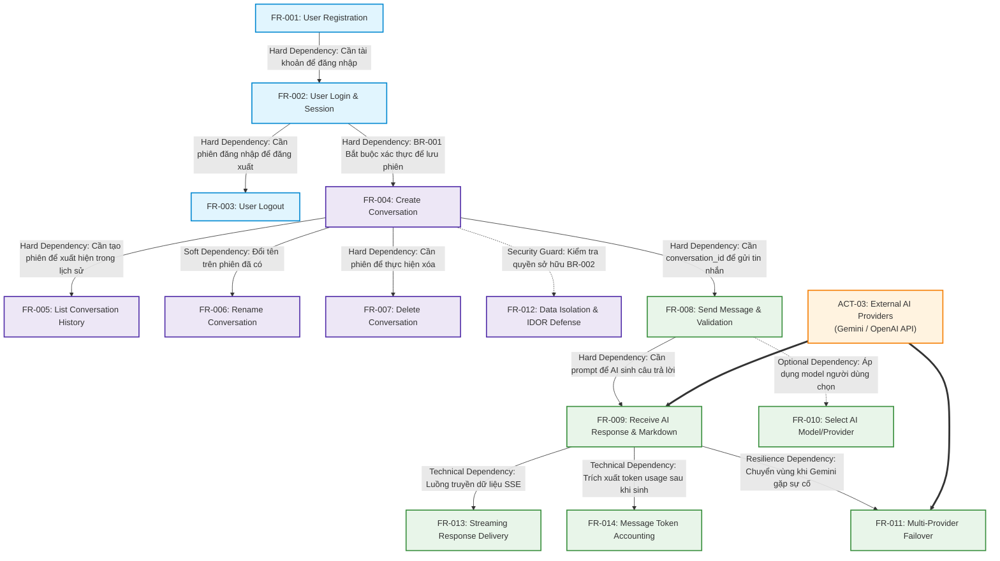

# PHÂN TÍCH PHỤ THUỘC GIỮA CÁC YÊU CẦU (REQUIREMENT DEPENDENCY ANALYSIS)
## Hệ Thống Website Chatbot Trợ Lý Ảo (AI-Chan Assistant)

---

| Thông Tin Tài Liệu | Chi Tiết |
| :--- | :--- |
| **Dự án** | Website Chatbot Trợ Lý Ảo (`ai-chan`) |
| **Mã tài liệu** | `REQ-DEP-001` |
| **Trạng thái Baseline** | **BASELINED** |
| **Mục đích** | Chỉ rõ thứ tự phụ thuộc nhân quả và điều kiện tiên quyết giữa các Functional Requirements (FR), ngăn ngừa việc triển khai tính năng khi yêu cầu nền móng chưa sẵn sàng |

---

## 1. Sơ Đồ Phụ Thuộc Giữa Các Yêu Cầu Chức Năng (Requirement Flow Graph)

---

## 2. Bảng Phân Loại Chi Tiết Các Mối Quan Hệ Phụ Thuộc

| Yêu Cầu Đích (Target FR) | Yêu Cầu Tiên Quyết (Prerequisite FR) | Phân Loại Phụ Thuộc | Lý Do & Ràng Buộc Kỹ Thuật | Tác Động Nếu Bị Nghẽn |
| :--- | :--- | :---: | :--- | :--- |
| **FR-002** (Đăng nhập) | **FR-001** (Đăng ký) | **Hard Dependency** | Không thể xác thực nếu bảng người dùng chưa có tài khoản. | Không thể tạo phiên làm việc cho người dùng mới. |
| **FR-003** (Đăng xuất) | **FR-002** (Đăng nhập) | **Hard Dependency** | Chỉ có thể thu hồi phiên khi phiên làm việc đã được cấp phát. | Không phát sinh thao tác đăng xuất. |
| **FR-004** (Tạo Conversation) | **FR-002** (Đăng nhập) | **Hard Dependency** | Theo quy tắc `BR-001`, một cuộc trò chuyện bắt buộc phải gắn với một `user_id` đã xác thực. | Khách vãng lai không thể tạo và lưu cuộc trò chuyện trên hệ thống. |
| **FR-005** (Lịch sử Conversation)| **FR-004** (Tạo Conversation) | **Hard Dependency** | Danh sách lịch sử chỉ có dữ liệu khi đã có các cuộc trò chuyện được khởi tạo. | Danh sách Sidebar trống hoàn toàn. |
| **FR-006** (Đổi tên Conversation)| **FR-004** (Tạo Conversation) | **Soft Dependency** | Phải có đối tượng cuộc trò chuyện thì mới có thể cập nhật trường `title`. | Tiêu đề giữ nguyên mặc định là "Cuộc trò chuyện mới". |
| **FR-007** (Xóa Conversation) | **FR-004** (Tạo Conversation) | **Hard Dependency** | Chỉ có thể xóa một bản ghi khi bản ghi đó đã tồn tại trong cơ sở dữ liệu. | Không phát sinh thao tác xóa. |
| **FR-012** (Cách ly dữ liệu IDOR)| **FR-004**, **FR-002** | **Technical Security** | Bắt buộc kiểm tra `conversation.user_id == current_user.id` trước mọi thao tác. | Nguy cơ rò rỉ dữ liệu nhạy cảm chéo giữa các người dùng. |
| **FR-008** (Gửi tin nhắn) | **FR-004** (Tạo Conversation) | **Hard Dependency** | Mọi tin nhắn bắt buộc phải có khóa ngoại `conversation_id`. | Không thể lưu tin nhắn vào cơ sở dữ liệu. |
| **FR-009** (Nhận phản hồi AI) | **FR-008** (Gửi tin nhắn) | **Hard Dependency** | Mô hình AI cần nội dung prompt và ngữ cảnh của tin nhắn người dùng để sinh câu trả lời. | Trợ lý ảo không có đầu vào để xử lý. |
| **FR-013** (Streaming SSE) | **FR-009** (Nhận phản hồi AI) | **Technical Dependency**| Tầng giao tiếp mạng cần hỗ trợ giao thức truyền luồng Server-Sent Events / ReadableStream. | Giao diện phải chờ toàn bộ văn bản sinh xong mới hiển thị tĩnh. |
| **FR-014** (Đo lường Token) | **FR-009** (Nhận phản hồi AI) | **Technical Dependency**| Chỉ có thể ghi nhận số lượng token khi nhà cung cấp AI trả về siêu dữ liệu `usage_metadata`. | Không đo lường được chi phí của từng tin nhắn. |
| **FR-011** (Failover Dự phòng) | **FR-009**, External APIs | **External Resilience** | Khi Gemini trả về lỗi mã 429 hoặc timeout, khối failover cần kích hoạt gọi sang OpenAI. | Gián đoạn phản hồi nếu Gemini bị sập dịch vụ. |
| **FR-010** (Chọn Model) | **FR-008** (Gửi tin nhắn) | **Optional Dependency** | Nếu người dùng không chọn, hệ thống tự động gán model mặc định (Gemini Flash). | Tin nhắn luôn được xử lý bởi model mặc định. |
